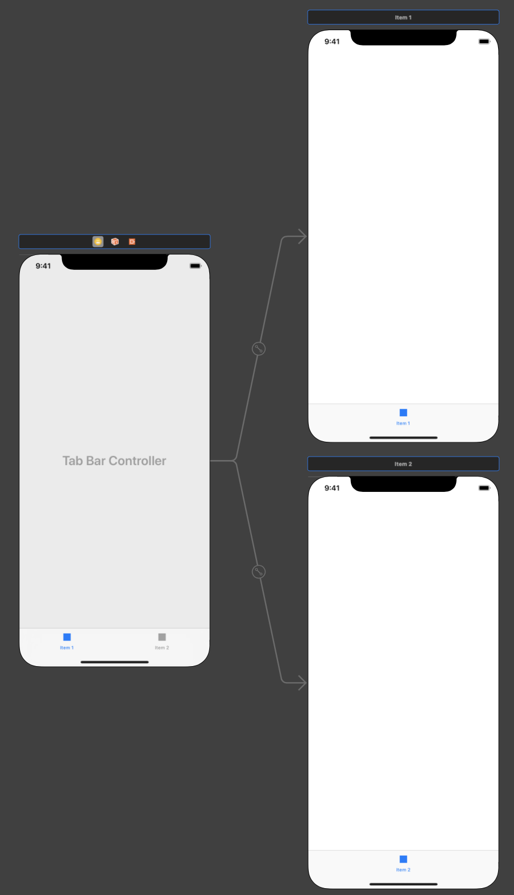
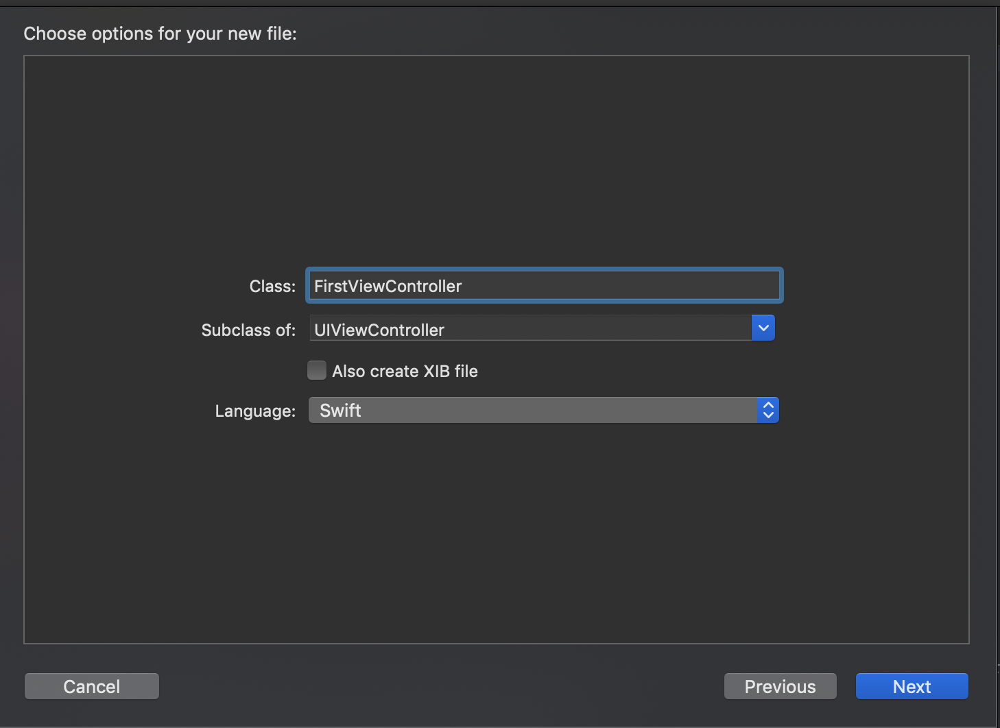
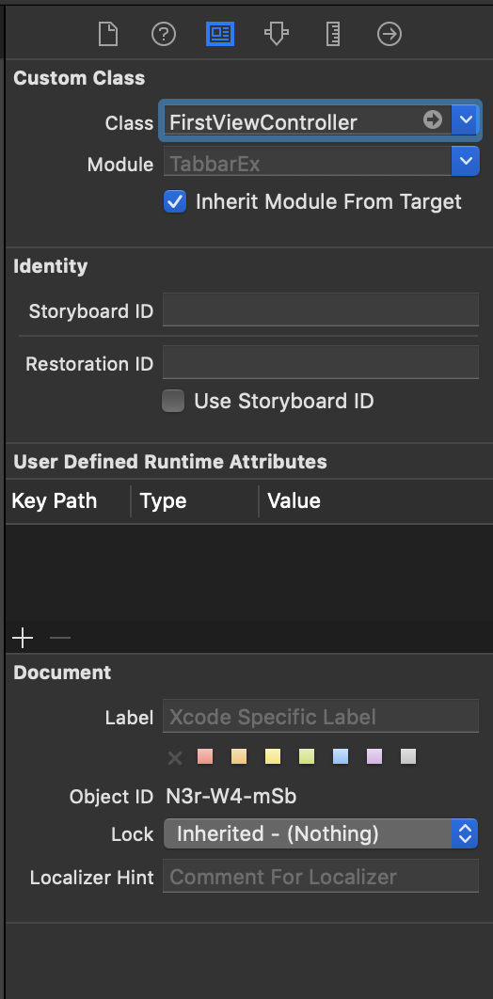

*1.탭바 컨트롤러 객체를 생성한다*

*2. UIViewController 객체를 상속한 클래스파일을 생성한다.*

*3. 뷰 컨트롤러를 선택하고, 아이덴티티 인스펙터에서 클래스를 해당 뷰컨트롤러의 동작을 코딩할 클래스(생성한 클래스)로 선택한다.*

!끝!

- 뷰를 더 추가하고 싶다면?

1. 뷰컨트롤러 생성

2. 탭바컨트롤러에서 컨트롤 + 드래그로 뷰컨트롤러와 연결(Relationship Segue의 view controller 선택)

3. 위의 1~3과정 반복
