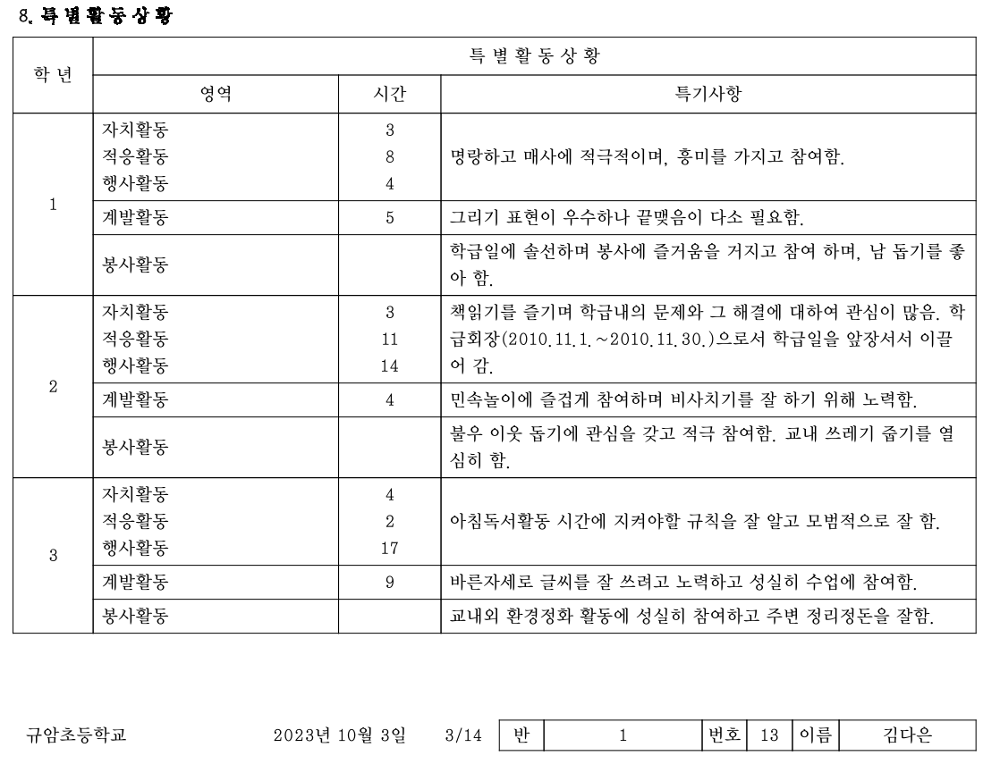
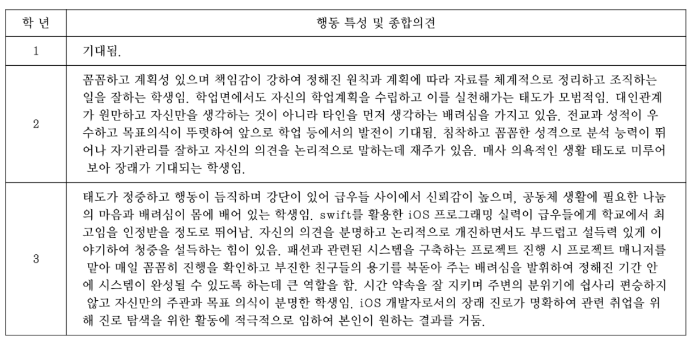
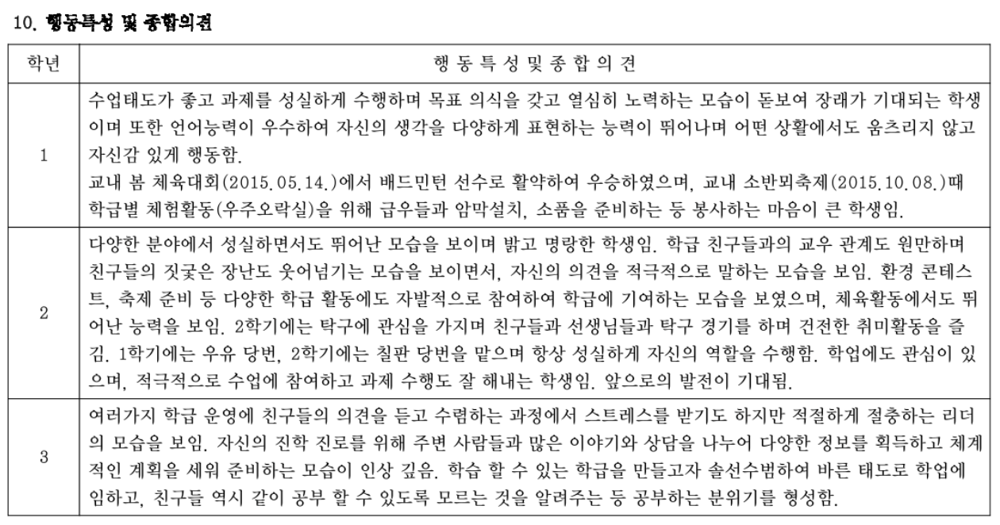
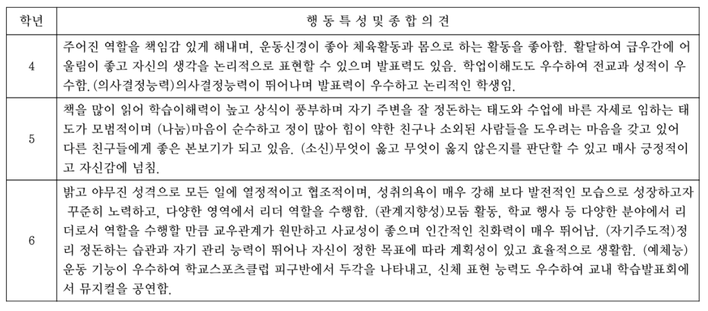

작성일: 2024-01-01

> 블로그를 정리하면서 노션에 작성했던 글을 옮겼습니다.
>
>
>
>
>
> https://daeun28.notion.site/2023-Retrospect-Teaser-6ed1ccd0f3b54a08adfc72ec71437e61?pvs=4

매년 회고를 하면, “올해도 참 많이 성장했다”라고 감상했다. 그리고 그 성장은 내가 어떠한 선택을 하지 않았음에도 자연스레 다음 연도와 이어졌다. 내가 변화할 필요까지는 없었기 때문이겠다.

2023년은 조금 다르다. “올해 너무 많이 변화했다”라는 감상과 더불어 내년에 어떤 변화를 만들지 결정하지 않으면 불리해질 것이다. 이런 생각이 든 것은 처음이라 공유하고 싶어졌다. 구체적으로 모두 써보자니 백만 년 걸릴 것 같아 찬찬히 그려보도록 하고, 나의 장점이자 단점인 추상화로 점철된 티저 정도로 그려보기로 했다.

참고: 좋은 회고를 하고 싶어서 올해의 은인 김창준 님의 Observable Question을 이용했다.

- 회고할 때 부정적 감정을 무시하지 않으면서 전반적으로 긍정적 감정을 많이 겪는가?
- 회고할 때 점차 생각을 더 적극적으로 해서 새로운 이야기를 만들어내는가?
- 회고할 때 시각의 전환(나 -> 그 -> 우리 -> 나 등)을 자주 하게 되는가?

## 알아차림

올해는 여러모로 나를 많이 알아차렸다. 나는 인생의 주제를 어떤 것으로 삼아 그림을 그리고 싶은지, 어떤 부분을 타협하지 않는지, 어떤 사람들과 함께할 때 행복한지, 지금 인식하고 있는 상태를 어떻게 변화시키고 싶은지 등을 생각하면서 가치를 알아차리는 것의 중요성을 깨달았다.

나만의 가치를 왜 계속 알아차려야 하냐고 묻는다면 복잡한 세상에서 쉽게 살기 위해서라고 할 수 있겠다. 올해 가장 힘들었던 시간은 나도 날 모르겠다는 생각이 드는 순간부터 시작했다. 지금까지 자신감과 나에 대한 믿음을 굳건히 내세우며 살아온 내가 나를 모른다는 것은 꽤 심각했다. 공허하고 허무한 느낌이 들었다. 나는 어떤 것을 위해 사는지 고민스러웠다. 고민에 빠져있을 때, 내가 멋있게 여기는 사람들의 공통점이 떠올랐다. 잠도 안 자고 매일 연습에 매진한 태민, 약 30억 달러를 미련 없이 기부한 이본 쉬나드, 목숨과 독립에 대한 외침을 바꾼 독립운동가 선생님들. 그리고 스스로 질문했다. 목숨과 바꿀 수 있는 가치는 무엇인가? 아니 그런 게 있는가?

## 사명

혼자 생각하니 이것저것 어른이 되면서 생긴 두려움을, 너무 많이 알게 된 정보를 고려하느라 어려워서, 제삼자가 날것의 나를 상세히 기록한 생활기록부를 봤다.

Previous image
Next image

재미있었다. 일관적으로 누군가 돕기를 좋아한다니. [ac2](https://www.ac2.kr/) 레벨 1이 끝나고 3개월이 되어가던 시점이었기에 어떤 방향으로 도울 때 가장 즐거운지 명확했다. 나는 누군가의 자아 실현에 기여할 때 행복하다. 이건 자신 있게 목숨이랑도 바꿀 수 있겠다고 생각했다. 발견한 순간 퍼즐이 풀리는 쾌감과 함께 가슴이 다시 뛰었던 경험은 아직도 생생하다.

## 나다움

나의 사명을 발견하곤 신이 났다. 이제 나를 많이 알게 된 것 같았다. 남은 4분기를 잘 보낼 수 있겠다는 희열에 가득 찼다. 그러나 미처 몰랐던 더 큰 산이 있었다.

본질에 다다랐다고 생각했는데, 당장의 현실과 괴리가 엄청난 것이 문제였다. 내가 해내고자 하는 것과 지금 하는 일을 어떻게 연결해야 할지 하나도 모르겠다고 생각했다. 뭔가 거창한 변화가 있고 난 뒤에 나의 사명을 실현할 수 있을 것 같았다. 매일 외치는 애자일이 갑자기 어렵게 느껴지고 완벽주의의 굴레로 빠져갔다.

다시 내가 멋지게 여기는 사람들을 들여다봤다. 올해 샤이니는 정규 8집 앨범의 타이틀곡으로 Don’t Call Me의 성공을 이어 나갈 수 있는 Juice와 올드스쿨 힙합이라는 새로운 장르의 HARD 중 컨템퍼러리 밴드라는 정체성을 기준으로 HARD를 선정했다. 내가 올해 롤모델로 삼은 이본 쉬나드는 ‘산에 오르거나 자연을 찾을 때 그곳에 갔던 흔적을 남기지 말라’는 좌우명을 기준으로 쉬나드 이큅먼트의 매출 70%를 차지하는 피톤 제작을 중단했다. 그리고 내가 멋지다고 생각한 주변인들도 자신의 원칙을 고수하여 OO다움을 만들어가고 있었다.

알아차린 후, 나에게는 아직 다은다움이 없다는 생각이 들어 조급해졌다. 이걸 만들기 위해 인위적으로 어떤 액션을 해야 할 것만 같았다. 조급한 마음은 결정을 회피하는 행동으로 이어졌다. 나의 원칙이 없으니 다른 사람들의 원칙이 더 옳은 것이라는 생각에 이리저리 휘둘렸다. 새로운 정보를 획득할 때마다 생각이 변했다. 이어지는 생각은 스스로 구덩이를 파고 숨어있게 했다.

내가 구덩이로 들어간 후에는 구덩이 밖에서 손을 내밀거나 사다리를 내려주는 사람들 덕분에 밖으로 나오는 패턴이 있다. 참 감사한 일이다. 이번에도 여러 사람의 힌트, 한솔 대표님이 선물해 주신 ‘그래서, 인터널브랜딩’, 최고의 코치 영기 님과의 대화를 통해 헤어 나올 수 있었다. 이 경험에서는 원칙이 형성되는 시간을 이해했다. 이 경험은 나의 사명인 ‘자아실현’이라는 키워드와도 연결되어 더 소중했다. 나의 자아를 실현할 줄 알아야 다른 사람의 자아실현도 도울 수 있지 않겠는가?

사람은 상황에서 스스로 옳고 그름을 판단하고 결정한다. 그리고 결정의 결과에 대해 책임지면서 원칙이 형성된다. 그리고 또 다른 상황에서 원칙으로 옳고 그름을 판단하고 결정하는 것이 반복된다. 이 과정은 완벽할 수 없고 평생 이어진다. 원칙을 뒤흔들만한 엄청난 사건이 있다면 중심부터 변화할 수 있고, 보통은 점진적으로 증분 할 것이다. 이렇게 증분 하다 보면 일관성이 보이고, 고유함과 독특함이 극대화되어 다은다움이 드러날 것이라고 이제 믿는다. (모든 사람들은 살아오는 과정에서 나다움이 조금은 있으니 없던 게 생기는 게 아니라 드러난다는 표현이 맞는 것 같다)

## 좋은 사람

> 위 내용과 이어지지는 않지만, 꼭 기록해 두고 싶은 내용이 있어 부록처럼 써본다.

올해는 좋은 사람과 좋은 말하는 사람을 구분할 수 있게 되었다. 내가 좋은 말을 많이 하는 사람이었기 때문이다. 진짜 좋은 사람은 내가 원하는 옳은 방향으로 나아갈 수 있도록 솔직하게 도와주는 사람이고, 좋은 말하는 사람은 내가 듣고 싶은 말을 하는 사람이다. 좋은 말은 잠깐 나의 기분을 달래는 데에 도움이 되고 달콤하지만 달콤함이 사그라지면 다시 고통스럽기에 중독적이고 변화를 만들지 못한다.

좋은 사람은 내가 진짜 원하는 것을 끊임없이 질문해 스스로 알아차리는 데 도움을 주고, 어려운 문제를 해결함으로써 나를 변화하게 한다. 가끔은 도전을 던지거나 솔직한 말로 잠깐의 수치심을 느끼게 하지만, 이 수치심을 지나가게 두면 견뎌낸 나는 새로운 것과 중요한 것을 볼 수 있다.

올해는 좋은 사람들과 함께하면서 제품의 실제 성과와 나의 큰 변화를 만들었다. 함께해주신 모든 분들께 진심으로 고마움을 전한다. 내년에는 나도 더 많은 사람에게 좋은 사람으로 기억되고 싶다.

- 내가 어디에서 뭘 하든 의심 없이 믿고 지지하는 가족과 친구들
- 내가 더 큰 기여를 할 수 있도록 연료를 넣어주고 같은 목표를 향해 달리는 픽소 동료들
- 재밌게 핵심을 배우고 실제로 변화를 만드는 것까지 함께해주시는 AC2 도반들
- 알아차리는 과정에 함께해주시는 나의 코치님들
- 나의 사명을 프로토타이핑할 수 있게 해주시는 모든 분
- 본인의 가치를 알려주고 새로운 세상을 보여주신 모든 분
- 나의 애씀과 노력을 알아주는 모든 분
- 생각지도 못한 감사를 표현하고 나의 무심함에도 다정하게 먼저 다가와 주시는 모든 분
- 일관성과 꾸준함이 얼마나 중요한지 상기시켜 주고 롤모델이 되어주는 샤이니와 이본 쉬나드
