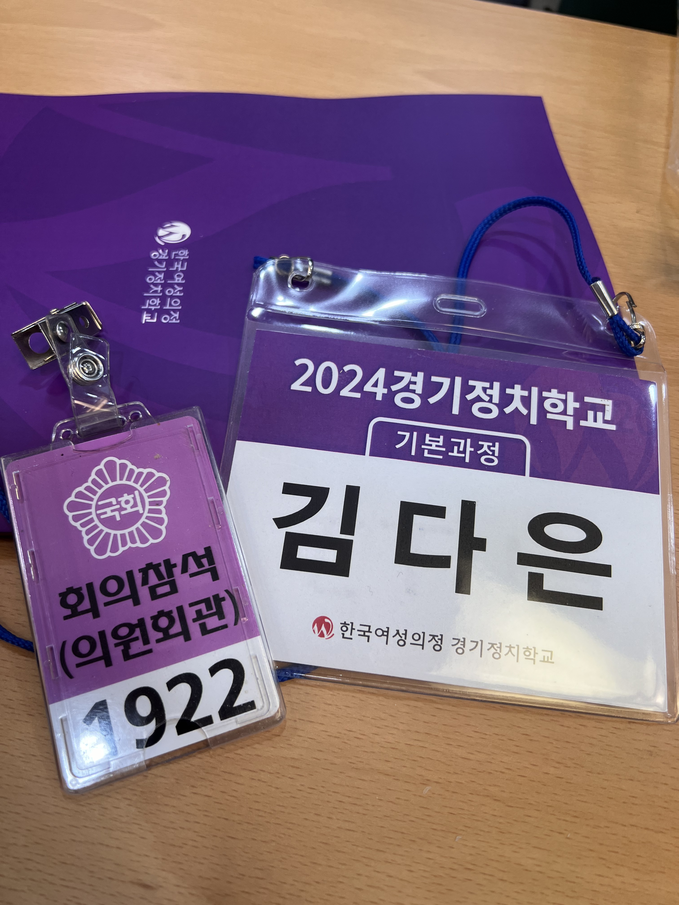
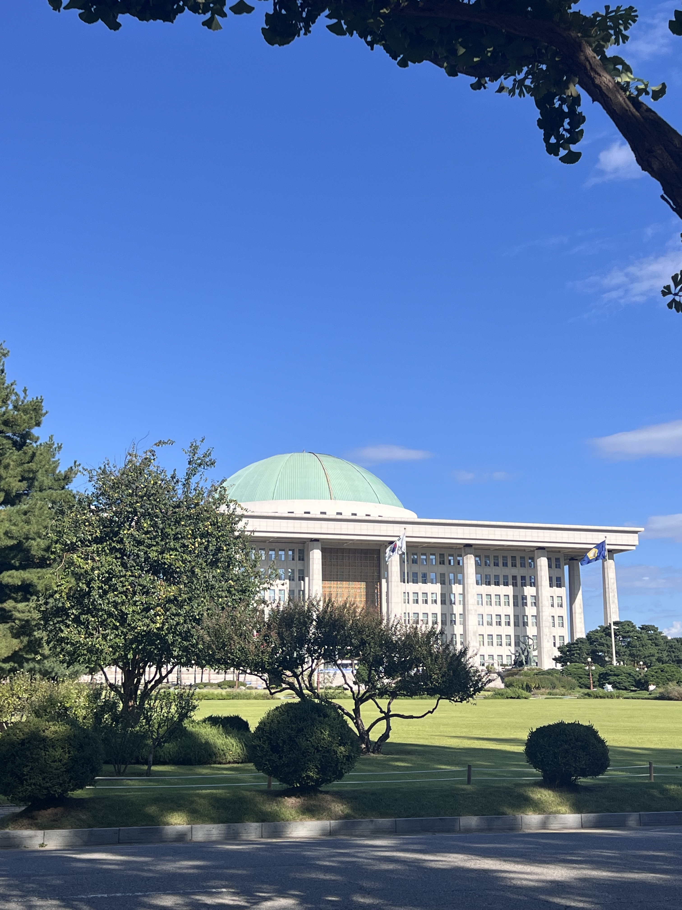
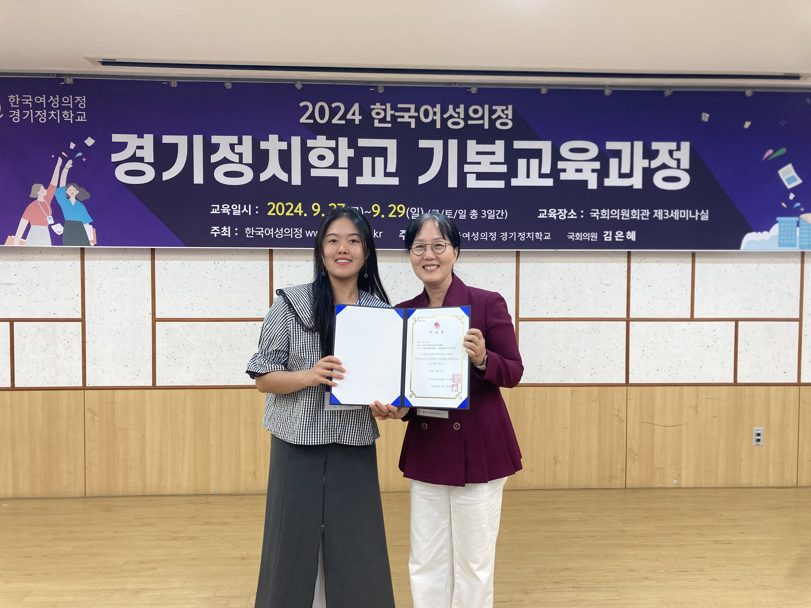
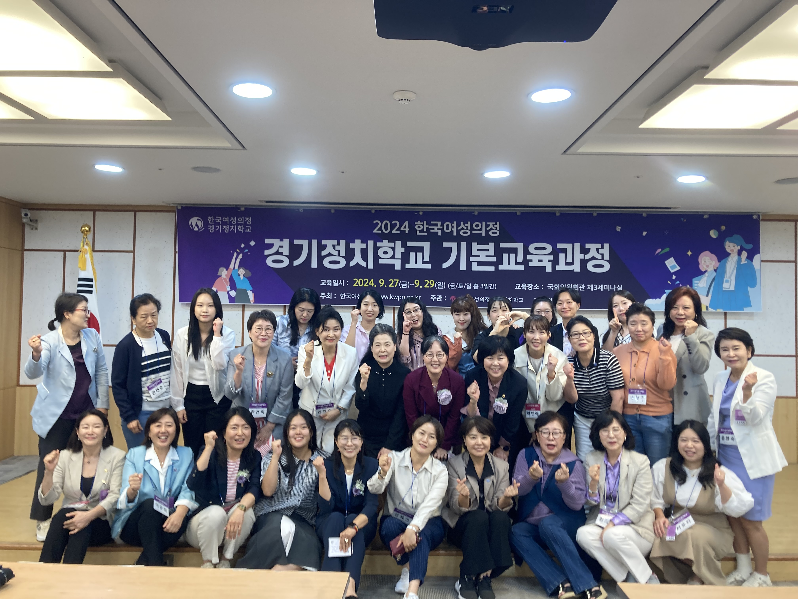

## 왜 경기정치학교에 가게 되었는가

2023년 회고를 하며 나의 비전을 정의하고, 2024년부터 오로라플래닛에서 ’자기다움으로 살 수 있는 생태계‘를 만들기 위해, 다른 사람들이 자기다움을 깨닫고 실현하는 과정을 도왔다. 다른 사람을 돕는 것만으로도 보람차고 행복한 일인데, ’자기다움‘이라는 키워드에 집중하다보니 나의 비전을 실현하기 위한 내용까지 정리되고 있다.

비전을 정의하는 것과 그것을 실현하기 위한 오늘의 행동을 결정하는 것은 거리가 꽤 먼 행위이다. 그래서 괴리에 힘들어지기 쉽상이다. 오늘 내가 하는 작업이 나의 비전과 어떻게 연결되어 있는지 설명하기 곤란한 날도 있다. 그런 날이면 비전도 정했는데 왜이렇게 힘든지 스스로가 납득되지 않는다.

하지만 중요한 것은, 오늘 내가 하는 작업이 나의 비전과 어떻게 연결되어 있는지 설명할 수 있는 날의 빈도를 늘려가는 것 이다. 처음에는 당연히 어렵다. 구체성이 떨어지고 정보가 부족하기 떄문이다. 구체화가 되면 일주일에 세 번 이었던 날이 네 번으로 늘고 다섯 번으로 늘게 된다. 지금의 나는 네 번에서 다섯 번으로 늘려 나가고 있는 단계에 있다.

어떤 변화가 있었냐고 묻는다면, (1) 전문가로서의 나를 구체적으로 정의하고 (2) 전문가가 되기 위한 단기 목표를 설정하는 것 이라고 하겠다. 2번에 대해서는 3배는 더 많은 설명이 필요하기 때문에, 이 글에서는 1번에 대해서 간략하게만 먼저 이야기해보겠다.

나의 비전은 ’자기다움으로 살 수 있는 세상‘이다. 비전을 실현하기 위해 전문가로서의 나를 다음과 같이 정의했다.

1. 개인의 범위에서 자기만의 방식으로 문제를 해결하고, 자기다운 성장의 과정을 돕는 라이프 코치
1. 국가의 범위에서 ’자기다움 교육‘이 가능한 시스템을 구축하여 국민의 행복지수를 높이는 대통령
1. 세계의 범위에서 ‘자기다움으로 살 수 있는 생태계’를 조성하는 오로라플래닛의 최고실현책임자

3개의 전문가가 되기 위해 부단히 애를 쓰고 있지만 막막했다. 특히 2번 [대통령]의 경우 정보가 부족한 상태였는데, 마침 뉴웨이즈의 ‘한국여성의정 경기정치학교’ 프로그램 홍보를 접하게 되어 운명적으로 경기정치학교를 신청하게 되었다. 교육 목적 자체가 여성 정치인을 발굴하고 교육하는 것 이었으므로 나에게 적합하겠다는 기대를 가지고 참석했다.

## 나에게 유의미했던 지식

이야기하기 전에, 나는 정치의 ’ㅈ‘까지만 아는 사람이었다는 사실을 밝힌다. 관심이 있었기에 가벼운 정보를 습득하고, 선거마다 투표권을 꼭 행사하는 것 까지였다. 특정 정당에 가입된 상태도 아니고, 단체에서 활동해본 적도 없으며, 단지 나의 비전을 실현하기 위한 수단으로 정치가 꼭 필요하다는 것까지만 인식하고 있었다.

> 제가 이해하고 해석한 내용이 틀릴 수 있음을 알립니다. 지적해주시면 배움에 큰 도움이 됩니다.

**정치의 본질**

어떤 분야의 본질을 아는 것은 쉬우면서도 어렵다. 가장 먼저 이론적으로 배우는 것이 본질이지만, 조금만 더 알면 본질 대신 함정에 빠지기 쉽기 때문이다. 경기정치학교는 내게 정치의 본질을 반복적으로 설명했다. 다양한 세션을 통해 이해한 정치를 나의 언어로 설명하자면, ’공동체의 결정을 내리는 과정에서 이해관계를 조율하는 행위‘라고 하겠다. 따라서 정치를 잘한다는 것은 ‘이해관계 조율에 성공하여 공동체에게 이익이 되는 결정을 이끌어냈다’라는 의미이고, 정치를 못한다는 것은 ‘이해관계 조율에 실패하여 공동체에게 손해가 되는 결정을 하거나 결정을 못했다’라는 의미라고 할 수 있겠다.

**국가의 본질**

정당한 폭력이 없으면 국가는 존재할 수 없다. 일정한 영토에서 정당한 폭력을 독점하는 정치질서가 곧 국가다. 모든 국가는 폭력의 혼란 상태를 종식시키기 위해 더 큰 정당한 폭력 위에 건설된 정치 조직인 경찰, 군대를 가진다. 폭력의 정당성은 공공질서가 개인의 행동보다 더 높은 가치를 가진다는 국민의 합의에서 나온다. 정치는 국민의 합의를 만들어낸다. 그래서 국가에서 정치가 중요하고, 건강한 정치가 지속되어야 한다. 정당한 폭력을 독점하지 못하고, 내란 상태에 빠지면, 나라가 망한다.

**정치인**

우리는 정치에 대한 전문성을 가지고, 직업으로 삼은 사람을 정치인이라고 부른다. 안타깝게도 한국 정치에서는 능력없이 세금 낭비하는 인간들이라는 인식이 있지만, 우리는 겉으로만 보이는 것을 넘어 그들의 진짜 전문성을 보아야 한다. 나는 이번 경기정치학교에서 실제로 정치를 했거나 하고 있는 사람들을 만나고 대화하면서 가지고 있던 편견이 완전히 깨졌다. 그들의 철학, 신념, 전문성을 확인할 수 있는 시간이었다. 그리고 이 시간 덕분에 내가 정치인이 되었을 때, 함께 성장할 수 있는 든든한 동료와 스승이 있겠다는 희망이 부풀어올랐다. 특히 자기다운 반도체 정치를 하고 있는 양향자 의원님께 많은 영감을 받았다.

정치인도 인간이다. 우리가 때때로 실수하듯이 정치인도 실수할 수 있다. 다만 중요한 것은 실수에 대한 책임을 지고 개선된 모습을 보여주는 것 이다. 다만 책임도, 개선도 없이 실수만 반복하는 사람은 정치인의 중요한 자질 중 하나인 ‘균형적인 판단’을 하지 못하고 있다고 볼 수 있다. 우리는 이에 대한 피드백을 제공해야 한다. 정치인에 대한 피드백을 제공하는 것은 권력을 감시하고, 정치인이 회고를 통해 성장하는 데에 큰 기여를 한다. 이는 단순히 정치인을 위해서 해야 하는 것이 아니다. 정치인이 성장할수록 이득을 보는 것은 국민이다. 정치인이 정치를 더 잘하게 되면 공동체에 이익이 되는 결정이 더 자주 일어날 것 이고, 우리 삶의 품질이 높아질 것 이다.

**정치 참여의 중요성**

2024년 대한민국 예산의 총지출은 656.6조원이다. 이 거대한 자원이 나에게 어떻게 돌아오는지 이해하고 있는 사람이 얼마나 될까? 1시간 걸리던 출근길이 20분으로 줄어드는 일, 청년 센터에서 원데이 프로그램에 참여하는 일은 그냥 일어나는 것이 아니다. 오랜 시간 동안 많은 이해관계의 조율을 통해 공동체의 이익이 되는 결정이라고 합의한 것 이다.

집단, 공동체에서는 항상 정치가 필요하다. 단 2명이라도 질서와 안전을 유지하고자 하는 욕구가 있고, 공동의 아젠다를 결정하는 힘인 권력이 자연스레 발생하기 때문이다. 우리가 일상에서 이해관계를 조율하여 결정을 내리는 모든 상황이 넓은 범위에서 정치 인 것 이다. 그래서 결정에 영향을 받는 사람이 정치에 참여하지 않고, 무관심한 것은 위험하다. 공동의 이익이 아니라 개인의 이익을 목적으로 공동의 아젠다를 결정하는 것이 조용하게 허용되기 때문이다. 현재 국가 시스템에는 삼권분립과 같은 기초적인 것부터 권력을 견제하기 위한 다양한 장치가 있다. 그런데 우리에게는 (1) 권력을 왜 견제 해야 하는지 (2) 내가 권력을 어떻게 견제할 수 있는지에 대한 정보가 부족하다.

**삶에서 적용하고픈 것**

일반적인 강의 교육의 성과는 강의 내용, 시간에 대한 만족도를 지표로 측정한다. 하지만 나는 ac2 교육을 받았기에 ’강의 내용을 삶에서 적용하고 있는가‘라는 지표가 더 중요하다는 것을 안다. 따라서 앞으로 내 삶에서 경기정치학교에서 배운 것을 어떻게 적용해볼지 선언하고 마무리하는 것이 좋겠다.

나는 모두가 자기다움으로 살 수 있는 세상을 꿈꾼다. 각자 고유한 생각과 신념, 철학을 건강하게 나누고, 공동의 이익을 위해 합리적으로 의사결정하는 세상 말이다. 이번 강연을 들으면서 머릿속에 가장 맴돌던 생각이 있었다. 이런 세상을 만들기 위해서, 지금 내가 해결해야 하는 문제는 정치 참여의 접근성이라는 것 이다.

누군가는 어릴 때부터 디지털 세상에서 일부 정보를 확대하여 주장하고 반대 측 주장에 대해 일방적인 비난을 하는 것이 자연스러워 본인에게 진짜 유리한 주장을 선택하는 능력이 부족하고, 누군가는 디지털 소외로 인해 부족한 정보만 접하게 되므로, 본인에게 유리한 의사결정 대신 익숙한 결정을 하게 된다. 정치인들의 권력 추구로 인해 흐려지는 국민의 시야는 국민을 불행하게 하고, 결국 나라를 약하게 만든다. 국민이 행복하고, 강한 나라가 되기 위해서는 올바른 의사결정에 필요한 정보를 더 쉽게 접할 수 있도록 만들어야 한다. 구체적으로 어떻게 정치 참여의 접근성을 높일지는 다음 글에서 풀어보겠다.

마지막으로, 3일 내내 함께 했던 동기분들과 아침저녁으로 고생해주신 운영진 분들께 감사한 마음을 전달하고 싶다. 즐겁고 머리를 많이 쓰게 된 시간이었다!

