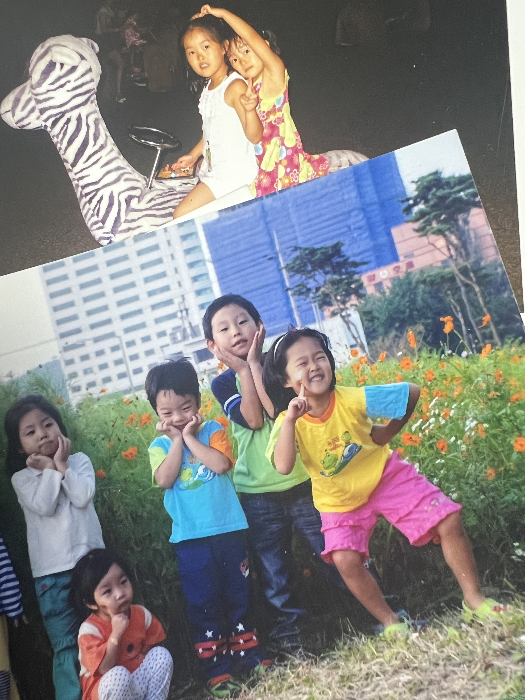

만 22세가 되었다. 이제 슬슬 '한 살 더하는 날'이라는 의미의 생일은 유쾌하지 않다.

나이 먹기 싫은 어른들의 마음을 완전히 이해했달까? (이것도 나중에 보면 웃기겠지)

시간의 흐름에 따라 매년 찾아오는 생일에는 함께 하는 사람과, 축하해주는 사람이 달라진다.

본인 하나 챙기기도 버거운 세상에서,

본인에게는 아무것도 아닌 날을 기억하고 신경써주는 마음이 참 아름답고 감사하다.

이런 진심어린 마음을 가득 받을 수 있는 날이라서 생일이 더 특별하게 느껴지는 것 같다.

반대로 다른 사람의 생일을 특별하게 만들어 주면서도 마음을 나눌 수 있다.

내가 좋아하는 사람을 생각하면서,

어떤 의미가 담긴 선물을 하는게 좋을지,

마음을 담은 축하 메시지는 어떻게 쓰면 좋을지 고민하는 시간이 좋다.

특히 나는 연락을 먼저 자주 하는 사람이 아니기 때문에,

나에게 있어 다른 사람의 생일은 좋아하는 마음을 듬뿍 전달할 수 있는 몇없는 기회다.

서로 연결될 수 있는 기회가 1년에 한 번만 있어도 관계는 소중하게 유지될 수 있다고 믿는다.

> 그래서 나에게 생일은 '연결'이라는 의미가 있다
>
>
>
>
>
> 22번째 생일

이번 생일에서 찾은 의미를 바탕으로 '더 많은 사람과의 연결'을 위해 내 삶의 v1.0을 한 페이지로 정리했다. (오늘은 v1.0을 출시하는 역사적인 날!)

🌈 [cutt.ly/daeun28](http://cutt.ly/daeun28)

페이지를 만들 때는 매년 변화에 따라 버전을 업데이트해야겠다는 막연한 아이디어를 가지고 있었는데,

지금 생각해보니 이 페이지는 앞으로 '과거/현재/미래의 나의 연결'을 도와주는 역할도 할 수 있겠다.

오늘 발견한 어린 나와 오늘의 나
