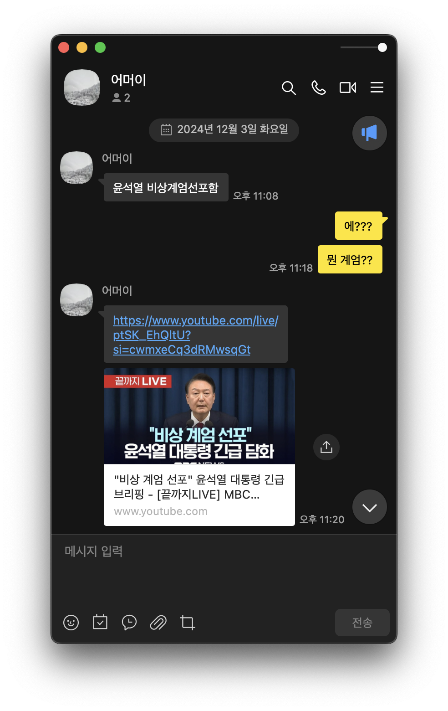
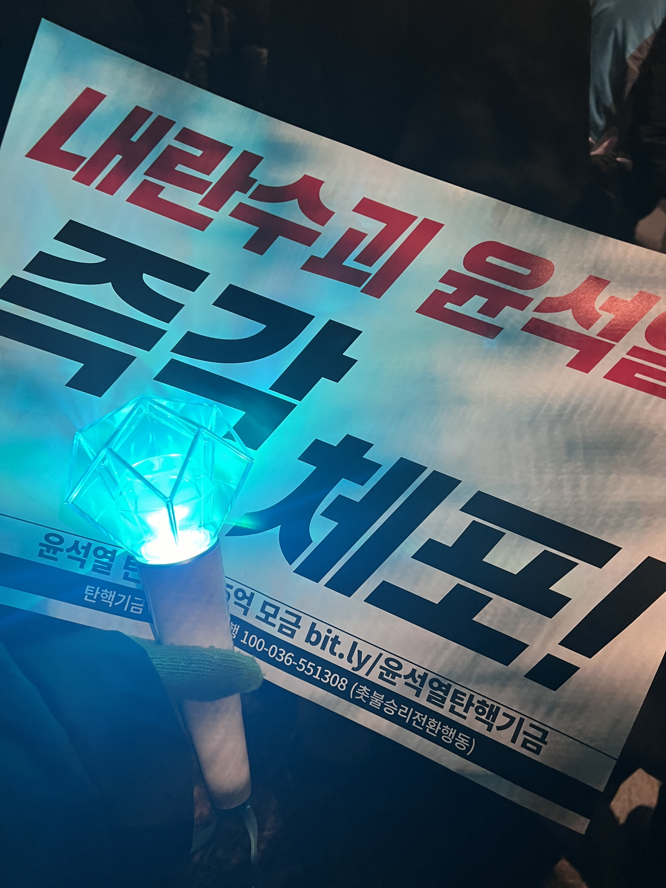
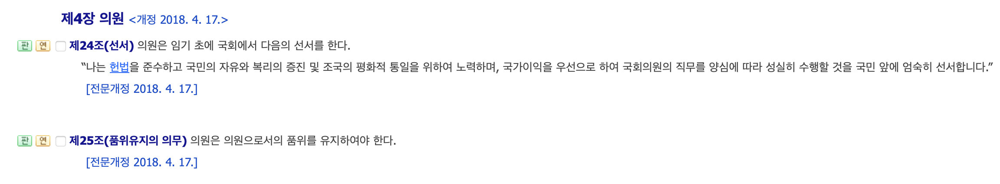

12월 3일, 카페에서 과제에 몰두하고 있는데 엄마에게 전화가 왔다. 과제에 집중하느라 문자로 이야기해달라고 했는데, '윤석열 비상계엄선포함' 이라는 문자가 왔다. 믿을수가 없었다.

화요일 밤 이후 국민의 일상이 마비되었다. 수요일 아침부터 강남역에서 미팅이 있어 겨우 3~4시간을 자고 일어나 지하철을 타고 이동하는데 꿈을 꾸는 것 같았다. 이동 중에도, 일을 하면서도, 계속 뉴스를 틀어놓고 상황을 주시하는 것만이 일정 중에 그나마 내가 할 수 있는 일이었다. 심지어는 어디서든 잠을 잘 자기로 소문한 내가 새벽마다 잠에서 깨어 뉴스 속보를 찾아보느라 잠을 잘 수가 없었다.

금요일에는 시간을 내어 직접 집회에 참석했다. 내가 할 수 있는 가장 적극적인 행동이었다. 추위에 벌벌 떨었지만 집회에 참석한 사람들의 열기는 뜨거웠다. 똘똘 뭉쳐 행동하는 것이 전혀 두렵지 않았다. 한마음으로 정의가 승리하기를 간절히 바랬다. 금요일 밤도 뉴스를 보다가 잠에 들었다. 일기를 쓰고 잠에 드는 루틴이 작동할 여유가 전혀 없었다.

토요일 아침에는 홍대입구에서 모임이 있어, 참석 후 국회로 이동했다. 이동하는 과정도 순탄치 않았다. 1시간 동안 택시와 버스를 타지 못하고 발을 동동 구르다가, 겨우 탄 버스는 동교동에서 국회 앞까지 평소 같으면 20분 걸릴 거리를 1시간 동안 기어갔다. 버스는 만원이었고 숨 쉴 공간만 겨우 확보해 움직일 수가 없었다. 옆 사람이 숨을 거칠게 몰아쉬기 시작하더니, 주저 앉았다. 너무 힘들어보여 괜찮냐는 말을 건넸지만, 들리지 않는지 답이 없었다. 다행히 조금 후, 나아지신 듯 했으나 힘들어하는 사람을 도울 수 있는 방법이 없다는 것에서 크나큰 무력함을 느꼈다. 동시에 각자의 어려움을 이겨내면서까지 힘을 모으는 사람들에게 경외를 느꼈다.

재생할 수 없는 동영상입니다.

[도움말](https://help.naver.com/support/service/main.help?serviceNo=3609&categoryNo=13368)**국민의 힘 당사 앞**

친구들과 함께 집회에 참석하려고 했으나, 교통 문제로 늦어진 탓에 사람이 늘어나 친구들이 있는 위치까지 전진할 수가 없었다. 혼자 뒤에서 구호를 외치다가, 국민의 힘 의원들이 퇴장한 장면까지 보고 근처에 있던 엄마와 만나 차에서 답답한 마음을 쏟아냈다. 같이 몸을 녹이며 본회의장을 지켜봤다. 김상욱 의원까지 표결에 참여했을 때는 희망을 가지고 국민의 힘 당사로 이동하여 엄마와 함께 투표에 참여하라는 목소리를 내었다.

국회의장이 약속한 9시 20분이 되었을 때, 답답함과 원망스러움을 가득 품은 채 자리에서 일어났다. 국민을 대리하는 권한을 부여받은 '국회의원'이 표결에 참여하지 않는 장면은 역사적으로 기록될 장면이었다. 각종 외신과 국내 언론은 '텅 빈 국민의 힘 의원 105명의 자리'와 '영하의 날씨에 국회 앞을 지키고 있는 100만명의 국민'을 대조하여 비추었다.

국회법 제4장 제24조에 따르면, 의원은 임기 초에 국회에서 다음의 선서를 한다.

> 나는 헌법을 준수하고 국민의 자유와 복리의 증진 및 조국의 평화적 통일을 위하여 노력하며, 국가이익을 우선으로 하여 국회의원의 직무를 양심에 따라 성실히 수행할 것을 국민 앞에 엄숙히 선서합니다.

105명의 의원들은 이 선서를 따르고, 의원으로서의 품위를 유지할 수 있는 마지막 기회를 버렸다. 국가이익을 우선으로 하여 국회의원의 직무를 양심에 따라 성실히 수행하는 것이 아니라, 정당의 이익을 우선으로 하여 국회의원의 직무를 사리사욕에 따라 내다 버렸다. 스스로 궤멸을 선택했다.

단편적으로 보면, 105명의 의원들과 자격이 없는 이를 국회의원으로 선출하고 지지하는 사람들을 비난할 수 있다. 하지만 좀 더 깊이 들어가면, 이런 사람들을 조종하는 세력을 볼 수 있다. 가짜 뉴스를 유표하고, 멀쩡한 사람들을 선동하고, 사고를 마비시키는 세력. 건강하게 논의해야 하는 '정치'라는 단어를 듣기만해도 피곤하고 꺼려지는 논란의 중심인 단어로 만들어버리는 이 세력들이야말로, 윤석열이 대국민 담화에서 말하는 국익과 국가를 망치는 반국가 세력이다.

나는 105명의 의원들이 국민의 힘 당론에 따라 표결에 참여하지 않고, 국민을 무시할 수 있었던 이유를 '정치적 무관심' 그리고 '정치 접근성'이라는 단어로 설명하고자 한다.
