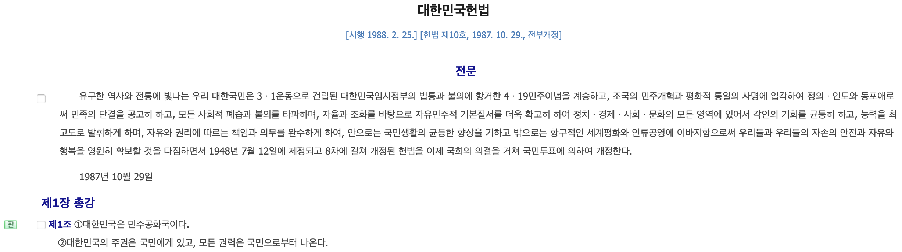

나는 이 글에서 12월 7일, 윤석열 대통령 탄핵소추안 표결에 참여하지 않은 105명의 의원들이 국민을 무시할 수 있었던 이유를 '정치적 무관심' 그리고 '정치 접근성'이라는 단어로 설명하고, 주권을 가진 국민으로서 권력을 행사하기 위한 방법을 제시하고자 한다.

대한민국 헌법 제1장 제1조 제2항에 따르면, 대한민국의 주권은 국민에게 있고, 모든 권력은 국민으로부터 나온다. 대한민국에서 교육을 받는 학생이라면 학교에서 이 문장을 여러 번 반복해 읽지만, 선거권을 행사하여 정치에 직접적으로 참여할 수 있는 나이, 만 18세부터는 이 문장을 읽을 일이 많지 않다.

나는 사회 생활을 시작한 후로, 주변 사람들이 정치에 대한 이야기를 극도로 꺼려하는 것을 느꼈다. 나도 1년 전까지 뉴스에서 비상식적인 내용에 대해 미성숙한 언쟁을 벌이는 정치인의 모습을 보면서, "피곤하다. 나의 평안을 깨고 싶지 않다"라는 이유로 정치 정보를 접하지 않기 위해 노력했다. 정치적 중립을 지킨다는 것을 핑계로 어느 정당의 편도 들지 않는 소위 '중도층'을 내가 속하는 집단으로 자랑스럽게 여겼다.

하지만 작년부터 내 삶에 정치가 어떠한 영향을 미치는지 이해하면서, '중도층'에 소속되어 있지만 정치 정보를 조금씩 접하기 시작했다. 그리고 최근에는 나의 비전과 정치가 긴밀하게 연결되어 있음을 이해하여, 보다 적극적인 참여를 위해 정치 관련 교육을 듣고, 정당 활동을 시작하며, 뉴스를 자주 찾아보고 있다.

나는 더 나은 세상을 만들기 위해 비슷한 가치를 믿는 사람들과 함께 하고 싶어 정당에 가입했지만, 잘못된 부분까지 감싸돌며 무조건 정당을 지지하는 활동을 원치 않는다. 그래서 특정 정당에 가입하기 전에 초당적인 단체 '한국 여성 의정'의 교육을 신청했다. 그리고 이 교육에서 이해관계를 조율하고 사회적 합의를 통해 결정을 이끌어내는 정치의 본질이 삶과 얼마나 맞닿아 있는지 느꼈고, '정치 접근성'을 높이는 것을 나의 정치적 과제로 가져가겠다고 다짐했다.

## 정치 접근성

그렇다면, 정치 접근성은 무엇일까? 정의를 찾아 헤메다가 윤석열의 내란을 계기로 첫번째 버전의 정의를 내릴 수 있게 되었다.

> 개인이 사실에 근거한 정치 정보에 접근하고
>
>
>
>
> 정치 활동에 참여하며
>
>
>
>
> 정치 과정에 관여할 수 있는 용이성

정치 접근성은 3가지 요소를 포함한다.

1. 정치적인 이슈와 신념에 대해 건강한 토론과 토의가 가능한 주변인
1. 투표, 정치 활동 등 다양한 형태의 정치 참여에 필요한 자원, 정보, 기회를 가질 수 있는 환경
1. 선거에 참여하거나 공직에 출마하는 것, 시민 활동에 참여하는 것 등의 정치 과정에 쉽게 참여할 수 있는 정도

내가 속한 집단인 '2030 세대'의 정치 접근성은 다른 세대보다 훨씬 낮다. 정치적 무관심에는 여러 원인이 있겠지만, 내가 2030 세대로서 체감하는 가장 큰 원인은 '스스로의 삶을 챙기기도 바쁜 세상에서 변화도 없어보이는 정치에 관심가질 이유를 알지 못하는 것'이다.

586세대는 독재정권에 저항하고 맞서싸우면서 민주주의를 직접 쟁취했고, 이 과정에서 정치 접근성이 높을 수밖에 없었다. 정치에 관심을 가지지 않으면, 당장 말도 안되는 이유로 잡혀가 고문을 당하고 죽임을 당할 수 있었다. 주변에 친하게 지내던 사람과 가족이 희생당하는 모습을 눈 앞에서 보면서, 정치가 삶에 어떤 영향을 미치는지 온 몸으로 느낄 수 있었다.

감사하게도 우리 세대는 많은 사람들의 희생으로 이루어진 민주 사회에서 평화와 자유를 아무런 노력 없이 누리며 살아왔다. 그래서 내가 잘 사는게 중요하지, 당장의 변화도 없는 정치에는 관심가질 이유가 없다. 어차피 정치인들은 기득권을 지키기 위해 선거철에만 입바른 소리하고, 맨날 싸우는 사람들이 아닌가. 그 모습을 보기만해도 평안한 나의 일상에 스트레스가 된다.

단기적인 관점에서 보면, 당장의 평안을 위해 스스로의 정치 접근성을 낮추는 것이 낫다. 하지만 장기적인 관점에서 보면, 정치 접근성을 높이는 것이 내가 더 나은 삶을 사는 데에 있어 유리하다. 현재 가장 큰 이슈를 통해 이해해보자.

## 윤석열의 내란

대한민국 헌법 제1장 제1조 제2항에 따르면, 대한민국의 주권은 국민에게 있고, 모든 권력은 국민으로부터 나온다. 그런데 12월 3일, 이 조항을 완벽히 무시한 사태가 발생했다. 아주 중요한 것들만 살펴보아도, 국가 재난 수준의 일들이 가득하다.

1. 12월 3일, 윤석열은 요건을 충족하지 않은 상태에서 절차를 무시한 반헌법적 비상 계엄을 선포했다. 그리고 포고령에 따라 국회에 계엄군을 투입했다.
1. 12월 4일, 계엄령 선포 155분 후 국회에서 헌법적인 절차에 따라 계엄 해제 요구 결의안이 가결되었다.
1. 12월 4일, 계엄 해제 요구 결의안 가결 약 3시간 후 윤석열은 계엄 해제를 선언했다.
1. 12월 5일, 한국은행이 비상계엄 후폭풍을 잠재우기 위해 시장에서 매입하는 환매조건부채권(RP) 규모가 당초 예측을 뛰어넘는 하루 10조 8000여억으로 확인됐다. (2주간 총 151조 3400여억, 2024년 우리나라 예산 총지출 657조의 약 23% 수준)

1. [https://n.news.naver.com/article/011/0004423935](https://n.news.naver.com/article/011/0004423935)
1. 12월 7일, 국민의 힘 국회의원 105명의 투표 불참으로 윤석열 대통령 탄핵소추안이 투표 불성립되었다.
1. 12월 8일, 한덕수 국무총리와 한동훈 국민의 힘 당대표가 헌법에 전혀 근거하지 않은 '질서 있는 퇴진'을 주장했다.

1. [https://n.news.naver.com/article/028/0002720489?cds=news_media_pc](https://n.news.naver.com/article/028/0002720489?cds=news_media_pc)

현 상황은 법치주의 사회를 살아가는 대한민국 국민이라면, 반헌법적 반법률적 행태임을 인지할 수 있다. 정치적 중립이라는 말이 성립할 수 없는 상황이다. 헌법과 법률, 국민을 무시한 일을 하는 세력이 명확하기 때문이다. 따라서 이 상황에서 정치적 중립을 지킨다는 말은 이 상황을 잘 모른다는 말과 같다.

## 윤석열과 국민의 힘 의원 105명이 국민을 무시하는 이유

우리나라는 대의민주주의를 채택하고 있으므로 헌법과 법률, 국민을 무시한 일을 하는 세력도 누군가 권력을 위탁했기 때문에, 대표자로서의 권한을 행사하고 있는 것 이다.

국민의 힘 공식 홈페이지 기준, 국민의 힘에서 뿌리로 하는 한나라당, 새누리당, 자유한국당, 미래통합당이 배출한 대통령은 이명박, 박근혜, 윤석열이다. 이명박은 2020년 대법원으로부터 '뇌물, 횡령' 혐의로 징역 17년을 선고받았다. 박근혜는 2017년 국정농단으로 탄핵 당하고, 2021년 대법원으로부터 '뇌물, 직권남용' 혐의로 징역 21년과 벌금 180억원을 선고받았다. 윤석열은 2024년 현직 대통령 최초로 내란 혐의 피의자로 입건되었다.

비공식적이지만, 국민의 힘은 대한민국의 건국 이후 이승만 대통령 시절의 자유당, 박정희 대통령 시절의 민주공화당으로부터 보수 정당의 계보를 잇고 있다. 우리는 학교에서 역사를 배울 때, 이승만과 박정희를 독재자라고 배운다.

[https://www.khan.co.kr/article/202309051341001](https://www.khan.co.kr/article/202309051341001)

[https://www.khan.co.kr/article/202309051341001](https://www.khan.co.kr/article/202309051341001)
[**[여의도 앨리스] 국민의힘 당대표실 이승만·박정희·김영삼 액자 사진 더 커진 이유는?**

국민의힘은 최근 당 최고위원회의를 여는 국회 본청 회의실 벽면에 걸린 전직 대통령의 액자 사진 크기를 키웠다. 보수정당 역사상 의미있는 대통령을 기리는 차원이라지만 사진 속 인물 선정은 꾸준히 논란거리였다. 최근 정부가 홍범도 장군 흉상 이전 추진으로 ‘역사 전쟁’에 기름을 부은 상황에서 당내에도 보수 역사에 대한 해석 불씨가 남은 모습이다. 국민의힘...

www.khan.co.kr](https://www.khan.co.kr/article/202309051341001)

사실을 근거로 올바른 판단할 수 있는 능력을 가진 대한민국 국민이라면, 특정 당에서 독재자와 범죄자가 반복적으로 배출된다는 사실을 근거로 선거에서 투표권을 행사할 수 있다. 학습을 통해 민주주의를 훼손하고 국민을 무시하는 사람들에게 권력을 위탁하지 않음을 선거에서 결과로 보여줘야 한다. 국민으로서 주권을 가지고 권력을 올바르게 행사하여 권력을 위탁한 대표자의 제대로 된 쇄신을 요구하고 감시해야 한다.

하지만 이들은 범죄가 드러났음에도 불구하고 가짜뉴스와 선동, 분열을 통해 국민의 눈과 귀를 가려 선거에서 승리했다. 이를통해 국민이 정치 공작에 쉽게 놀아난다는 것을 학습했고, 이번 사태처럼 앞으로도 권력을 유지하기 위해서라면 어떤 행위도 개의치 않을 것 이다.

[https://www.hani.co.kr/arti/politics/politics_general/1171801.html](https://www.hani.co.kr/arti/politics/politics_general/1171801.html)

[https://www.hani.co.kr/arti/politics/politics_general/1171801.html](https://www.hani.co.kr/arti/politics/politics_general/1171801.html)
[**윤상현 “1년 후 국민 달라져…무소속도 다 찍어줘”**

윤상현 국민의힘 의원이 ‘윤석열 대통령 탄핵소추안 표결 불참’에 따른 역풍을 우려하는 김재섭 의원에게 “내일, 모레, 1년 후에 국민은 또 달라진다”고 말했다. 12·3 내란사태에 대한 국민적 분노를 별 것 아닌 것처럼 치부한 것이다. 윤 의원은 8일 배승희 변호사가

www.hani.co.kr](https://www.hani.co.kr/arti/politics/politics_general/1171801.html)

## 주권을 가진 국민으로서 권력을 행사하는 방법

더이상 사리사욕을 채우기 위한 세력이 나를 조종하게 두어서는 안된다. 스스로 주권을 가진 국민으로서 권력을 행사하고, 나의 삶을 위해 더 나은 정치인에게 권력을 위탁해야 한다.

> 정치를 외면한 가장 큰 대가는 가장 저질스러운 인간들에게 지배당한다는 것이다
>
>
>
>
>
> 플라톤

지금 당장 나의 정치 접근성을 높이고, 권력을 행사하지 않으면 나의 삶은 고달파질 것 이다. 80년 독재정권 시절처럼 마땅한 이유없이 범죄의 피해자가 되고, 인권을 유린당하며, 죽임을 당할 수 있을 것 이다. 97년 국가부도 사태와 같이 일자리를 잃고, 가족이 모두 길거리에 나앉거나, 빚을 감당하지 못해 삶을 포기할 수 있을 것 이다.

현 상황에서 정치 접근성을 높이기 위한 구체적인 방법을 살펴보자.

1. 정치적인 이슈와 신념에 대해 건강한 토론과 토의가 가능한 주변인 만들기: SNS에 목소리를 내는 지인과 함께 대화를 나누고, 정치 커뮤니티나 시민 단체 행사에 참여하여 정치 관련 주제의 대화를 자연스럽게 만든다.
1. 투표, 정치 활동 등 다양한 형태의 정치 참여에 필요한 자원, 정보, 기회를 가질 수 있는 환경 만들기: 공신력 있는 언론의 정보를 다양한 채널을 통해 구독한다. 언론에서 요약 또는 해석한 정보가 있다면 원문을 통해 직접 사실을 확인한다. 특히, 유튜브와 SNS 등에서 무분별하게 유포되는 가짜 정보를 멀리한다.
1. 선거에 참여하거나 공직에 출마하는 것, 시민 활동에 참여하는 것 등의 정치 과정에 쉽게 참여할 수 있는 정도를 높인다: 집회 주최의 공지 채널을 구독하고, 근처에서 열리는 집회에 참석한다. 집회 참석이 어려운 경우, 청원에 참여하거나 SNS를 통해 관련 정보를 사람들과 나누면서 온라인으로 연대한다.

---

이 글을 읽었음에도 불구하고, 스스로의 정치 접근성을 높이지 않는 선택을 했다면 댓글을 달거나 연락을 주시면 좋겠습니다. 이 글에서 어떤 지점을 더 보완할지 알게 되거나, 추가적인 대화를 통해 부족한 부분에 대한 설명이 가능하겠습니다. 나는 당신이 우리 사회의 건강한 시민이 되고 싶다는 욕구가 분명히 있을 것이라 믿습니다. 말같지도 않은 이유로 인간임을 포기하지 마십시오. 더 나은 인간이 되는 과정을 도와드릴 용의가 있습니다.
