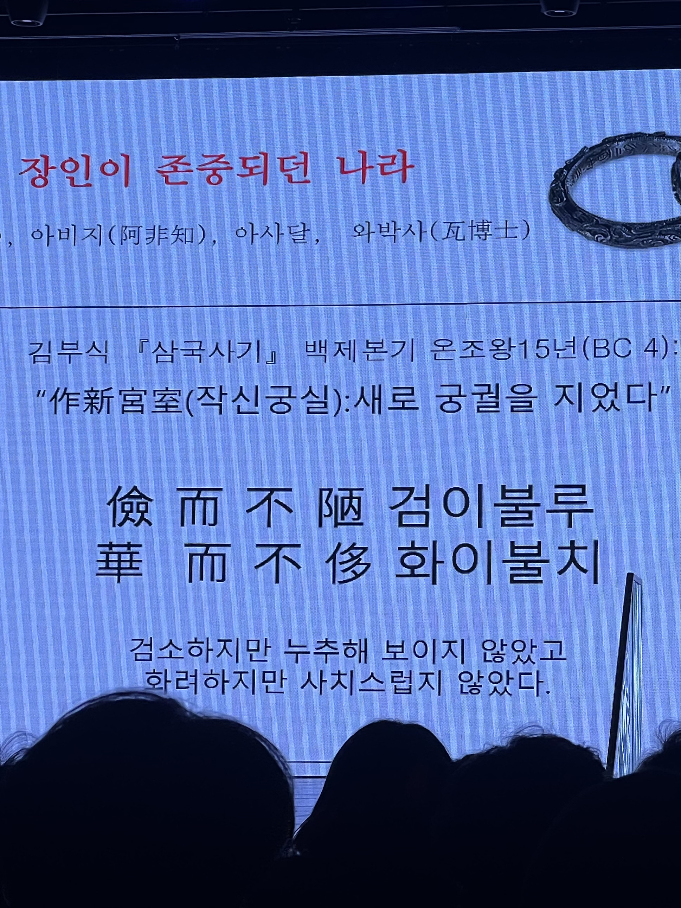

강력한 동기가 생겼기 때문이다. 미션을 향해 나아가는 과정에서 필요하다는걸 알았기 때문이다. 아주 단순하다.

학교에 다닐 때 ‘도덕’ 과목은, 가르치는 선생님이 나와 맞지 않아 그냥 공자노자맹자장자 외우는 시간이었다. 과목에 대한 흥미는 없었을뿐더러 그 시간이 지루하고 싫었다. 한창 사춘기였고, 끓어오르는 반항심을 성숙하게 표현할 줄 몰랐기에 “왜 배워야 하지? 써먹을 곳도 없는데”라는 냉소적인 반응을 수업시간에 조용히 드러내기도 했다. 이랬던 내가 2025년의 키워드를 ‘중용’으로 결정하고, 실천하려 하는게 참 재밌다.

2024년의 나는 단기적인 시야, 부족한 역량을 가지고 대의를 빠르게 완수하고자 욕심을 부렸다. 어느정도 직감한대로 결과는 기대에 미치지 못했다. 다행인 것은 실패를 통해 많은 배움이 있었다. 의미있는 실패였다.

‘중용’이 나에게 필요해진 장면이 뚜렷하지는 않다. 작년에 일어났던 사건들과 배움이 얽히고 설켜 ‘중용’과 관련된 표현을 더 자주 만나게 되었다. 가장 먼저 ‘떳떳함’을 만났고, ‘균형’, ‘중용’과의 만남이 1년 동안 쌓여 지금 나에게 중용을 실천하는 것이 중요하다고 느끼고 있었다.

중요한건 알겠는데, 더 깊이 탐구하지 않았다. 내가 아는 것을 실천으로 옮길 때, 필수 동기가 빠져있었기 때문이다. 바로 ‘멋’이다. 내 삶에서 중요한 결정은 ‘멋’을 빼고 이야기하기 어려울 정도다. 다행히 얼마전에 멋진 표현을 만나 모든 동기가 채워졌다. 유홍준 교수님 강의에서 만난 ‘검이불루 화이불치’였다.

공자의 논어에서 군자의 자질을 말할 때에도 쓰이지만, 유홍준 교수님은 백제에서 만든 궁궐을 표현할 때에 쓰인 것을 말씀하셨다. ‘검소하지만 누추해 보이지 않았고 화려하지만 사치스럽지 않았다’ 이 얼마나 멋있는 표현인가?

이렇게 작은 동기가 생기는 소중한 순간이 쌓여, 올해의 키워드를 ‘중용’으로 결정하고, 실천을 다짐하게 되었다. 많은 사람들이 창대한 꿈을 향해 나아가는 삶이 멋지다고 이야기하지만, 미약하더라도 무언가 하고 싶어지는 순간을 알아차리고 그것을 해나가는 삶도 못지않게 멋지다는걸 배웠다.
