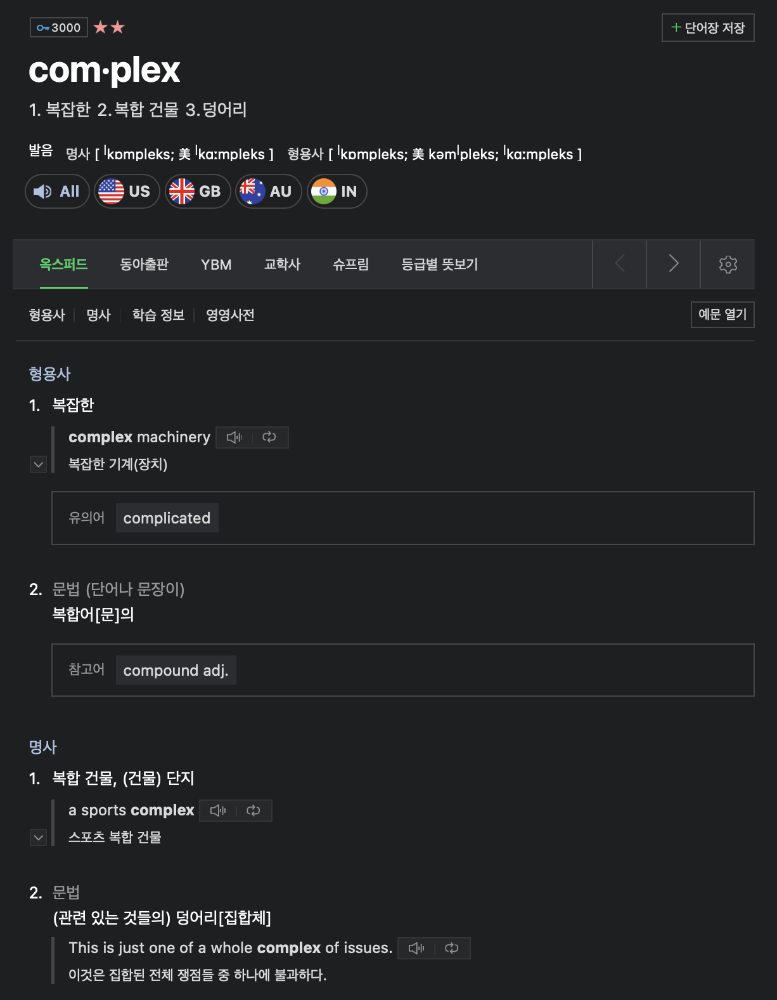
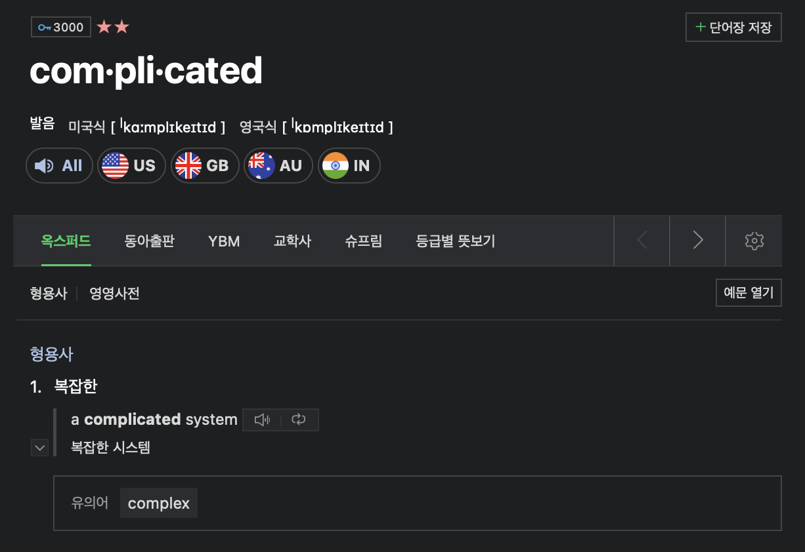

최근 관심사는 복잡한 문제를 핵심부터 해결하는 능력을 키우는 데에 있다. 이를 위해 복잡계(Complex System)을 공부하기 시작했고, 도움을 받기 위해 존경하는 멘토님을 만났다. 대화 중 이런 질문이 있었다. “Complex와 Complicated는 어떻게 다를까요?” 나는 몰라서 답할 수 없었다.

가장 먼저 네이버 어학 사전에 검색했다. 두 용어가 같다는 설명뿐이다.

한국의 단순한 해석으로는 동일한 용어로 결론지었나보다. 설명하기 어려워서 일 수도 있겠다. 그러나 이 용어가 탄생한 곳을 깊이 들여다보면 다를 것 같다는 직감이 마구 생겼다. 어떤 배경에서 탄생했고, 어떤 맥락에서 사용되는지를 이해해야 정확하게 용어를 이해하고 설명할 수 있으니까.

OED(Oxford English Dictionary)에서 어원을 찾아보고 싶었지만, 로그인이 안되는 관계로 나중에 보충하기로 하고,, 어원학 전문가 GPTs에게 먼저 물어보았다.

둘의 가장 큰 차이는 근본적인 의미(Root Meaning)에 있다.

- Complex → 라틴어 *complecti* ("to weave together")

- 라틴어 *complecti*는 “함께 엮다, 짜다”라는 의미이다.
- Complicated → 라틴어 *complicare* ("to fold together")

- 라틴어 *complicare*는 “함께 접다, 꼬다”라는 의미이다.

**단어**

**정의**

**뉘앙스**

**예시**

**Complex**

여러 개의 상호 연결된 요소로 구성된 것

중립적 또는 긍정적 – "복잡하지만 체계적"

"인간의 두뇌는 complex한 기관이다." (여러 부분으로 이루어졌지만, 기능적으로 연결됨)

**Complicated**

이해하기 어렵거나 지나치게 복잡한 것

부정적 – "불필요하게 어렵거나 혼란스러운 상태"

"이 가구 조립 설명서는 너무 complicated하다." (지나치게 어렵고 혼란스러움)

정리하자면,

- Complex는 복잡하지만 체계적으로 구성되어 이해할 수 있는 것
- Complicated는 혼란스럽고 불필요허게 어려워 이해하기 어려운 것

이므로, ‘복잡함’과 ‘난해함’으로 의미를 구별하여 생각해볼 수 있겠다.

## 문제 해결에서의 Complex와 Complicated

여기까지 이해했을 때, 문제 해결 관점에서 두 용어를 구별하면 얻을 수 있는 이점이 떠오른다.

복잡한 문제인지, 난해한 문제인지 파악한 후 유형에 맞는 접근법을 선택할 수 있는 것이다.

난해한 문제는 불필요한 요소를 제거하여 이해하기 쉽게 단순하게 만들고, 체계적으로 접근하면 해결할 수 있을 것 이다. 하지만 복잡한 문제는 여러 layer의 요소가 상호 연결되어 있으므로, 상황에 따라 변화하며 하나의 해결책으로 해결되지 않는다. 해결하기 위해서는 전체 시스템을 이해하고 적응(Adaptive)해야 한다. 피드백을 받아 지속적으로 조정하며 최적의 방법을 찾아나가야할 것이다. 바로 애자일이다!

**2.14 '복잡하지만 단순하게'를 읽으면서, 기억하고 싶은 설명이 있어 기록한다.**

피자를 만드는 것은 까다로운(complicated) 일이기는 하나, 복잡한(complex) 일은 아니다. 복잡성 관련 문헌에서 가장 주의해야 할 부분 가운데 하나가 'complicated'와 'complex'의 차이를 구분하는 것이다. 일반적인 구어에서는 둘 다 '복잡'이라고 번역하는 것이 자연스러운데, 복잡성 과학에서는 이 둘의 개념이 다르게 쓰인다. 이 책에서 하나하나 뜯어 살펴볼 'complex'는 복잡함 이면에 체계적인 생성 메커니즘과 현상의 패턴이 있는 것이고, 'complicated'는 그런 특징이 없는 것을 말한다. 이 책에서는 'complex'와 'complicated'를 우선 모두 '복잡'으로 번역하고, 특별히 이들을 구분해 줘야 할 경우에 한해 'complicated'를 '까다로운' 등 다른 말로 번역했다.
