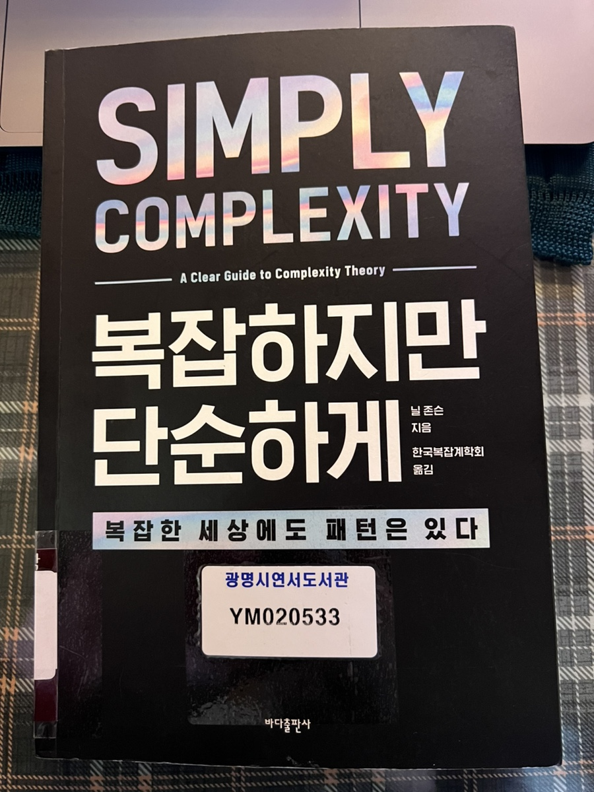

세상이 어떻게 돌아가는지 이해하여 입체적인 관점을 장착하고 싶기 때문이다.

내가 태어나기 얼마전부터 디지털 세상이 열리면서 모든 것의 속도가 빨라졌다. 내가 기억하는 나의 첫 전자기기는 ‘옵티머스원’이었다. 전화로, 문자로 친구들과 연락하는 것과 궁금한게 있으면 검색엔진에 키워드를 입력하여 정보를 얻는 것이 너무나도 당연했다. 이렇게 원하는 결과를 얻기까지 걸리는 시간은 대충 30분 안팎이었다.

과업의 난이도에 따라 다르겠지만, 기술의 발전 덕분에 원하는 결과를 얻기까지 걸리는 시간은 점점 줄어들고 있다. 같은 시간 동안 더 많은 결과를 보고 배울 수 있어 좋지만, 한편으로는 원하는 결과를 보기까지 걸리는 ‘시간을 견디는 힘’이 약해지는게 걱정이다.

작년 나의 실패를 회고했을 때, ‘시간을 견디는 힘’이 너무나도 약하다는걸 느꼈다. 실패에는 다른 요인도 있기에 결정은 후회하지 않는다. 다만, 시작부터 끝을 결정하기까지 걸리는 시간이 내가 원하는 결과인 ‘성공’을 만나기에는 충분하지 않았다.

‘시간을 견디는 힘’을 기르기 위해서는 장기적인 관점이 필요하다고 생각했다. 단기적인 시각을 가지면 작은 실패에도 쉽게 좌절하고 포기할 가능성이 크지만, 장기적인 관점을 가지면 실패를 성장의 과정으로 받아들이고 배우면서 나아갈 수 있다. 결국, 먼 훗날 성공할 것이라는 믿음을 가지려면 현재의 어려움을 넘어 더 넓은 시야로 미래를 바라보는 태도가 필수적이다.

알고있던 주제 중 ‘복잡계’를 배우면 세상이 어떻게 돌아가는지 이해하여 장기적인 관점을 장착할 수 있을 것 같았다. 그래서 이 주제를 가르쳐주신 영기님과 대화하면서 타당한 접근법일지 생각했다. 영기님께서 ‘복잡계’를 학습하고나서 장기적인 관점을 넘어 입체적인 관점을 가지게 되었다는 부분에서 타당하는 생각이 마구 커졌다. 특히 세상을 선형적으로 바라보다가 비선형적으로 바라보게 되셨다는 장면과 마치 매트릭스 영화의 한 장면처럼 밖에 있는 사람이 안에 있는 사람을 보는 느낌이라고 하셨던 장면이 기억에 남는다. 가장 중요한건 내가 아는 영기님이 실제로 입체적인 관점을 가진 분이라는 사실이다. 이 사실이 전제되어 있었기에 ’복잡계‘ 학습에 대한 확신이 생겼다.

올해 ’복잡계‘를 학습하면서 당면한 문제에 적용하여 입체적인 관점을 훈련하는데 시간을 사용하기로 결정했다. 부디 12월의 내가 세상이 어떻게 돌아가는지 이해하고 입체적인 관점을 장착하여, ’복잡계‘ 학습의 의미를 이야기할 수 있기를 바란다.

