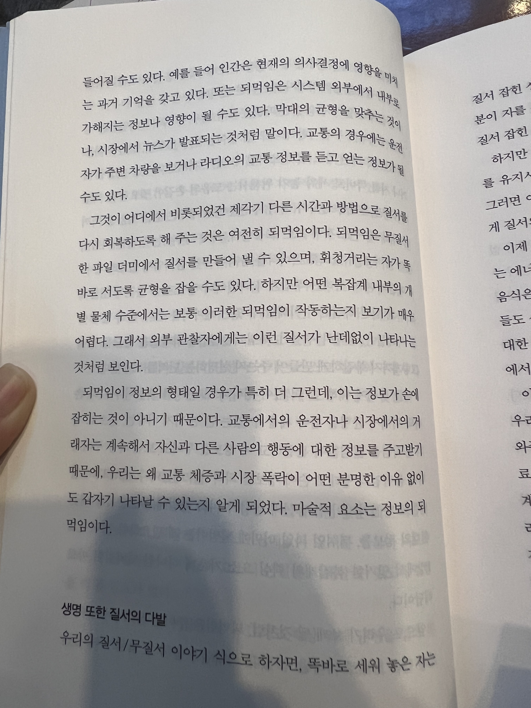

많은 조직문화 아티클에서 심리적 안전감이 중요하다고 말한다. 아마 2015년 구글의 ‘아리스토텔레스 프로젝트’ 결과가 큰 영향을 미쳤을 것 같다. 이 프로젝트에서는 구글 직원 200명, 180개팀을 대상으로 ‘성공적인 팀’의 특징을 조사했는데, 그 결과 심리적 안전감이 높은 팀이 높은 성과를 낸다는 결과가 밝혀졌다.

연구 결과는 익히 알고 있었지만, 그 중요성에 대해 깊이 생각해본 적은 없었다. 이미 많은 전문가의 생각이 공개됐지만 그들과 나의 생각을 비교하여 더 많이 배우기 위해, 내 생각을 기록해보았다.

나는 제럴드 와인버그의 <대체 뭐가 문제야> 라는 책을 읽고 나서부터, 현재 상태(as-is)를 정확하게 파악하고, 이를 기반으로 원하는 상태(to-be)를 정의하는 것이 진짜 문제를 해결하는 방법이라고 생각해왔다. 현재 상태를 정확하게 파악하는 것으로부터 문제 해결이 시작되는 것이다.

우리는 항상 열린 시스템(open system)에서 문제를 해결해야 하기 때문에, 현재 상태를 ‘정확하게’ 파악하는 것은 아주 어렵다. 그럼에도 불구하고, 정확하게 파악하기 위한 노력을 기울일 때 가장 중요한 정보는 이해관계자의 관찰 결과이다. 내가 관찰한 것과 어떻게 같고 다른지 비교하면서 좀 더 정확한 현재 상태를 파악해나갈 수 있으니까.

그런데 이해관계자는 인간이므로 생존에 위협을 느낀다면, 즉 ‘심리적 안전감’이 낮으면 관찰 결과를 사실과 다르게 말하거나 함구하는 선택을 할 수 있다. 현재 환경에서 생존하기 위한 자연스러운 선택이다. 이렇게 되면 문제 해결이 까다로워지며, 더 많은 비용이 발생한다. 높은 성과를 내기 어려워진다.

따라서 혼자 일하는 것이 아닌 상태에서 높은 성과를 내기 위해서는, ‘심리적 안전감’을 높이는 것이 중요하다.

