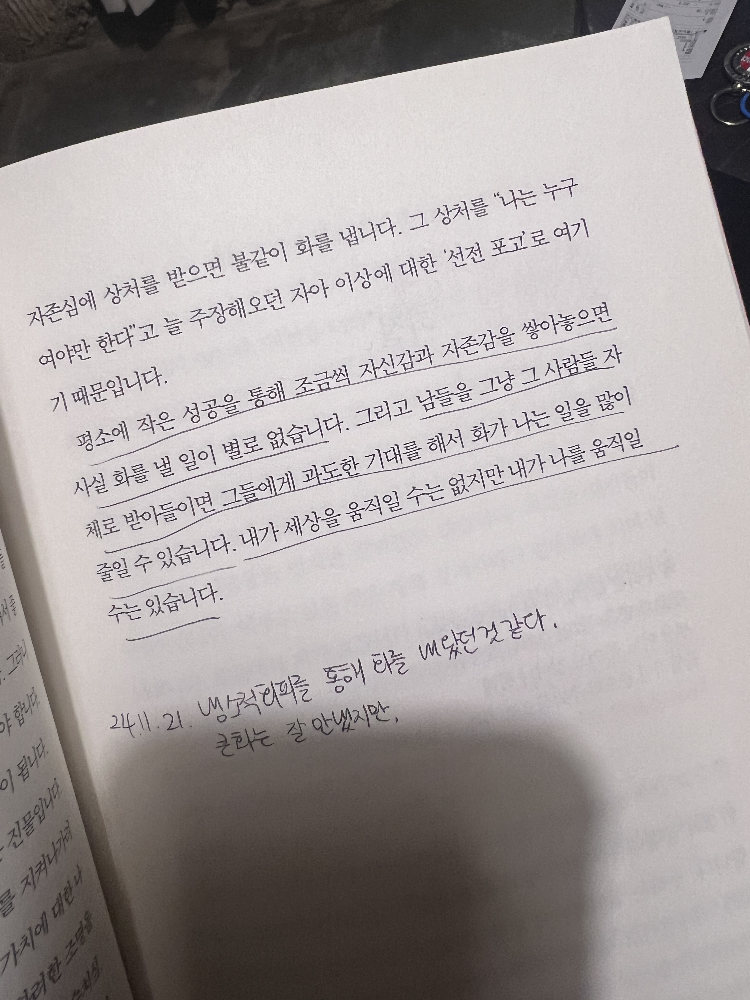

나는 나의 느낌을 방치하는 나쁜 버릇이 있다. 23년을 기점으로 조금씩 개선하고 있고, 개선의 효능을 느끼고 있지만 아직 부족하다. 어린시절 생존을 위해 생긴 버릇이라 단번에 개선하기 쉽지 않음을 알고 있다. 그리고 다른 사람에게 표현하기 전에 나를 돌아보면서 평정심을 유지하는데에 도움이 될 때도 있지만, 가끔 이 버릇이 누군가를 불편하게 할 때는 버릇이 참 원망스럽다.

나는 나의 느낌을 표출하지 않으려고 부단히 애쓰는 반면, 누군가는 과도하게 느낌을 표출한다. 나와 반대인 사람이라서 그런가, 이런 사람들을 마주할 때면 부담스럽기도 하고 도와주고 싶다가도 나를 지키기 위해 피하게 된다. 근처에 있으면 내가 소모되는 느낌이 들어 불편하기 때문이다.

두가지 측면을 알게 되고나서는 완벽해지고 싶은 나이기에 자연스럽게 질문을 던지게 되었다.

> 어떻게 하면 나의 느낌을 잘 알아차리고 적절하게 표현하면서 상대를 이해할 수 있을까?

답은 작년 마음이 불안하던 시기에 <프로이트의 의자>라는 책을 읽으면서 찾을 수 있었다.

> 평소에 작은 성공을 통해 조금씩 자신감과 자존감을 쌓아놓으면 사실 화를 낼 일이 별로 없습니다. 그리고 남들을 그냥 그 사람들 자체로 받아들이면 그들에게 과도한 기대를 해서 화가 나는 일을 많이 줄일 수 있습니다. 내가 세상을 움직일 수는 없지만 내가 나를 움직일 수는 있습니다.

> ‘진짜 나’를 찾더라도 그것을 잘 지키고 살려면 솔직해야 합니다. 솔직하면 가끔 불이익을 당하기도 합니다. 솔직해서 치러야 하는 대가가 있습니다. 나를 드러내면 남들이 나를 싫어하거나 심지어 배신합니다. 그래도 솔직함이 ‘진짜 나’의 에너지원입니다.

핵심은 내가 나를 믿고 솔직하며 떳떳할 수 있는 힘에 있다. 그러니 선택은 내가 할 수 있다는 사실을 아는 것으로부터 ‘마음을 스스로 다룰 줄 아는 사람 되기’를 시작해보자.
