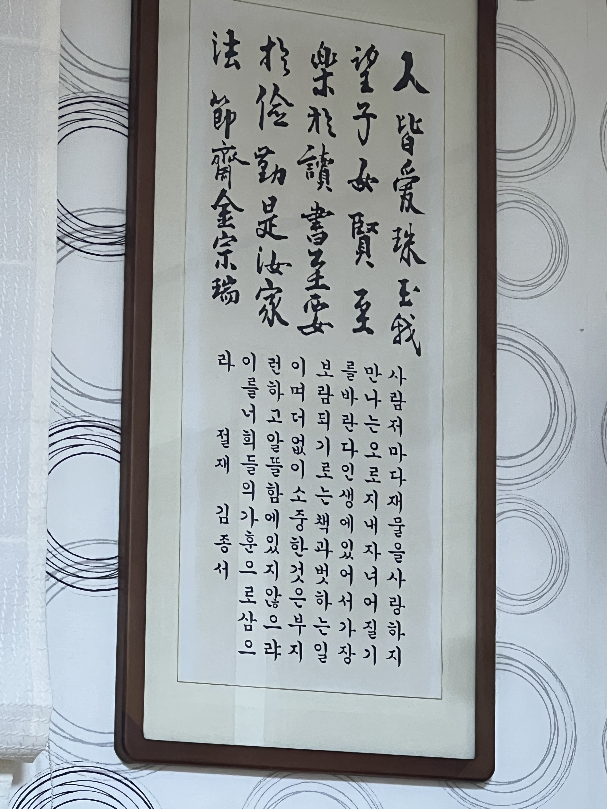

할아버지 기일을 맞아, 할머니가 혼자 사시는 정읍에 다녀왔다. 어렸을 때부터 할머니에게 듣고 싶지 않은 말들을 많이 들어온터라, 아주 가까운 혈연임에도 불구하고 친밀감이 없다. 친밀감과는 별개로, 내가 좋아하는 식혜를 매번 준비해주시고, 뭐라도 챙겨주려 하시는 마음은 늘 감사하다. 그래서 죄책감도 느끼지만, 죄책감 보다 원망이 몇배는 커서 따로 안부를 묻지 않게 된다. 대신 명절과 가족행사에는 꼭 가서 할머니와 친척들에게 가족의 의무를 다하려고 한다. 불편한 마음을 꾹 누르고 살갑게 이야기하려고 애를 쓴다.

매번 할머니 집에 들어서면 “안녕하세요” 라는 말과 함께, ‘살갑게 이야기해야지’ 다짐한다. 그리고 같은 공간에서 시간을 보내다보면, 또다시 내가 정말 듣고 싶지 않은 말이 그의 입에서 흘러나온다. 불편한 감정이 일지만 이제는 나의 감정을 적절하게 표현하여 대처할 수 있기 때문에, 예전보다 덜 상처 받는다.

불편한 감정이 가라앉을 때 쯤이면, 이제 안부 인사를 자주 드리는 다른 친척과 비교하는 이야기가 시작된다. “OO이는 꼬박꼬박 할머니 건강하시죠, 잘 지내세요, 전화하는데 다은이는 연락 한 번 없고,,,, 연락 좀 해야지” 라는 말을 들으면, 안부를 묻고 싶지 않고, 물을 수 없는 이유를 조목조목 말씀드리고 싶어진다. 그러나 지금까지 봐온 그에게는, 나의 이유 하나하나가 상처가 될 것을 알고 있다. 그래서 그냥 내가 나쁜 손녀라고 여기면서 마음 편하시길 바라는 바람으로 말을 삼킨다.

좋은 마음으로 들어섰던 할머니 집에서 나는, 항상 나쁜 기분으로 나선다. 안부를 묻지 않는 이유가 하나 더 생긴 채.

아직까지 살면서 내게 안부를 물어달라는 말을 한 사람은 할머니 뿐이었다. 그래서 오늘은 조금 더 생각해보았다. 안부를 묻고 싶지 않은 사이는 무엇인가?

단번에 정의내리긴 어려운 질문이라, 안부를 묻고 싶은 사람과 묻고 싶지 않은 사람의 차이를 생각해봤다.

1. 안부를 묻고 싶지 않은 사람은 본인을 위해 나를 사용한다.
1. 안부를 묻고 싶지 않은 사람은 본인의 생각을 내가 받아들이기를 요구한다.
1. 안부를 묻고 싶은 사람은 도움을 요청하거나 도움을 준다.

이렇게보니 핵심은 ‘초점’에 있었다. 안부를 묻고 싶지 않은 사람은 말과 행동의 초점이 항상 본인에게 있다. 표면적으로는 나를 위해서인 것 같아 보이지만, 조금만 들여다보면 본인에게 있다는걸 알 수 있다. 그러나 안부를 묻고 싶은 사람은 초점을 변경할 줄 안다. 사람인지라 주로 본인에게 있지만, 가끔 나에게 초점을 돌린다.

일반화할 수는 없겠지만, 이렇게 다른 사람에게 초점을 돌릴 줄 모르는 사람은 함께 공유하는 시간에서 본인도 모르는 사이에 나에게 해를 입힌다. 그래서 나는 굳이 내가 먼저 찾아가서 해를 입고 싶지 않다. 안부를 묻고 싶지 않은 것이다.

