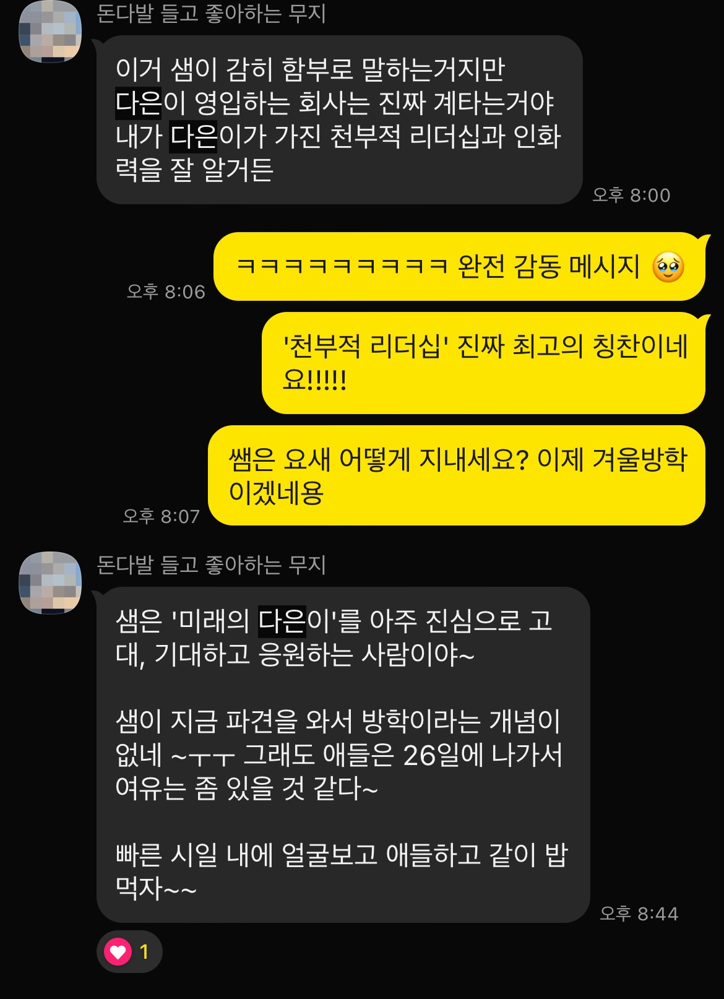

얼마 전, 이전 직장의 대표님들을 만나서 이야기할 수 있는 기회가 있었다. 감사하게도 내가 가고자 하는 길을 응원해주시고, 먼저 이야기 나누자고 청해주셔서 오랜만에 즐거운 대화를 나눴다.

한솔 대표님은 HR에 대해 고민하시다가 한 책을 보게 되었는데, ‘팀의 에너지를 긍정적으로 전환하는 사람’이 있는 팀은 성공할 확률이 높다는 대목에서 나를 떠올리셨다고 했다.

퇴사한지 1년이 다 되어가는데도 좋은 팀원으로 나를 기억하고, 구체적으로 내가 어떤 팀원이었는지 말해주시다니, 엄청 감동적이었다. 대화가 끝나고 버스를 타면서 내가 언제부터 에너지의 방향을 긍정적으로 전환하려고 노력했는지 생각했다.

중학생까지의 나는 사람들과 어울리면서 문제를 주도적으로 해결하려고 했지만 그리 긍정적이진 않았다. 명확하게 기억나는 변곡점은 없지만 아마 고등학생 때부터 지금 모습에 가까워진 것 같다.

고등학교에서 만난 친구들은 내가 처음 만나는 유형의 사람들이었다.

무덤덤하고 조용해보이지만 같이 놀 때 재밌고 배려할 줄 아는 친구,

신념이 확고하고 스스로를 지킬 줄 알면서 밝고 다른 사람들과 유머로 어울릴 줄 아는 친구,

좋아하는게 확실하고 옳다고 믿는 것을 증명하기 위해 당당하게 맞설 줄 아는 친구,

모두와 두루두루 어울리면서도 해를 끼치는 사람에게는 선을 명확하게 긋는 친구,

다른 사람들과 나누고 선의를 베푸는것에 즐거움을 느끼는 친구,

부당한 것에 항의하며 상대를 설득할 줄 아는 친구,

보이지 않는 곳에서 다른 사람을 돕는 친구.

지금 돌아보면 그때의 나보다 훨씬 성숙하고 배울 점이 많은 친구들을 만났다. 인생에서 손에 꼽을만한 행운이다.

이 친구들과 스포츠클럽을 함께 하면서 연대와 협력의 힘을 믿게 되었다. 스포츠클럽을 담당해주신 체육 선생님께는 스포츠정신과 우리팀/상대팀을 대하는 태도를 배웠다. 하나의 목표를 향해 달려가면서, 각자의 역할을 책임지고, 갈등을 해결하고, 할 수 있다고 격려하며 서로를 응원하고, 결국 성취해내는 모든 순간이 행복했다.

나는 삶에서 에너지의 방향을 긍정적으로 전환하는 방법을 이들로부터 배웠다.

*스포츠클럽을 담당해주셨던 선생님과 최근 나눈 메시지*
