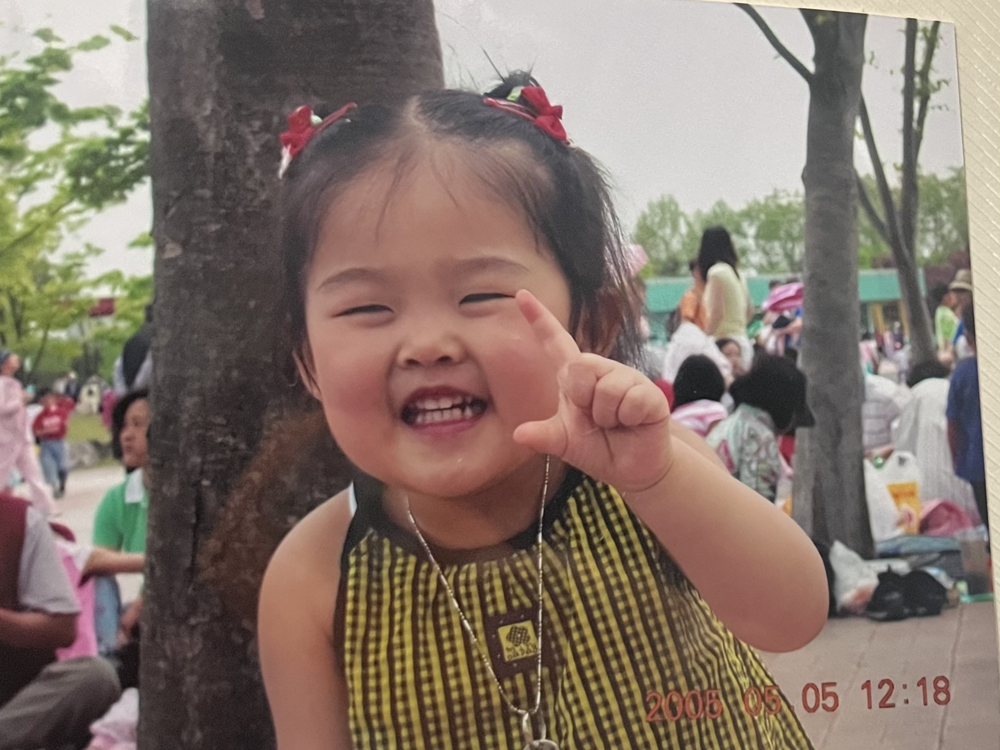

나는 스스로의 상태 변화를 감지하기 위해 다양한 장치를 삶 속에 심어 두었다. 의도적으로 심어놓은 것도 있고, 회고하면서 발견한 패턴을 이용한 것도 있는데, 최근에 발견한 패턴이 참 재미있어서 탐구해보고 싶어졌다.

사람들은 누구나 추억하기를 좋아할 것이다. 원해서 남겨놓고 일부러 꺼내는 기억은 대체로 행복한 기억일 테니까. 나도 행복한 기억을 돌이켜 생각하다보면, 지금 내가 존재하는 시간이 행복해지기 때문에, 추억을 즐겨 한다.

그런데 가끔, 추억하다가 향수를 느끼는 날이 있다. 여기서 향수는 ‘고향을 그리워하는 마음‘이다. ’고향‘은 내가 돌아가고 싶은 장면 어디든지 될 수 있다.

추억만 하는 것과 향수까지 느끼는 것은 매우 다르다. 추억은 단순한 감상으로 종료되고, 건강한 행동으로 나타난다. 예를 들면 밥먹을 때 잠깐 무한도전을 본다거나, 같은 시간 속에 함께 했던 사람과 대화를 나누면서 웃는다거나, 이동하면서 옛날 사진과 영상을 보고 끝난다. 해야 할 일을 하면서 조금 더 행복해진다.

그러나 향수는 욕망을 채우기 위해 기약없이 이어지고, 건강하지 않은 행동으로 나타난다. 예를 들면 좋아했던 가수의 영상을 끝없이 보다가 늦게 잠에 든다거나, 계획했던 일을 하지 않고 어디론가 훌쩍 떠나기도 한다. 해야 할 일을 피하고 과거에서 헤어나오지 못하다가 현실을 보게 되면, 곧 허무해진다.

그렇다면 향수를 느낀다는 것은 내 상태가 어떤 것임을 의미하는걸까? 이 질문에 답하기 위해 향수를 느낄 때 채우고자 하는 욕망을 면밀히 들여다봤다. 단순히 그 시절의 내가 그리워서라는 말로는 설명할 수 없었다. 내가 아는 나는 그립다는 이유만으로 스스로를 조절하지 못하는 사람은 아니다. 그러나 현실이 정말 괴로운 상태라면 나를 조절하기 어려울 때가 있다. 바로 그 상태였다. 과거로 도망치고 싶을 정도로 현실이 정말 괴로운 상태. 그럴 때 향수를 느끼기 위해 많은 시간을 사용했다.

