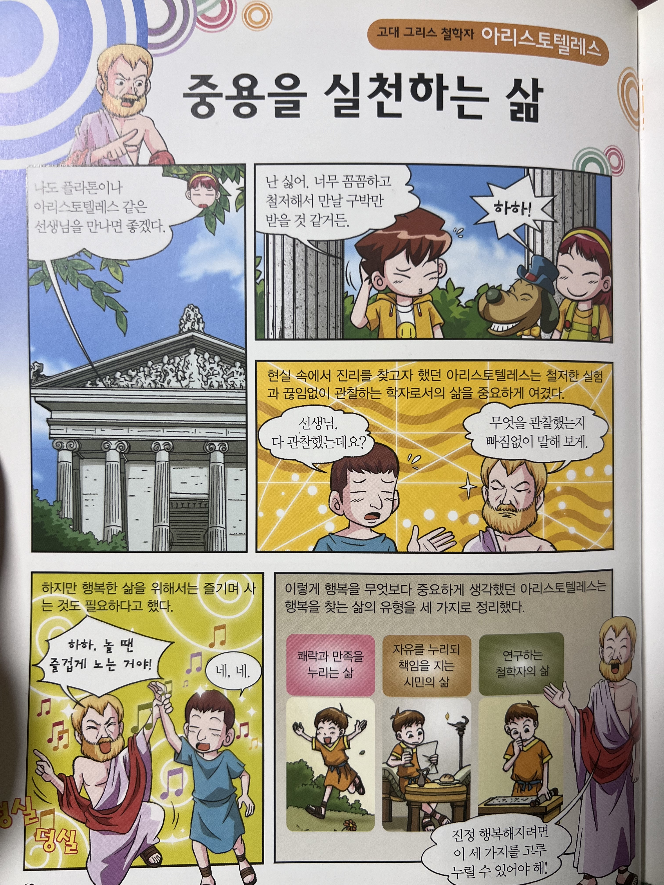

사회적 성공을 이뤄낸 사람들 중 본인의 방식이 무조건 옳다고 말하는 사람을 보면 불편한 마음이 단전에서부터 올라온다. 단순히 아직 사회적 성공을 이루지 못한 나의 열등감에서 비롯되는 것만은 아니었다. 반대의 삶을 ‘실패’로 치부하면서 그의 방식을 잘못된 것으로 단정하는 말들이 불편했다.

많은 사람이 알다시피 ‘사회적 성공’은 단순히 개인의 노력과 실력으로만 이뤄낼 수 있는 것은 아니다. 운, 개인이 처한 환경, 주변 사람 등 여러 요인이 곱해져 ‘사회적 성공’을 만든다.

그래서 사회적 성공을 이뤄낸 삶이 꼭 멋지다고 생각하지 않는다. 그보다는 말이 되는 삶이 정말 멋지다고 생각한다. 말이 되는 삶의 핵심은 중요한 결정의 이유를 설명할 수 있는 것이다. 이유가 크건 작건 상관없다. 그 사람의 서사를 공감할 수 있는 이유라면 그걸로 되었다.

나는 멋진 삶의 다채로운 형태를 목격하고 싶다. 그러면서 현대인으로서 부족한 공감 능력과 포용력을 기를 수 있을 것이라 믿는다. 원하는 상태에 도달하기 위해 처한 환경 속에서 최선을 다하고, 실패하면서 배우고, 중요한 결정의 이유를 설명할 수 있고, 좋아하는 것을 즐기면서, 남에게 해를 끼치지 않는 멋진 사람들을 더 많이 만나고 싶다. 그리고 이런 사람들에게서는 배울만한 점이 많더라.

