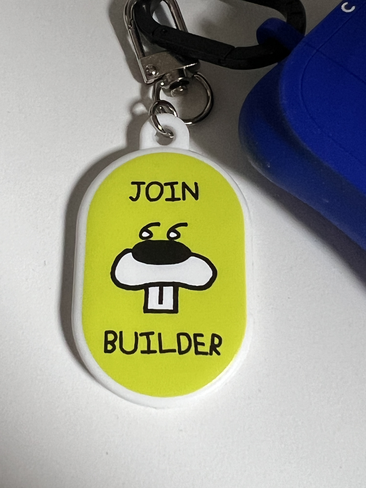

나는 어렸을 때부터 평화를 갈망해왔다. 갈망하게 된 여러 계기가 있었지만, 더 중요한 것은 평화를 유지하려는 욕구가 내 가치 체계를 형성하고 성장시켜 왔다는 점이다.

평화에 위협을 느끼는 상황은 주로 ‘소외’에서 시작된다. 나 또는 누군가 집단에서 소외되는 상황이다. 소외가 시작되면 욕구의 불만이 생기고, 힘의 불균형이 느껴지며, 갈등의 촉발로 나타난다. 그러면 마치 평화가 깨질 것 같아 두렵다.

‘소외’는 쉽게 보인다. 핵심은 집단 의사결정에 참여하지 못하는 것이다. 나는 마음읽기 능력은 낮지만 사람들의 눈빛, 말투, 표정, 몸짓에서 진짜로 참여하는 사람과 아닌 사람을 구별할 수 있다.

당연히 집단 의사결정에 모두가 참여하는 것은 이상적인 이야기다. 각자의 이해관계와 맥락이 너무나도 다르기 때문이다. 하지만 그럼에도 불구하고 더 많은 사람이 참여할수록 더 좋은 의사결정이 될 확률이 높아진다고 믿는다.

독선적인 결정보다 타협하고, 협상하면서 더 많은 에너지를 쓰기 때문에 단기적인 손해는 볼 수 있지만, 소외되는 사람을 살피고 챙기는 것이 목적한 바를 이루는 데 궁극적으로 기여할 것이라 생각한다.

그리고, 나 또한 언제든지 소외될 수 있음을 명심하자.

