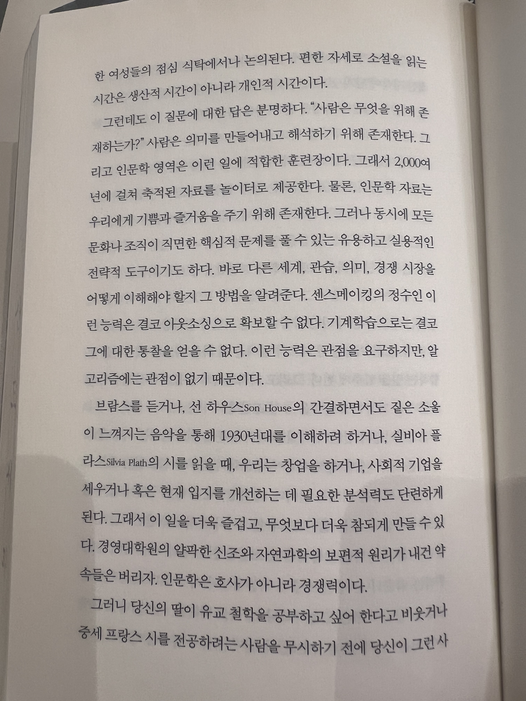

모두들 인생의 주인은 자신이라고 말하지만, 막상 살아가다보면 내가 주인이 맞나 싶을 정도로 내게 영향을 미치는 요소가 많다. 특히 내가 결정한 것에 책임을 지는 동안 변동되는 상황은 통제할 수 없기에 무력감이 들 때도 있다. 하지만 우리는 본질적으로 스스로 결정을 내리고자 하며, 이를 충족하는 것이 삶의 의미를 느끼는 데 중요하다.

내가 무언가에 휘둘리고 있을 때, 가장 많이 가지는 느낌은 결정권 상실에서 오는 ‘상실감’과 ‘무력감’이다. 이 느낌이 강해지면, 자기 효능감이 약해진다. 그렇게 되면 다시 회복하는 데 상당한 비용이 든다.

그러니까 ‘결정권 상실’보다 ‘결정권 사용’의 순간을 더 자주 만드는 것이 내 중심을 지키는 방법이 될 수 있다.

사실, 우리는 매순간 결정하고 있다. 외부 상황이 어떻든 나는 아무런 조치를 취하지 않겠다는 것도 결정이고, 누군가 대신 결정하고 책임지기를 바라면서 침묵하는 것도 결정이다. 또한 상황을 더 악화시킬 수 있겠지만 용기를 내어 개선을 제안하는 것도 결정이고, 지금 할 수 있는 최선의 조치를 취하는 것도 결정이다.

다행인 건 우리는 어떤 상황에서도 결정을 만들 수 있다. 그래서 중요한 건 결정을 내가 만들고, 결과에 따라 새로운 결정을 다시 만들어가는 것이다. 이렇게 접근하다보면, 상황에 따라 유연하게 나의 중심을 지킬 수 있고, 무언가에 휘둘리지 않을 수 있다. 그렇게 내가 할 수 있는 것들을 찾아, 조금씩 해내면 자기효능감이 쌓이고 중심이 더 단단한 사람이 될 수 있다.

모든 결정을 붙잡고 의식적으로 행하면 이상적이겠지만, 그렇게 되면 너무 피곤해서 죽을 수 있으니, 생존을 위해 의식적인 결정의 비율을 적절하게 유지해보자.
