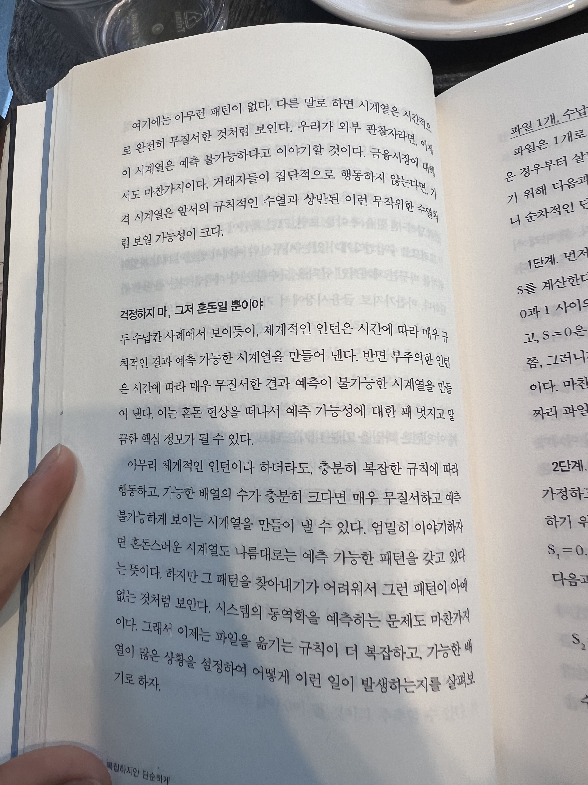

다른 사람을 돕는 것은 나를 살게 한다. 사람들은 이런 나를 잘 아는지 감사하게도 내게 종종 도움을 요청한다.

3년 전까지는, 그냥 ‘돕는 행위’ 자체가 의미있었다. 누군가의 삶에 보탬이 되는 것만으로도 큰 기쁨이 되었다. 하지만 점점 그 행위가 무의미해지는 경험이 쌓였다. 요청에 응답하는 수준의 도움을 제공했기 때문에, 요청이 없거나, 요청이 잘못되었다면 제대로된 도움을 제공할 수 없었다.

이 사실을 깨달은 후, 요청을 받으면 즉시 응답하는 대신 먼저 질문을 던지게 되었다.

보통 문제가 생기면 즉시 어떻게 해결할지부터 생각한다. 그래야 문제에서 벗어날 수 있기 때문이다. 그러나 잘못된 문제는 더 많은 문제를 낳는다. 문제에서 벗어나기는커녕, 카오스에 입장할 수 있다.

그래서 정확한 문제 정의가 중요하다. 현재 상태를 진단하고, 목표 상태를 구체적으로 그려보면, 문제 해결의 실마리는 자연스럽게 보이기 마련이다.

이제, 누군가를 도울 때 적절한 질문이 떠오를 것이다. 문제 정의를 돕는 것부터 제대로된 문제 해결을 돕는 것이다.

- “언제 제 도움이 필요하다고 느끼셨나요?”
- “제 도움을 통해 어떤 목표를 달성하고자 하시나요?”

도움을 요청할 때에도, 도와주는 사람이 맥락을 충분히 이해해서 제대로 기여할 수 있도록 정보를 제공하자.
