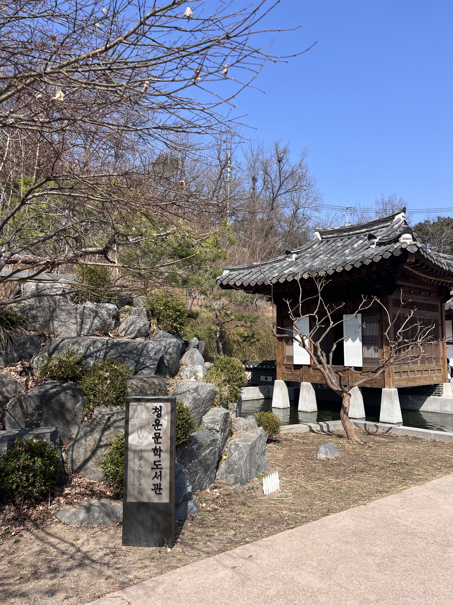

높은 위치에 있다고 평가되는 사람들을 바라볼 때면 항상 궁금한 것이 있었다. 품위를 유지하는 데에 꼭 비용을 들여야 하는가? 품위는 자연스럽게 우러나와야 하는 것이 아닌가?

아니나다를까, 표준국어대사전에서 품위의 설명은 품격의 설명과 달랐고, 내가 우러나와야 한다고 생각한 것은 품격이었다. 품위와 품격은 외부/내부 시각에 따라 결정된다는 [해석](https://brunch.co.kr/@e46a33ad50df4bb/10)도 있지만, 여기서 더 중요한건 중심이 바로 세워져있는 말과 행동이라고 생각한다.

가령 자신이 충분히 하고도 남는 일을 굳이 다른 사람에게 시킨다거나, 물건을 소중히 다룰줄 몰라 매번 새로 산다거나, 비용을 지불한다는 이유로 사람을 하대하는 이들을 볼 때면, 안타깝기 그지없다.

그렇게 하지 않으면 설 수 없을만큼 위태로워보이기 때문이다.

> The true test of a man's character is what he does when no one is watching
>
>
>
>
>
> John Wooden

