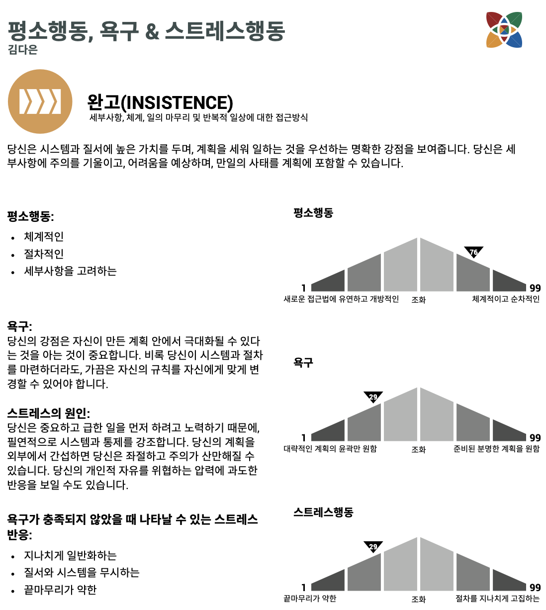
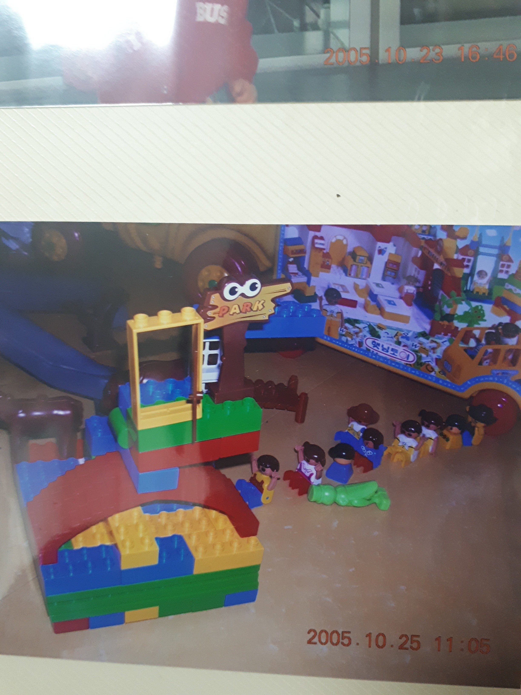

이유없이 마음에 드는 단어들이 있다. 나는 ‘다’라는 글자가 포함된 단어를 유독 마음에 들어한다. 그래서 내 이름도 참 좋아하는데, 그 중에서도 가장 맘에 드는 단어는 ‘다채로움’이다.

사실 이 단어가 왜 마음에 드는지 깊게 생각해본적은 없다. 그래서 아직도 명확한 이유를 찾지는 못했지만, 쌓인 시간을 바탕으로 3가지 정도의 이유를 찾을 수 있었다.

1) 국립국어원 표준국어대사전에 따르면, 다채로움의 사전적 정의는 ‘여러 가지 색채나 형태, 종류 따위가 한데 어울리어 호화스럽다’라고 한다. 이 설명은 내가 그리는 세상의 일부를 표현하기 때문에, 자주 쓰게 된다.

2) 이 단어는 나의 강한 통제 욕구를 예쁘게 포장한다. 모든 것을 아우르고, 더 많은 것을 통제하고 싶은 나로선 좋아할 수 밖에 없는 것이다.

*어제 실시한 버크만 검사 결과 중*

3) 어렸을 때부터 여러 가지 시도를 하는 내가 좋았다. 사물놀이부터, 피아노, 바이올린, 피구, 배드민턴, 글쓰기, 역사, 노래부르기, 로봇과학, 프로그래밍 등 작은 미션을 완수하다보면 느낄 수 있는 효능감이 중독적이었다. 그리고 이 효능감은 내가 새로운 시도를 무엇이든 잘 해낼 수 있다는 믿음의 근간이 되었다. (엄마아빠 고마워,,)

*만 2세 시절 만든 다채로운 레고,,*

이렇게 내가 좋아하는 단어나 자주 사용하는 단어의 의미를 들여다보고, 이유를 찾는 시간은 나를 더 깊이 이해하게 해준다.
