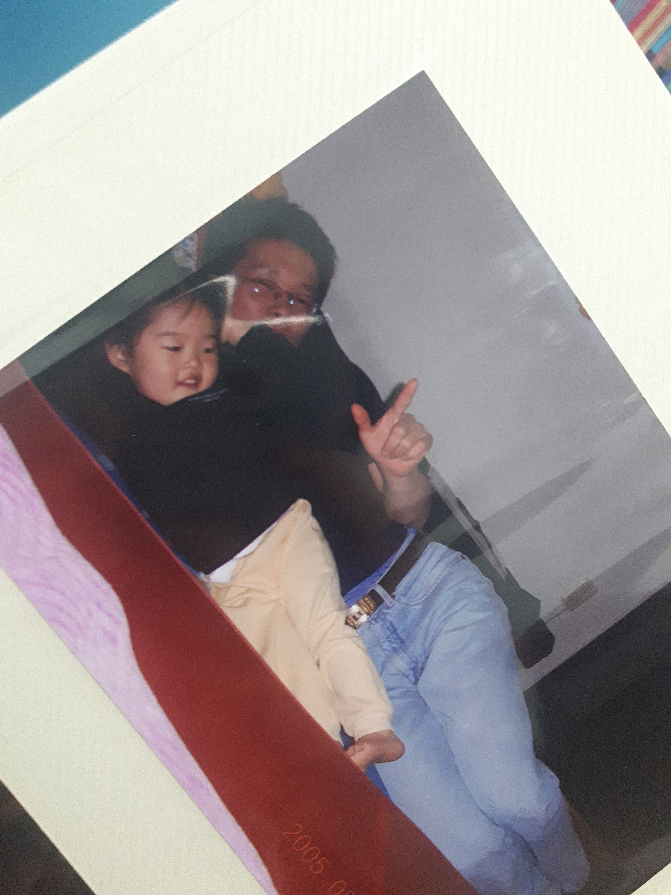
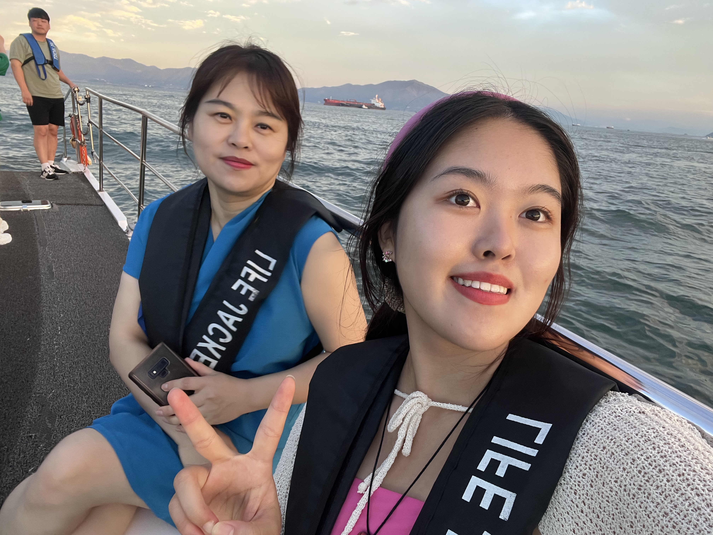

내 삶의 태도와 관점을 형성하는데 가장 큰 영향을 준 사람은 아마 부모님일 것이다. 아빠의 낙천과 말도 안되는 재치, 엄마의 당당함과 정의감은 나의 근간이다.

돌이켜보면 이들은 항상 하고 싶은게 있었다. 관심사는 음악부터 역사, 운동, 캠핑까지 분야를 가리지 않았다. 최근에는 둘다 음악에 푹 빠져있는데, 양상이 조금 다르다. 아빠는 AI로 음악을 만들면서 작곡가 데뷔(?)를 꿈꾸고 있고, 엄마는 기타 학원을 다니며 공연을 준비하고 있다. 나의 다채로움의 원천은 부모님이다.

아빠는 내게 자연의 즐거움을 알려주고 싶었던 것 같다. 여름에는 벌레 싫다고 그렇게 투정을 부리는데도 등산을 가게 했고, 해먹과 텐트를 설치하고 오동통면을 끓여먹으며 캠핑했다. 갯벌에서 조개를 함께 캐고, 계곡에서는 다슬기를 잡았다. 공주에서는 구석기 축제, 부여에서는 백제문화제, 서동연꽃축제를 즐겼다. 겨울에는 어떤 내리막길에서 타는 썰매가 더 스릴있을까 함께 궁리하고, 꽁꽁 언 얼음 위에서 스케이트를 타러 다녔다.

엄마는 내게 배움의 즐거움을 알려주고 싶었던 것 같다. 교과를 공부하는 학원은 한 번도 안가고, 피아노 학원만 6년 넘게 다닌 것만 봐도 알겠다. 직접 연주할 수 있는 악기가 있다는 것이 삶에서 얼마나 즐거운 일인지 배울 수 있었다. 독서토론, 원어민과 영어 전화, 바이올린, 사물놀이, 미술, 요리 등 다양한 채널을 통해 배움의 기회를 주려고 했던 마음이 느껴진다. 특히 복지관에서 청소 봉사, 혼자 사시는 노인을 찾아가 반찬을 전해드리는 봉사에서는 다양한 삶을 배울 수 있었다.

이 덕분에 나는 언제든지 무엇이든 잘 해낼 수 있다는 믿음이 생겼다. 졸업식에서 뮤지컬 공연도 해보고, 로봇과학, 스키캠프, 중국어캠프 등 시키지 않아도 내가 먼저 하고 싶은 것들이 더 많아졌다. 나도 누군가 이런 믿음을 만드는 과정에 기여하고 싶어졌다.

