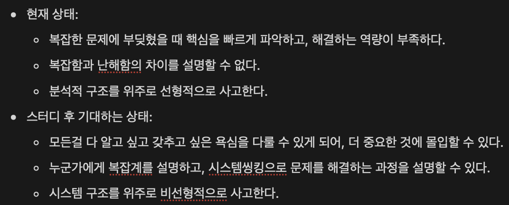
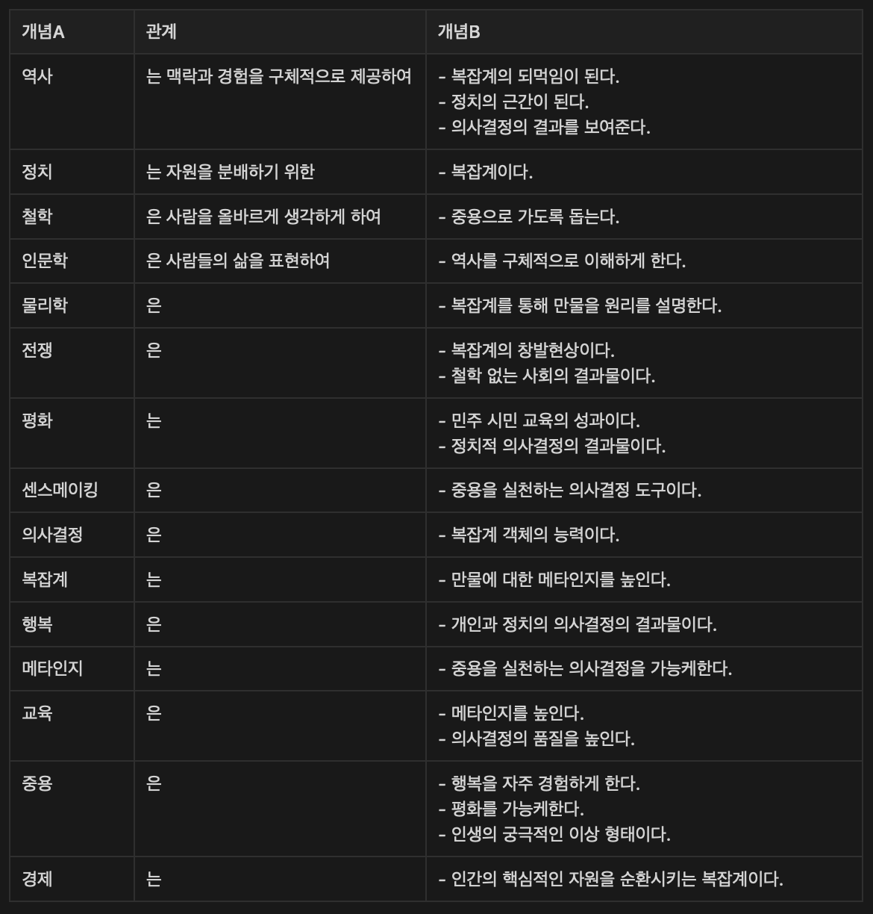

2월 14일, 나는 ‘중용을 실천하는 삶’에 가까워지기 위해, ‘복잡계’를 공부해서 문제 해결 관점을 달리 하고자 했다.

*스터디 계획 페이지 중 일부*

우선, 한 달 동안 여러가지 Input과 실험을 통해 기대하는 상태에 도달했는지, 어떤 변화가 있었는지 살펴보자. (글쓰는 시점이 늦어져 거의 두 달이 되어버린,,)

## 결과

### **1. 기대하는 상태에 도달했는가**

-> 평균 6.6점 수준

**1) 모든걸 다 알고 싶고 갖추고 싶은 욕심을 다룰 수 있게 되어, 더 중요한 것에 몰입할 수 있다.**

8/10. 예전보다 확실히 완전주의를 의식적으로 다루는 빈도가 증가했다. 예를 들면, 회사에서 특정 업무를 할 때 업무의 완료 조건과 목표를 반드시 확인하고, 그걸 달성하기 위한 일만 했다. 복잡계 책을 읽으면서도 비슷한 상황이 있었다. 복잡계는 물리학, 특히 상대성 이론의 등장 이후 발전한 이론이기에, 까다로운 수식과 복잡한 개념이 많았다. 당연히 나는 그 모든 개념을 이해하고 싶은 욕구가 생겼고, 나에게 그리 중요하지 않은 물리학 강의들을 재생목록에 넣었으나, 중요하지 않음을 알아차린 후 보지 않았다.

**2) 누군가에게 복잡계를 설명하고 시스템씽킹으로 문제를 해결하는 과정을 설명할 수 있다.**

5/10. 복잡계를 설명할 수는 있다. 누가 물어보면 ‘의사결정 할 수 있는 노드가 관계를 형성하면서 질서와 무질서를 오가는 시스템’이라고 말하면서 창발현상과 되먹임을 설명하곤 하지만, 사실 잘 설명하고 있다고 느끼진 않는다. 시스템씽킹은 아직 갖추었다고 말하기 어려워서 점수를 줄 수 없었다. 나에게는 아직 난이도가 높게 느껴져서 천천히 이해를 해나가야겠다.

**3) 시스템 구조를 위주로 비선형적으로 사고한다.**

8/10. 이전보다 비선형적으로 사고함을 느낀다. 예를 들면, 나의 경제 관리 시스템을 만들 때 가장 많이 느꼈다. 예전처럼 선형적으로 사고했다면, 모든 기능을 구현하려고 하다가 중요한 기능을 부실하게 구현했을 수도 있는데, 이번에는 달랐다. 이 시스템의 사용자인 내가 어떤 니즈를 가지고 이 시스템을 사용할 것인지를 가장 먼저 정의했다.

그리고 ‘지출/수입 내역만 입력하면 특정 주기로 패턴을 파악하여 다음 주기에 개선할 수 있고, 정산 시간을 획기적으로 줄이고 싶다’라는 니즈를 시작으로 기능을 구현하니 약 4시간 만에 아주 만족스러운 시스템을 만들 수 있었다. 이러한 사고 방식은 회사의 중요 의사결정을 파악하는 경험 등에서도 효과적이었다.

### **2. 다른, 어떤 변화가 있었는가**

사실 기대했던 상태는 냉정하게 보면, 도달하지 못했다. 기대가 컸기 때문이기도 하다. 하지만 그럼에도 불구하고 너무 만족스러웠던 시간으로 느끼는 이유는 예상치 못했던 변화에 있었다.

**1) 사물과 사람을 보는 관점**

요즘 사물과 사람을 볼 때 가장 먼저 생각하는 것은 ‘서사’이다. 지금까지 그 사람이 어떤 의사결정을 통해 서사를 만들어왔는지, 그 사물이 어떤 외부 작용에 의해 서사가 생겨났는지를 먼저 생각한다. 그리고 그게 나에게는 어떤 의미가 있는지 연결하면서 센스메이킹한다.

관점의 변화는 그동안 관심없었던 예술과 건축 같은 분야에 대해 다시 생각하게 했다. 경제와 같이 거부감이 컸던 분야에 대한 냉소적인 태도도 변화했다. 어떤 일을 할 때에도 새로운 관점에 따라 일하니 작은 아이디어도 빛을 발했다. 모든 것이 open system이라고 생각하니 새로운 가능성을 활짝 열어두게 되었고, 부정적인 뉘앙스의 피드백도 문제 해결의 관점으로 받아들일 수 있게 되었다. 센스메이킹이 왜 창의성과 연결되는지 이해할 수 있었다.

영기님이 말씀하셨던 ‘매트릭스’ 밖에서 세상을 보는 시각을 짧은 시간에 얻은 것 같다. 입체적인 관점을 통해 더 많은 것을 볼 수 있는, 궁극적으로 원하던 상태에 도달한 것이다.

**2) 비전**

더 많은 사람들이 더 자주 행복한 사람을 만들겠다는 미션과 교육이라는 도메일이 핵심이라는 믿음은 견고하지만, 과연 진로 메타인지 교육이라는 것이 대한민국의 as-is에 맞아떨어지는 솔루션인지 의구심이 생겼다.

분명히 이상으로 추구하기에는 좋은 솔루션이지만 마음이 불편하고 현실과 너무 먼 거리에 있다고 느낀다. 모든 사람은 그 자체로 open system이기 때문에, 외부 상호작용에 의해 삶의 방향이 바뀔 수 있다. 언제든지 스스로에게 나쁜 선택을 할 수 있다. 그 선택에는 나름의 이유가 있다. 더 좋은 선택을 할 수 있었는데 몰랐던 것일수도 있다. 그러나 내가 원래 생각했던 진로 메타인지 교육은 이를 부정하는 느낌이다.

내가 진정으로 원하는건 사람을 부정하는게 아니다. 믿고, 느려도 선한 방향으로 나아가는 것이다. 이걸 꺠달으니 올해 대한민국의 as-is에 대한 통찰이 생기면 비전이 바뀔 수 있겠다는 생각이 든다.

**3. 이해하게 된 중요 키워드 간 관계**

## ​

## 과정

과정은 생각보다 단순했다. 책, 영상 매체를 위주로 Input을 넣고, 내가 결정해야 하는 순간마다 Input을 적용하여 Output을 만들었다. 그리고 다음 Input을 선택하거나 배움을 바탕으로 다른 Output을 만들었다.

도서관에서 책을 빌리기 전에는 대략적인 지식을 얻고 싶어 복잡계 관련 영상을 살펴봤다. 특히 Systems Innovation에서 만든 영상이 복잡계의 기초 개념과 익숙해지는데 큰 도움이 되었다. 영상을 보다보니 복잡계는 기존 선형성을 붕괴시킨 상대성 이론의 등장 이후 발전을 거듭한 것 같아 과학 분야의 입문 영상도 살펴 보았다. 여기에서부터 역사적으로 중요한 마일스톤이 어떻게 연결되어 있는지 이해할 수 있었다.

준비운동을 마친 후에는 복잡계의 입문서인 ‘복잡하지만 단순하게’, 그리고 커네빈 프레임워크를 만든 데이브 스노든의 또 다른 관심사 센스메이킹의 입문서인 ‘센스메이킹: 이것은 빅데이터가 알려주지 않는 전략이다’ 두 권을 읽었다. 원래 읽으면서 의식적으로 삶에 적용해보고 싶었지만, 개념을 내것으로 만드는 것 조차 어려워서 실패했다. 다행인건 이 책이 내 뇌에 잘 들어앉아서 자연스럽게 삶에 적용하게 되었다는 것이다. 복잡계는 아직 적용한다고 말하기 부끄러운 수준이지만, 센스메이킹을 자주 적용하게 되었다.

불확실한 상황에서 협력사와 어떤 관계를 만들어가는게 좋을까, 행사에서 홍보물과 다과를 어떤 방식으로 배부하는게 좋을까, 동생이 잘못을 저질렀을 때 어떻게 알려주는게 좋을까, 실수를 저질렀을 때 어떻게 빠르게 회복할 수 있을까 등 정말 다양한 결정에서 센스메이킹을 적용했고, 덕분에 중요한 배움을 적은 노력으로 얻을 수 있었다. 재밌는건 구체적인 사례를 기억하지 못한다고 여기던 내가 기억하는 사례가 증가했다는 사실이다. 센스메이킹은 이야기와 서사를 기반으로 이루어지다보니, 구체적인 이해를 돕는다. 추상과 구체를 오가면서 배우는 능력도 점점 좋아지고 있음을 느낀다.

책을 읽고, 삶에 적용하면서 배움을 얻은 후에는 역사를 이해하는게 중요하겠다는 판단이 생겼다. 결국 자원을 확보하고 생존하기 위해 했던 과거의 의사결정이 지금까지 영향을 미치고 있으니 말이다. 최근에는 인간 사회라는 복잡계의 대표적인 창발현상인 전쟁과 관련된 역사를 살펴보고 있다.
