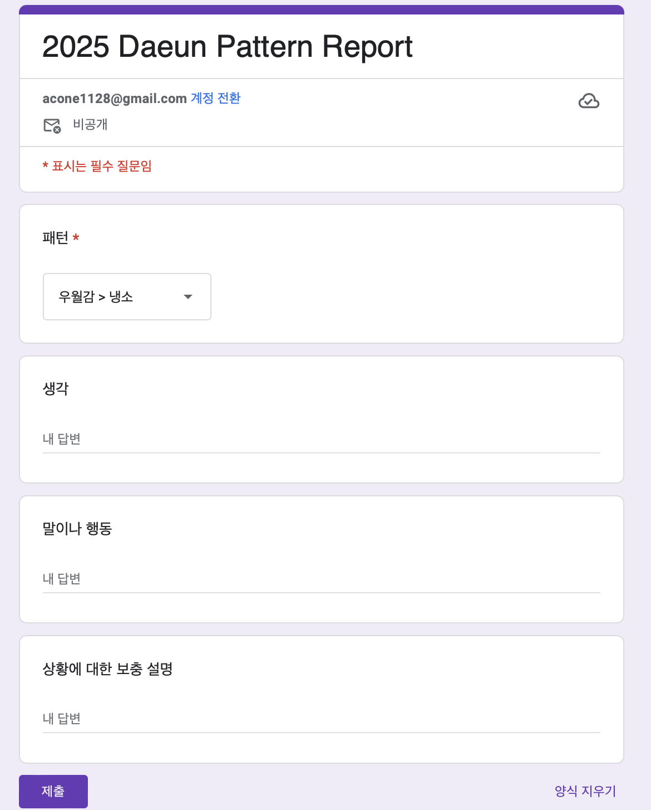

나는 집단에서 서열을 나눌 때, 운이 좋게도 보통 중간 이상의 자리에 위치했다. 그래서 우월감이라는 것을 효능감의 일부로 착각하면서 살아왔는데, 2023년부터 인식하고, 문제로 바라보기 시작했다. 문제로 인식한 지는 시간이 좀 흘렀다. 하지만 마땅한 해결방안을 찾지 못해, 우월감이 무의식에서 의식으로 이동한 후 말이나 행동으로 드러나지 않도록 늘 조심하고 있었다.

그리고 오늘, 민주주의와 윤석열 파면으로 가득한 유튜브 알고리즘에 ‘대중의 지배로 몰락하는 현대 사회 (feat. 오르테가 이 가세트 '대중의 반역')’라는 영상이 나타났다. 흥미로운 제목과 썸네일에 누르지 않을 수 없었고, 그렇게 보게 된 영상에서 설명하는 대중의 특징 4가지 중 마지막 특징이 너무나도 와닿았다.

1. 문명에 대해 깊은 고찰을 하지 않고, 마치 그것이 자연인 것처럼 생각한다.
1. 원리에 대한 관심이 없다.
1. 원래 가지고 있던 것이 없어졌을 때, 응석받이 같은 불만을 표출한다.
1. 자신보다 더 높은 존재를 인지하고 인정하는 능력을 상실했다. 따라서 자신의 상태가 최선의 상태라고 생각한다.

나보다 뛰어난 사람은 세상에 널렸다. 알고 있다. 모를 수 없다. 모든 사람이 나보다 하나 이상 뛰어난 면이 있다. 그런데 나는 나보다 뛰어난 사람을 발견하면 가끔 회의적으로 변한다. “기대했던 것보다는 결과물이 별로인데?”, “그게 왜 중요한거지?” 와 같은 판단을 하며 냉소적 태도를 취하기도 한다. 전형적으로 자기만족을 위해 남을 낮게 보는 생각이다.

이는 나의 치명적인 약점이다. 전혀 중용을 실천하는 모습이 아니다. 오히려 의식의 영역에 들어오는 순간 죄책감이 들고 괴롭다. 그래서 이번에는 좀 더 구체적인 데이터를 확보하는 것으로부터 문제 정의를 제대로 하고, 해결을 위한 실험을 시작하기로 했다.

첫번째로 내가 우월감을 자각했을 때, 어떤 상황에서 어떤 생각을 하고, 어떤 말이나 행동을 하는지 바로 기록하기로 했다. 언제 어디서든 기록할 수 있도록 구글폼을 만들고, 휴대폰 홈 화면에 바로가기 아이콘을 설정했다.

이러한 노력과 요구를 통해, 올해를 마무리할 때에는 만나는 사람들의 뛰어난 부분을 발견하고, 판단 없이 함께 잘 지내는 엘리트(귀족)의 모습이 더 많아질 것이다.
