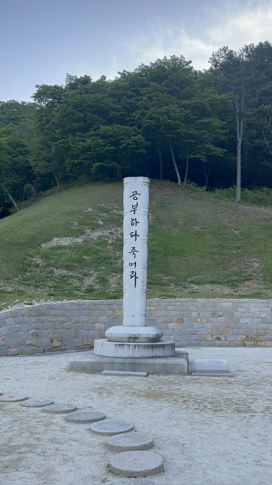
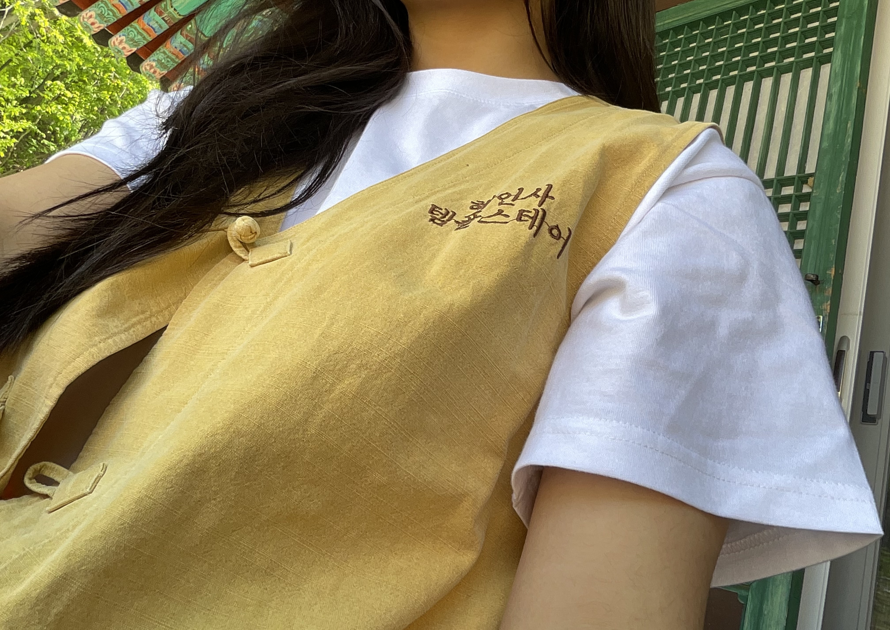

개념을 정의하지 않으면, 글을 쓰지 않고, 만족하지 않으면, 결과물을 내보이지 않고, 충분히 준비가 되었음에도, 시작하지 않고, 시작한 후에도 놓친 것이 있지는 않을까 계속 다시 본다. GPT에게 항상 MECE(Mutually Exclusive, Collectively Exhaustive)한지 평가를 요구하고, 말이 안되는 논리를 펼치기 두려워하고, 도덕적으로 항상 올바른 판단을 해야 한다는 생각이 당연하다. 항상 높은 에너지를 유지하며 다른 사람에게 긍정적인 영향을 끼쳐야 하고, 목표를 향해 나아가야 한다. 아무것도 하지 않는 시간은 낭비다.

이건 내 이야기다. 이런 나를 마주하며 얼마 전에 깨달은 놀라운 사실은 인생이 연역적이거나 귀납적이지 않다는 사실이다. 센스메이킹 책을 보면서 느낌은 알고 있었지만, 마음에 와닿지 않았는데, 이제야 제대로 알게되었다. 머리로만 알고 있던걸, 설명할 수 있게 되었달까,,

나는 하나의 비전을 향해 나아가기 위해, 갖추어야 하는 전문성이 있고, 전문성을 갖춘 사람이 되기 위해 달성해야 하는 중간 목표를 정리하여 삶의 중요한 선택을 하는게 옳다고 믿었다. 질서정연한 것이 만족스러웠고, 확실해보였기 때문이다. 나의 시간을 인생에서 중요한 것들로만 채우고 싶었다.

그러나 아쉽게도 인생은 닫힌 시스템이 아니다. 내가 통제할 수 없는 것이 너무 많다. 언제 더 매력적인 기회가 올지, 나를 파멸로 이끌 위험이 닥칠지 알 수 없다. 나를 구성하는 외부와 내부의 요소들은 지금도 변화하고 있고 나는 이를 통제할 능력이 없다. 여기까지 인정하면, 비관을 시작할 수도 있다. 어차피 내 맘대로 안되는 거 그냥 살자는 결론도 맥락에 따라 타당할 수 있다. 하지만 항상 더 나은 걸 찾으려는 나의 기질은 비관을 용납할 수 없었다.

작년의 배움대로 as-is를 먼저 살펴보았다. 어떤 요인이 완벽주의자가 되는 것에 기여했을까? 선천적으로 타고난 기질, 청소년기 경험의 산물인 성격, 인생에서 기억에 남는 장면 등 떠오르는 것이 많았다. 일단 ‘도움을 주는 사람으로서의 강한 정체성과 실행 중심의 통제력이, 관계의 상호성·감정의 수용성·현재의 충분함을 받아들이는 능력을 가리고 있다’ 정도로 정리했다. 아직 명확한지는 모르겠지만, 뒷받침할 근거는 충분하다.

자, 원래 같으면 바로 목표를 정의했을 것이다. 아무래도 무엇이 문제인지를 알면 문제를 해결한 상태를 정의하고 싶으니까. 하지만 이번에는 목표를 정의하는게 지금의 문제를 강화하는 것을 알고 있다. 그러니 다르게 해봐야겠지. 뾰족한 목표 없는 시간을 보내기로 했다. 긴장과 불안을 느끼고 책임지고 완벽하지 않아도 충분히 만족스러울 수 있다는 경험을 처음으로 남기고 싶어졌다. 그리고 사실은 이게 자연스럽고 더 잘 살 수 있는 방식이라는걸 뇌에 새기고 싶다.

깨달으면 실행해야 직성이 풀리는 나답게, 가장 먼저 일주일동안 템플스테이에서 책만 읽었다. 그 와중에도 욕심내어 1일 1권 하겠다고 6권 들고가갔다. 밤을 새더라도 온김에 다 읽어야 하지 않을까 라는 생각이 스쳐지나갔지만, 문제의 중요도가 높기 때문에 메타지각이 바로 되었고 딱 3권 읽었다. 이 과정도 좋았는데, 결과도 좋았다. 기억에 남고 만족스러운 독서가 되었으니까.

3권 중 한권의 책의 이름은 <주의력 연습> 이었다. 이 책의 저자, 아미시 자는 인간의 주의력은 한정된 자원이고, 시간을 관리하는 것이 아니라 주의력이 어디에 있는지를 관리해야 원하는 선택을 할 수 있다고 말했다. 그리고 인간의 주의력 문제는 시간여행에서 비롯된다고 했는데, 이는 현재에 머무르지 않고 계속 반추, 계획, 상상하는 시간들이 우리의 집중을 방해하고 있음을 뜻했다. 중간중간 주의력을 현재에 두는 뇌과학적인 훈련 방법을 제시하는데, 요약하면 적어도 4주동안, 주 5일, 하루 12분 동안 명상을 하는 것이다. 저자의 논리가 나를 설득하여 지난 화요일부터 아침에 일어나 명상을 시도하고 있다. 결정하지 않고 그냥 하니까 생각보다 쉽고 효능이 느껴진다. 나의 긴장을 완화하고 주의력을 관리하여 원하는 선택을 하는데 도움이 되기를 기대하고 있다.

Previous image
Next image

이러한 시도를 왜 하는지에 대해 명확한 이유를 정리하지 않고, 직감적으로 나에게 중요한 시도를 하는 시간은 태어나 처음이다. 그러나 역설적이게도 올해 중용을 실천하는 데에 있어 OKR을 정리하는 것보다 지금의 경험이 더 강하게 연결되어 있는 느낌이 든다. 생소하지만, 자연스러움과 해방감을 느낀다.
