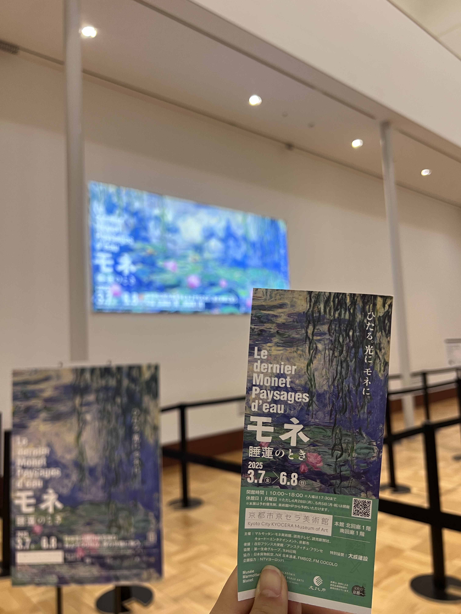
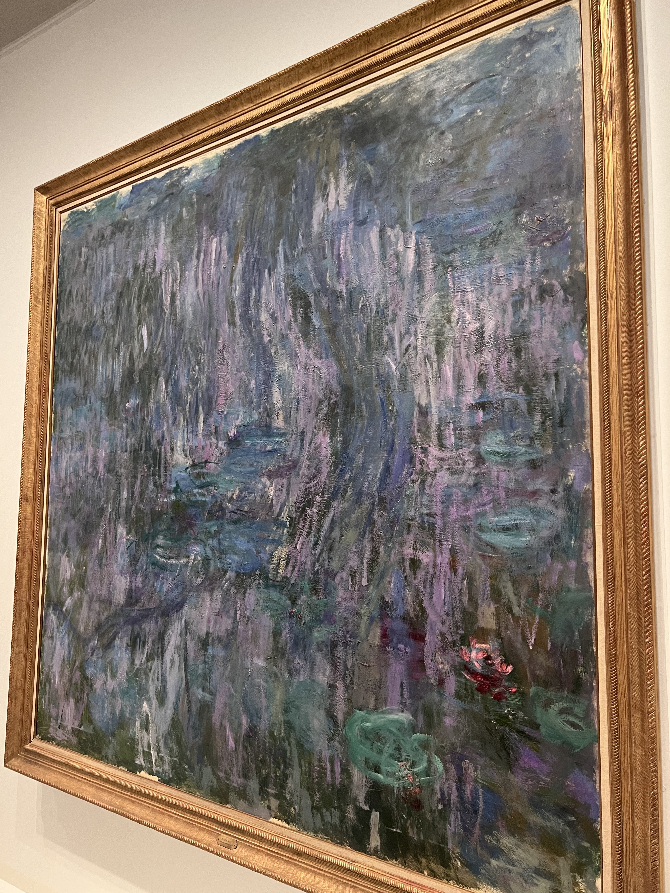

얼마 전 교토교세라미술관에서 ‘모네 수련의 시간’ 이라는 전시를 봤다. 미술에 조예가 없어서 잘은 모르지만, 실제 작품을 느껴보고 싶어서 시간을 냈다. 하나의 객체를 들여다보는 방법을 알게 된 후 감상을 하니 확실히 기억에 남는 것들이 몇 개 있다.

먼저, 그의 그림이 살아있음을 느꼈다. 새벽의 연못, 노을지는 다리, 쨍쨍한 여름의 들판이 그려졌다. 오묘하지만 본적이 있는 듯한 색감과 붓칠의 흔적을 보는게 재밌었다. 그림을 보며 감상하는 관람객의 모습은 또 하나의 재미였는데, 각자 무엇을 느꼈을지 궁금했다. 살아있는 그림은 백년이 흘러도 많은 사람들이 시간을 내어 찾아오게 만드는구나, 신기했다. 특히, 양갈래 머리에 수첩을 들고 설명을 열심히 읽으면서 무언가를 적던 일본 소녀의 관심어린 눈이 기억에 남는다. 그녀는 이 전시가 끝나고 어떤 말을 했을까?

느끼는 것을 표현하는 감각이라는 모네의 고유한 자질은 변함없음을 느꼈다. 그림이 그려진 연도를 보면 점점 색감이 투박해지고, 붓칠이 거칠어지는 것을 느낄 수 있는데, 이는 모네가 말년에 백내장으로 인해 색을 분간하기 힘들어졌기 때문이다. 하지만 그럼에도 불구하고, 그림을 보았을 때 상상하는 풍경은 크게 다르지 않았다.

모네의 그림은 모두 시간, 계절, 날씨에 따라 변하는 자연을 그리는데, 변화하는 순간의 인상을 그리기 떄문에 명확할 수 없다고 한다. 복잡한 자연의 순간의 스냅샷을 찍는게 아니기 때문이다. 그래서 그림 속 객체의 모든 경계가 흐릿하다. 어디가 경계인지 콕 찝어서 명확히 할 수 없을거다. (AI가 컷아웃하기 힘들 것 같다) 나는 불명확한것을 좋지 않다고 생각했는데, 이번에 생각이 바뀌었다. 꼭 명확할 필요는 없다. 모네의 그림은 명확하지 않아서 아름답고 자연스러웠다.

Previous image
Next image
