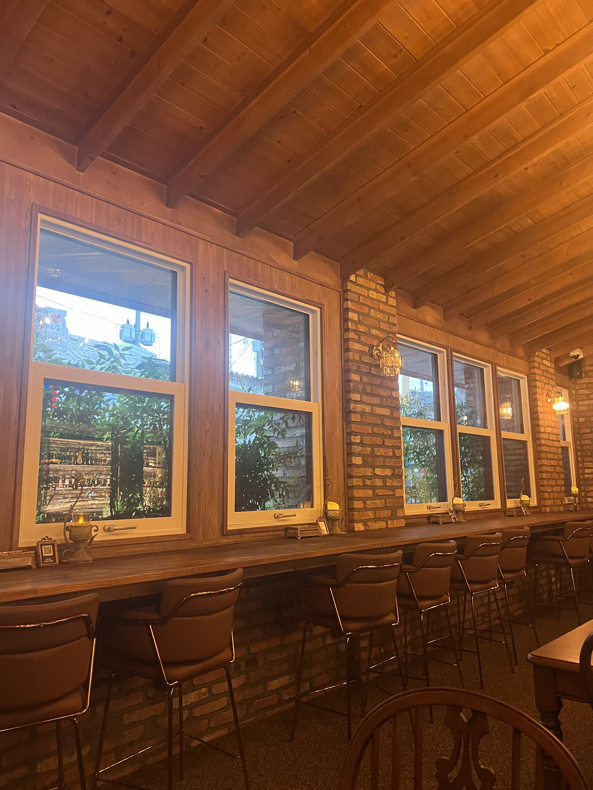

최근 자주 하는 말들이 있다. ‘그런가?’는 얼마 전에 어떤 분께서 내가 단정짓는 말버릇이 있는 것 같고, 그것이 내가 경직되는데 영향이 있을 수 있다고 피드백을 주셔서 의식적으로 쓰기 시작했다. ‘그럴 수 있지’는 아마 ‘이해보다 인정’이라는 문장을 내것으로 받아들이기 시작한 고등학생 때부터 많이 쓰기 시작했던 것 같다.

모든 사람들은 각자의 사정이 있고, 나는 그 사정을 모두 헤아릴 수 없기 때문에, 대화를 나누거나 행동을 관찰하다보면 이해가 되지 않는 것들이 많다. 예전에는 이해되지 않는 것을 상대방의 문제로 여겼다. 그러니까 내가 생각하는 바람직한 상태와 상대방의 현재 상태가 다르다고 본 것이다. 이러면 나는 계속 유리한 위치에 있을 수 있었다. 나는 바람직한 상태를 유지하고 있다고 믿을 수 있었다. 그럼 안전함을 느낄 수 있었다. 지금도 종종 무의식적으로 사용하는, 아주 바람직하지 않은 생존 전략이다.

이 전략은 나를 오랫동안 안전하게 지켜주었다. 하지만 시간이 지나며 단점이 더 크게 작용하기 시작했고, 변화하는 상황에 따라 그 영향력도 달라졌다. 안타깝게도 이제 단점은 내게 문제로 인식되고 있다. 1) 사람들은 내가 이미 바람직한 상태를 알고있고, 바람직한 모습을 보일 때가 있으므로, 도움이 필요 없는 사람으로 인식한다. 2) 나는 도움을 요청하는 것이 어렵다. 3) 혼자 해결할 수 없는 문제도 일단 혼자 해결하려고 한다.

고집이 센 성격은 단점을 더 강화했다. 반박 의견을 위협으로 인식하고, 위협에 대응하기 위해 경직된 상태를 유지했다. 점점 피드백을 얻기 어렵고 유연함과 거리가 멀어짐을 느꼈다. 이렇게 다양한 경험이 쌓여 형성된 관성은 한 번에 바꾸기 어렵다. 그래서 아주 간단한 말버릇 바꾸기부터 시작하기로 했다. 다행히 나는 누군가 납득이 되는 자극을 주면, 동기가 잘 유지되어서 변화한 경험이 몇 번 있다. 이번에도 내가 납득될때까지 에너지를 써가며 정성스러운 설명을 해주신 감사한 분이 계셨다. (앞으로는 납득이 안되더라도 해보는 내가 되면 좋겠다)

그런가? 라는 말의 효과는 상당했다! 내 의견이 틀리다는 느낌보다는 더 좋은 의견으로 나아가기 위한 조력의 느낌이 강해서, 생각을 더 유연하게 만드는데에 도움이 된다. 이제, 말버릇을 바꾸기 시작한지 3주째다. 성급한 판단이 줄고, 자세가 조금 더 편안해지고, 반박 의견을 조금 더 부드럽게 받아들이는 내 모습을 보는게 재밌다. 달콤한 안전지대를 지키기 위해 썼던 에너지를 나의 영역을 확장하는 곳에 쓰는게 만족스럽다. 앞으로도 이렇게 조금씩 변화하는 사람이 되기를!

*감사한 분께서 술을 사주셨던 문래의 한 위스키집*
