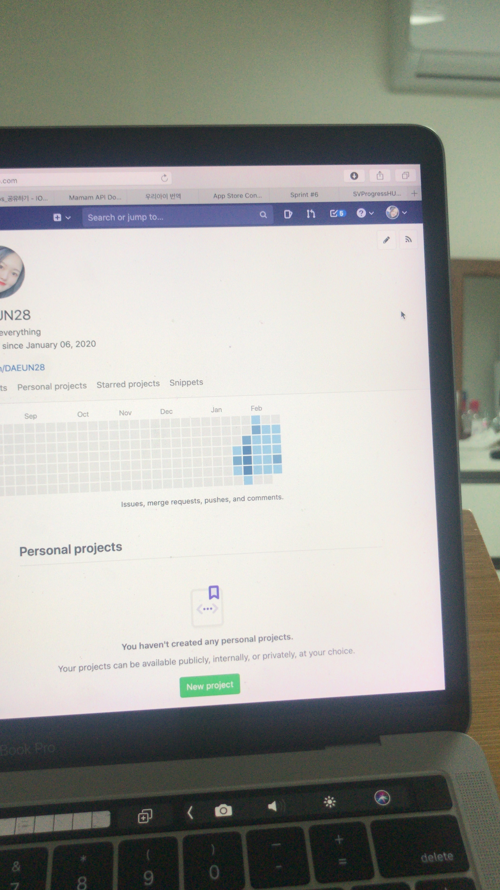

일기를 쓰기 시작하고 많은 것들이 달라졌다. 시작하게 된 계기는 사소하다. 인턴 생활을 하면서 첫 자취를 하게 되었고, 마침 샤이니 2020 시즌 그리팅 다이어리가 일기 쓰기 적당했으며, 엄마가 5년 동안 쓸 Q&A 북을 선물해주었다. 단순히 종이의 여백을 채우기 위해 시작했던 일기는 갈 곳 없던 이야기를 들어주고, 생각 정리를 도와주고, 메타인지를 높여주었다. 이 효능이 너무나도 높아서, 일기는 자연스럽게 습관이 되었다.

일기는 기록에 초점을 맞춘다면, 저널은 성찰에 초점을 맞춘다. ac2에서 배운 저널은 일기와 시너지를 발휘하여 더 큰 효능을 느끼게 했다. 내 경험에 비춰보면, 일기와 저널을 쓰는 날에는 내가 몰랐던 나를 알게 되고, 미웠던 사람이 이해되기 시작한다. 돈 주고도 배울 수 없는 교훈을 얻기도 하고, 멈추지 않던 눈물이 웃음으로 바뀌기도 한다. 실제로 나는 가족 간의 갈등이 심화되어서 연차까지 내야했을 때, 매일 야근하느라 신경증을 의심하며 입원했을 때, 존재에 대한 혼란을 느끼며 삶에 의문을 가졌을 때, 무기력과 불안을 극심하게 느꼈을 때, 좋아하는 사람을 더이상 보지 못하게 되었을 때 등 삶의 중요한 신체적/심적 고통의 순간에서 일기와 저널 덕분에 살아날 수 있었다.

페니베이커의 표현적글쓰기에 따르면, 대학생에게 하루 15분 나흘간 저널을 쓰게 했더니 병원에 덜 가고, 면역력이 높아지고, 학교 생활에 적응을 더 잘하고, 성적도 좋아졌다. ([**Pennebaker**](http://en.wikipedia.org/wiki/James_W._Pennebaker)의 연구 참고) 이렇게 살아나는 경험을 더 많은 사람들이 했으면 좋겠다. 나는 더 많은 사람들이 더 자주 평안했으면 좋겠다는 소망이 있고, 일기와 저널은 마음이 평안해지는데 아주 쉽고 유용한 방법이기 때문이다.

*아득한 인턴시절,,*
