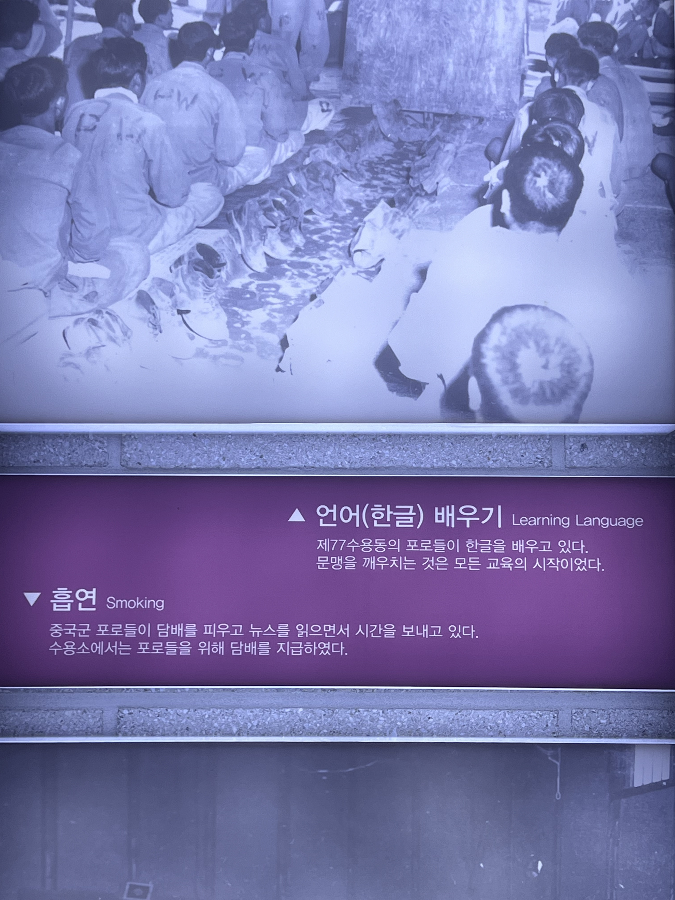
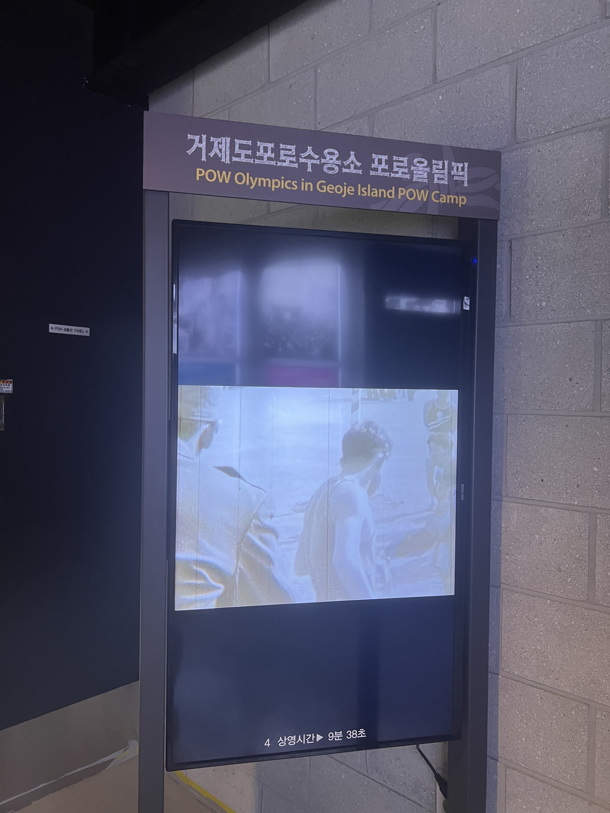
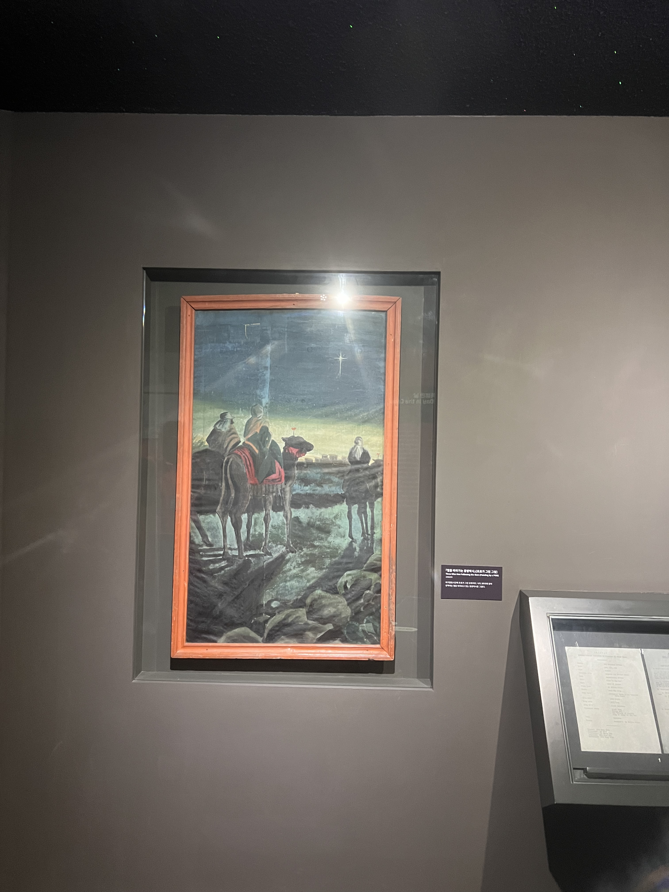
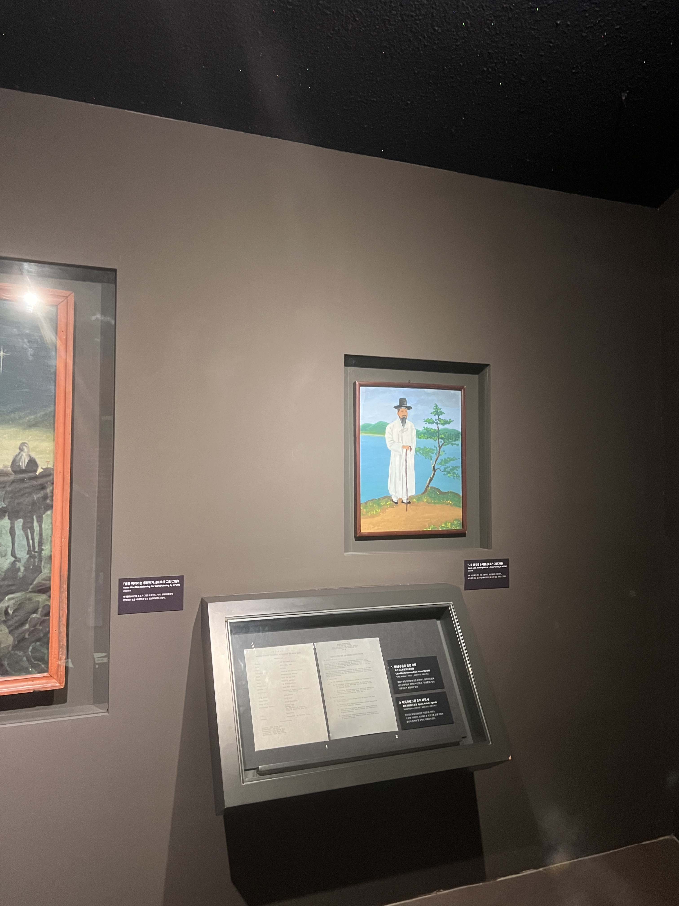
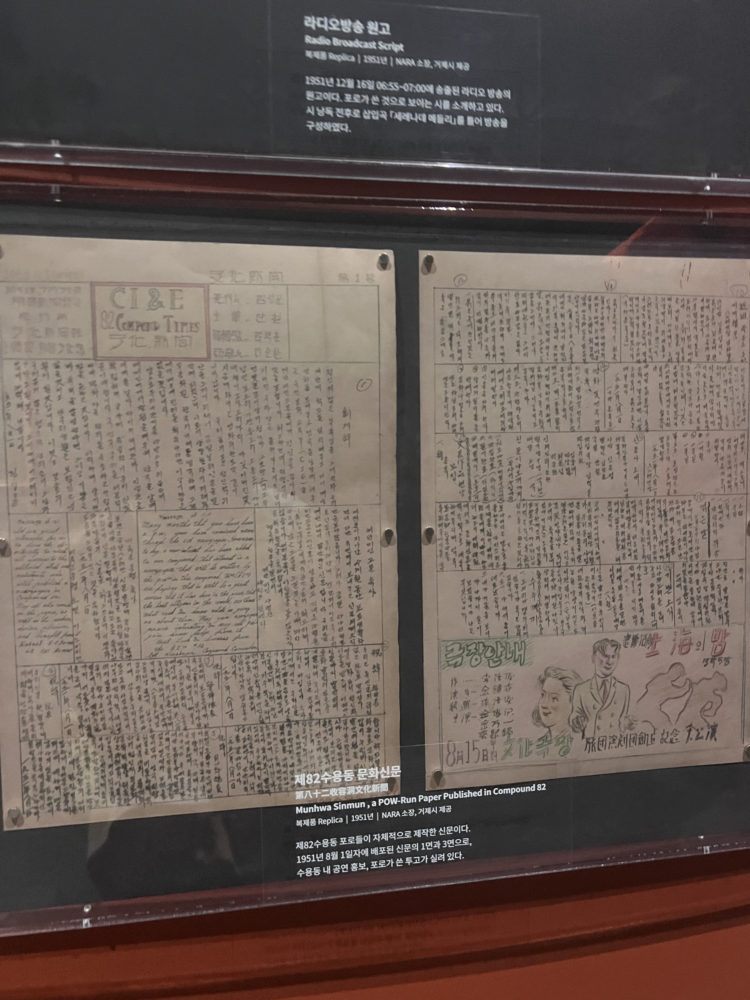
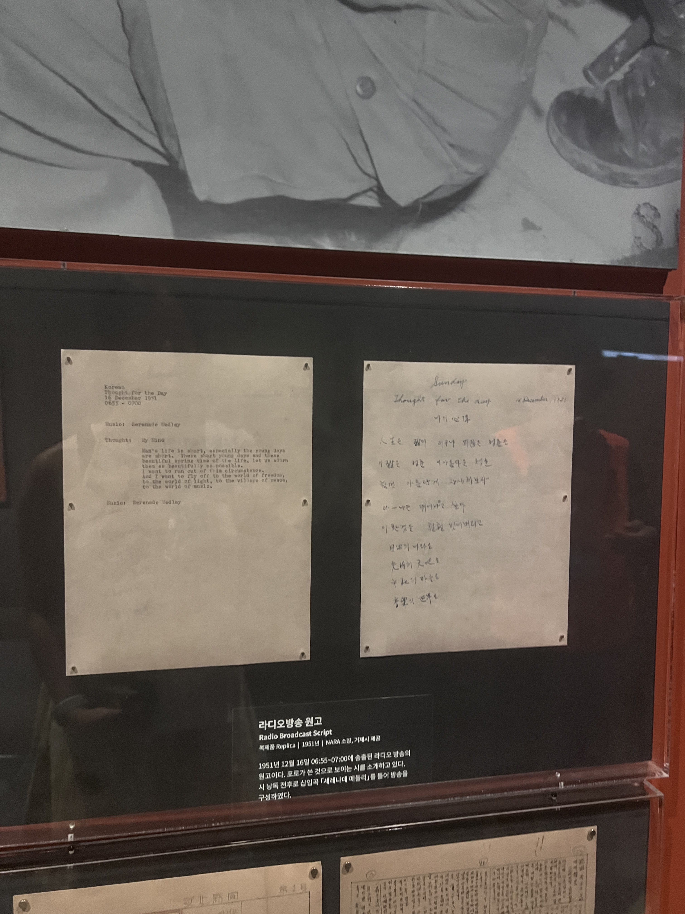

역사에 대한 개괄적인 설명보다, 그 역사를 만들어낸 사람들의 이야기가 더 많이 남는다. 시험에서 만점을 받기 위해 배우는게 아니라, 복잡한 세상을 더 이해하고 평화의 비용이 얼마나 비싼지 느끼기 위해 배우는거니까.

포로 생활에 대한 개인적 추측은 모두 빗나갔다. 한국전쟁에서 남한은 북한군 및 중공군 포로에 대한 대우가 명시된 제네바 협약을 충실히 준수했기 때문이다. 포로들은 기초적인 수준의 노동을 하면서 취미 생활을 할 수 있었다. 자체 올림픽, 연극 공연, 신문 발행, 직업 교육이 이루어졌고 담배까지 제공됐다. 오죽하면 한국군의 대우가 더 좋지 못했다고 표현할까. 심지어 북한은 남한군 포로에게 강제노동을 시켰다는 현실까지 알게되니, 인간적인 분노가 올라올 수 밖에 없었다.

Previous image
Next image

가장 분노스러웠던 사건은 돗드 준장 납치 사건이다. 북한의 간첩이 포로수용소에 일부러 잠입하여 휴전협상을 유리하게 만들기 위해 미군 육군 준장을 납치한 사건이다. 수단을 가리지 않고 갈등의 극치를 보여주는 전쟁에서 도의적인 모습을 기대하는건 불가능함을 느끼며 허탈했다.

전시에서는 한국 전쟁과 수용소 연대기, 실제 포로들의 생활 모습과 더불어 친공 포로와 반공 포로의 갈등도 비중있게 다루어졌다. 이들을 분리시켜야할만큼 갈등은 심화되었다고 하는데, 사제 무기를 만들어 서로를 죽이는 사상검증이라니. 정말 끔찍했다. 인공기와 체제 선전 문구를 적은 천을 볼 때마다 저들이 진정으로 지키고자 하는 것은 무엇일까라는 공허한 물음만이 남았다.

포로의 사상과 그에 따른 행위를 배제하고, 더 나은 삶을 살기 위해 교육을 받고, 창작하는 모습을 볼 때는 안타까움이 들었다. 특히 어느 포로가 그린 그림에서는 전쟁에 가려진 재능과 열정이 느껴졌다. 시대가 죽인 인재가 얼마나 많을까?

Previous image
Next image

평화파크에서는 우리가 지금 누리고 있는 평화가 얼마나 소중한지 깨닫게 하는 문구와 인물을 소개했다.

> 전쟁은 그 수행에 있어서 악한 사람을 학살하는 일은 없고,
>
>
>
>
> 언제나 선량한 사람만을 학살한다.
>
>
>
>
>
> 소포클래스

유적공원을 둘러보는 3시간 동안 시니어해설사 분들 덕분에 몰랐던 이야기를 많이 알게 되었는데, 그 중에 가장 기억에 남는 이야기는 백두산함 이야기다. 한국전쟁 당시만 해도 우리나라는 북한에 비해 국력이 한참 모자랐으니, 국민들의 생활도 어려울 수 밖에 없었다. 그런데 어려운 생활 속에서도 해군들은 월급을, 해군의 아내들은 삯바느질한 돈을 모았다. 그리고 이 돈에 정부의 지원금을 보태 해군 최초의 전투함, 백두산함을 구매했다. 포탄 하나하나가 아까워서 제대로된 훈련도 하지 못했는데, 처음으로 출정한 대한해협에서 600명의 북한군이 탄 함정을 격파했다. 이 북한군 함정은 부산을 향하는 길이었고, 인천상륙작전 전까지 최후의 방어선이 부산이었음을 생각하면 백두산함에 올랐던 사람들의 업적을 기억할 수 밖에 없다. 금모으기 운동 이전에 백두산함이 있었다. 대체 힘 없고 해준게 없는 나라를 위한 국민의 희생은 어떤 힘에서 나오는걸까.
