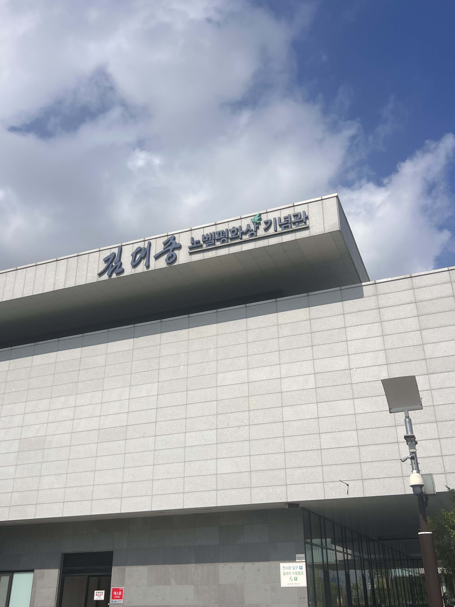
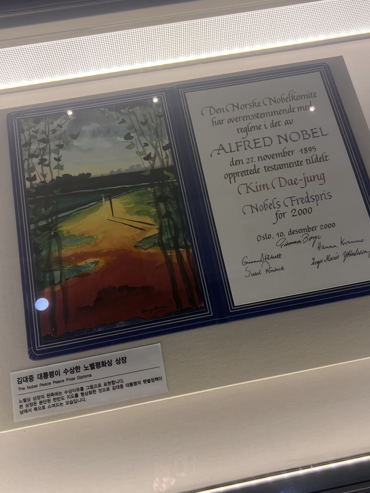
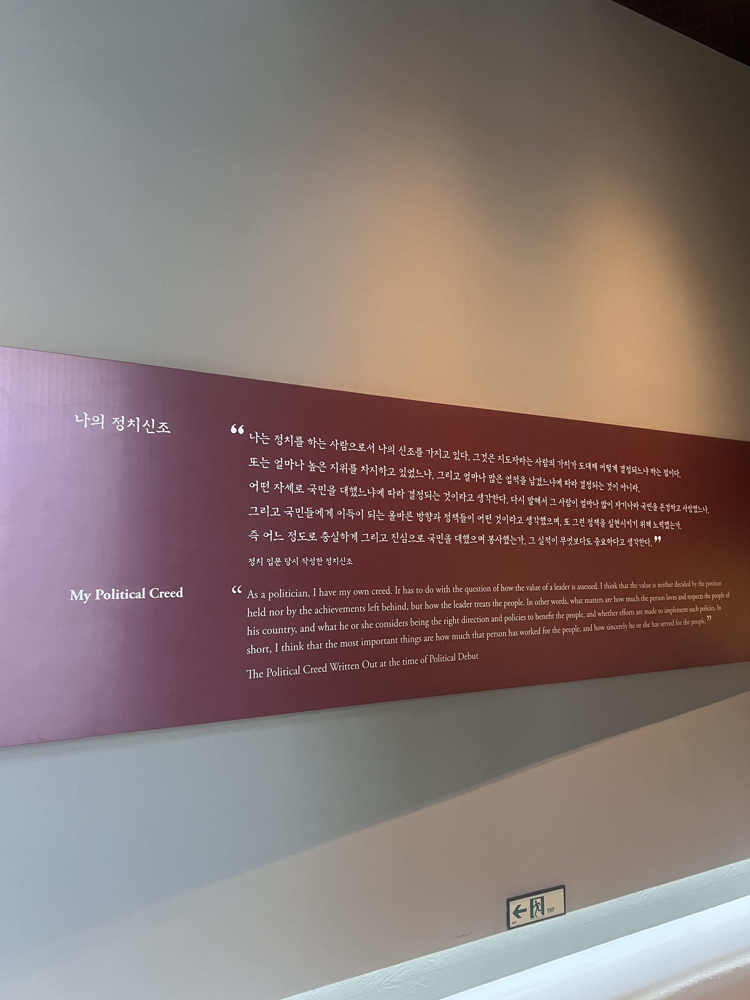
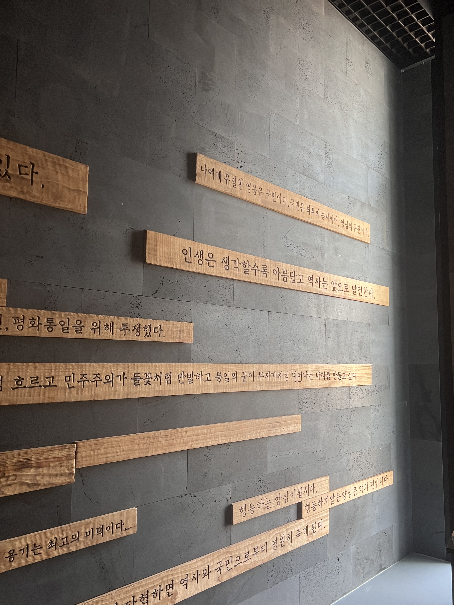
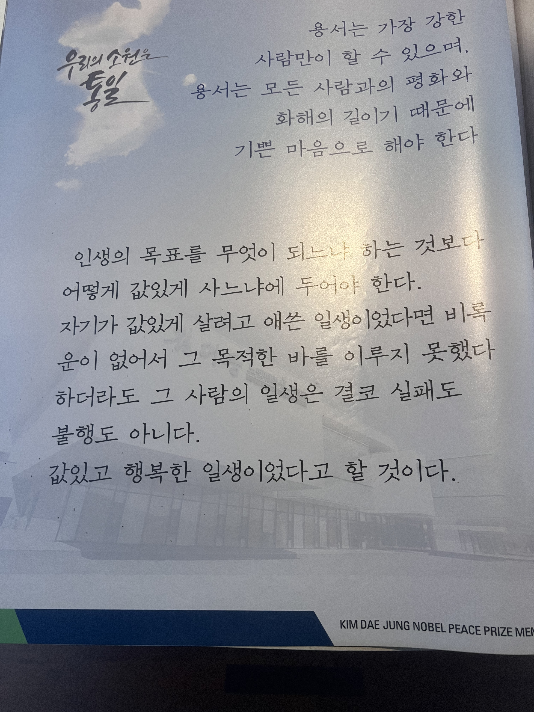

목포 여행에서 김대중노벨평화상기념관은 올해들어 평화라는 단어가 머릿속에 자리잡은만큼, 나를 사로잡은 장소였다. 평일 오전이라 그런지, 사람이 많지 않아 이야기 하나씩 오랫동안 들여다보기 좋았다. 2시간 30분 정도 들여다보고 생각한 결과, 김대중 대통령은 존경받아 마땅한 위대한 사람이었다.

관람은 1층의 영상실에서 시작된다. 연대기를 담은 20분짜리 영상을 큰 디스플레이로 보게된다. 진중한 목소리의 성우 나레이션과 함께 그가 중요히 여겼던 가치와 가치를 실천한 장면을 소개한다. 잊고있던 그에 대한 정보를 머릿속에 불러오기 좋은 시간이었다.

영상을 다 본 후 조금은 무거워진 마음으로 계단을 올라 2층 전시관으로 들어선다. 기념관의 이름에 걸맞게 가장 먼저 보이는 것은 노벨평화상 문서와 메달, 그를 상징하는 인동초였다. 벽 전체에 수상 당시 장면을 상영하고 있어, 한쪽면만 보면 오슬로에 있는 것만 같다. 왼쪽 문으로 들어가면, 구체적인 수상 사유, 그리고 노벨상에 대한 설명과 함께 지금까지 노벨상 수상자를 소개하고 있다. 특히 노벨평화상을 수상한 단체나 개인에 대해서는 자세한 설명을 볼 수 있었다.

그러나 나는 노벨평화상 자체가 궁금했다기보다, 김대중이라는 사람이 인류의 평화에 어떤 기여를 했는지가 궁금했으므로, 이어지는 김대중 대통령의 일생 전시로 빠르게 이동했다. 가장 먼저 보이는 것은 그의 정치 신조였다. 나는 그가 변함없이 국민을 칭하는 말, ’존경하고 사랑하는 국민 여러분’이라는 말이 정말 멋지다고 생각해왔는데, 이는 정치에 입문할 때 작성한 정치 신조에 기반했다는걸 알게되었다. 온갖 고초를 겪고 최고 권력을 가지게 되었을 때에도 한결같으려면 얼마나 마음을 갈고 닦아야 할까? 그 시간과 노력을 감히 헤아릴 수 없다.

일생 전시는 짧은 영상으로 이야기를 이해한 후, 이야기와 관련된 물품을 전시하는 방식이었다. 구사일생한 순간들이 재연 드라마로 상영되고 있었는데, 꽤나 현실적이어서 보면서 분노가 올라올 정도였다. 특히 그가 전세계적으로 협력한 것을 보여주는 물품들이 기억에 남는다. 아웅산수치 여사와 주고 받은 편지, 미국의 주요 인사들과 주고 받은 편지, 그리고 미국에 망명할 때 영어로 연설하거나 기자회견하는 영상을 보면서 언어를 뛰어넘은 그의 언변에 감탄할 수 밖에 없었다. 그의 일대기를 한문장으로 축약한 것을 읽을 때 느끼는 위대함과 구체적으로 어떤 말을 했고, 어떤 사람과 함께 했는지 볼 때 위대함은 매우 다르게 느껴졌다. 서생적 문제의식과 상인적 현실감각을 두루 지닌 사람이라는걸 느끼면서, 비현실적인 능력에 압도되었다.

일생 전시의 마지막 부분에는 전두환 시절 광주민주화운동의 배후로 몰려 사형을 선고받고 감옥에 수감되어 있을 때, 이희호 여사 및 가족들과 주고 받은 편지를 볼 수 있었다. 그는 가족에 대한 사랑과 하나님에 대한 신실한 믿음까지 변함없이 지니고 있었음을 알 수 있었다. 이쯤되니 이 정도로 온 마음 다해 정성껏 산 사람이 있다는게 신기할 지경이었다. 민주화에 대한 그의 열망은 세계 제일이라는 말이 자연스럽게 튀어나왔고, 노벨평화상 수상 사유을 기억하지 못해도 수상을 인정할 수 밖에 없었다. 노벨평화상 관련 전시가 가장 마지막에 위치했으면 울림이 더 컸을텐데 아쉽다.

Previous image
Next image

마지막 전시에서는 그가 대통령으로서 이룬 성과를 전시했다. 인상깊었던 부분은 아직도 그를 존경하고, 김대중 정신을 이어가고자 하는 사람들의 영상이었다. 타계한지 17년이 지나가는데도 배우려 하고, 기억하려 하다니. 김대중 대통령이 얼마나 값있게 살았는지 느낄 수 있었다.

플라톤은 지혜를 갖춘 철학자가 국가를 다스려야 한다고 했다. 나는 이 전시에서 김대중 대통령이 철학자라는 것을 느낄 수 있었다. 단순히 말하고 글쓰는 표현력만 뛰어난 것이 아니라, 언어로 표현하기까지 사유의 깊이가 너무나도 깊은 분이다. 감히 롤모델로 삼을 수 있을까 싶을 정도로.

전시를 보며 홀로 감상하고, 발전시킨 생각들도 참 좋았지만, 마지막에 동행자와 나눈 대화까지 좋았다. 그는 김대중 대통령이 박정희, 전두환, 노태우 등을 용서하고 사면한 것이 이해되지 않았는데, 이번 전시를 보면서 용서가 어떤 맥락에서 이루어졌는지 이해할 수 있었다고 했다. 그리고 본인이 용서하기 위해 노력하고 있는 경험을 이야기했다. 만난지 겨우 4시간된 사람과 이토록 깊은 이야기를 나눌 수 있다는게 신기하고 감사했다.
