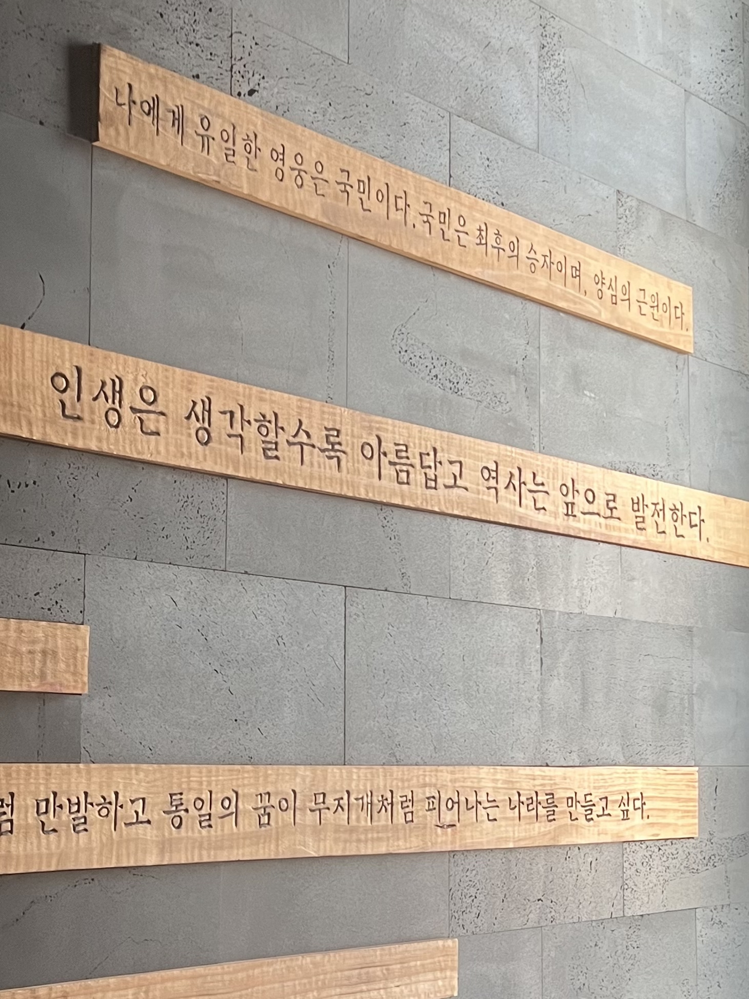

하동에서 한 달은 인생에서 기억에 남을만한 소중한 시간이었다. 목표지향적인 것만이 옳다고 생각했던 관점을 넓혀주는 시간이었다. 내게 중요한 키워드를 걸러주는 시간이었다. 생명에 대한 감각을 조금이나마 깨워주는 시간이었다. 이 시간들을 회고하다가 나도 모르게 아름답다는 감상이 생겼다. 태어나서 처음해보는 이 경험이 놀라워서 회고 글을 공개가능한 범위에서 편집해 남겨본다.

### **#1 첫 출근**

뭐든 잘 해낼 수 있다는 믿음이 있었는데, 실제로 그랬다. 좀 바쁜 상황에서 버거 세팅에 투입될 정도였다. 우쭐했다. 뭔가 처음할 때부터 잘 해내는게 재밌다. 효능감이 느껴지기도 하고, 원리가 머리에 딱 들어맞을 때의 쾌감이 좋다. 일이 생각보다 어렵지 않고, 워라밸이 좋을 수 있겠다는 기대가 생겨서 여기서 일해보는 것도 재밌겠다는 생각이 들었다. 사장님과 구체적인 연봉협상을 하게 되는 가장 큰 계기였다. 초록한 자연을 매일 볼 수 있고, 함께하는 사람들이 생각보다 더 좋은 사람들이며, 내가 할 수 있는 역할이 많을 것 같다고 생각했다.

이렇게 맞아떨어지는 상황에서 당연히 나의 결정을 밀어붙이기 위한 근거를 덧붙이기 시작했다. 강수돌 교수님이 하동에 산다는 사실, 서울에서 부자연스럽게 살아가는 기계적인 삶에 대한 거부감, 사장님께 배울만한 것들이 많을 것 같다는 기대, 수진 언니가 하는 봉사활동을 함께하고픈 마음. 많은 요소들이 복합적으로 얽히고 섥혀 하동에서의 삶에 대해 기대가 자라났고, 이는 일주일만에 worry map으로 정리되었다. 다도를 활용하는 심리치료센터를 차리고 싶어졌고, 심리상담업계 구조에 대해서도 파악을 하게 되었다. 이렇게 뭔가 맞아떨어지는 느낌! CA가 린츠카페에서 말했던 것처럼 편안하고 온전한 모습이 상상되니까 정확히 맞아떨어지는 느낌이 들었던거다.

### **#2 터널 시야에서 다르게 해보기**

지금까지 내가 해왔던 결정처럼, 충분히 확신이 생긴 상태에서 핵심 이해관계자와 논의를 시작했다. 차를 가지러 갔을 때 아빠는 내가 무엇을 하던 그에 맞는 정보를 주고자 했다. (개발자를 다시 할 생각이 없냐고 물은걸 보면 현시대에 맞는 직업을 저버리는게 아깝다고 느끼는 것 같긴했지만) 동생과 갈등 상태에 있던 엄마는 극렬한 반대를 했다. 얼마나 반대했냐면, 내가 ‘회피’하고 있다고 표현할 정도였고, 격양된 목소리를 보였다. 그리고 처음에 나는 그런 엄마의 의견을 받아들일 생각이 없었다.

감정이 앞서 엄마가 조금은 원망스럽기도 했다. 잘 알지도 못하는 사람이 말하는거라고 무시하고 싶기도 했다. 하지만 나는 다르게 해보기 위해 하동에 왔음을 알고 있었다. 그리고 조금 뒤에서 전체를 조망하니 보이는 것들이 있었다. 권고사직을 당했을 때처럼 시야를 빠르게 넓히니 보이는 것들이 있었다. 엄마는 내가 소중하다. 내가 덜 힘든 일하기를, 가까이에서 안전하기를 원한다. 조금 더 생각해보면, 집에서 일어나는 갈등 속에서 평정심을 유지하는 내가 필요할 수도 있다.

그래서 이번에는 엄마의 판단을 선택하기로 했다. 내가 보지 못하는 것들을 엄마는 더 긴 시간 속에서 보았을 것이라 믿으며. 이번에도 글쓰기가 가장 강력한 도구였다. 특히 일기는 내가 몰랐던걸 알게 해주는 너무 좋은 도구였다. 일주일동안 고민하다가 하루만에 결정한 과정에서도 맞아떨어지는 느낌이 들었다.

여기서 발휘된 나의 강점은, 다르게 해보고 싶어하는 것이었다.

### **#3 평화**

나는 계속해서 평화를 찾아 다닌다. 갈망한다. 그리고 평화는 쉽게 얻을 수 있는게 아니다. 그래서 그 어려움만큼 가치롭다. 하동읍성에 올라 평상에서 명상을 한 장면, 배드리공원에서 슬로우조깅을 하며 자연을 맘껏 즐긴 장면, 셋이 소파에 앉아 하울의 움직이는 성을 본 장면, 진주 영화관에 간 장면, 아빠에게 차를 받고 논산에서 대화하던 장면, 엄마가 나의 소중함에 대해 이야기하던 장면, 지리산 계곡에서 자유롭게 헤엄치던 장면, 노량대교를 보며 책을 읽던 장면, 통영 게스트하우스에서 지는 해/바다/고양이를 바라보던 장면, 거제 카페에서 책을 읽던 장면, 티카페 하동에서 차를 마시며 아이디어를 정리했던 장면, 비를 맞으며 러닝하던 장면, 아빠/은서와 함께 남해 바다를 바라보던 장면, 목포에서 처음 본 사람과 김대중노벨평화상기념관에서 대화하던 장면, 경치가 좋은 하동의 카페에서 개발하던 장면들이 모두 평화로웠다. 지적인 충만함이 아니라 그냥 마음 속 충만함의 중요성을 알게 되는 과정들이었다. 기억에 오래 남을 장면들이 모두 소중하다.

평화는 내가 어떤 고민을 하든 중심 키워드가 되어주었다. 딱히 중심으로 두지 않아도, 평화는 항상 중심으로 생겨났다. 내가 가는 곳마다 존재했다.

### **#4 사랑**

태어나서 사랑에 대해 가장 많이 생각하고 말한 한달이었던 것 같다. 설명하기는 어렵지만, 명확하지 않은게 사랑이라는건 좀 알겠다. 예전엔 무조건적이고 헌신적인 것에 대해서만 사랑으로 여겼다면, 이젠 다른 형태도 이해할 수 있게 된거다. 영화와 책에서 사랑은 항상 등장했다. 그만큼 인간에게 사랑은 중요한건가보다. F1: 더무비에서는 소니헤이스의 레이싱 사랑, 하울의 움직이는 성에서는 하울과 소피의 사랑, 백만엔걸 스즈코에서는 스즈코와 료헤이의 사랑, 독일인의 사랑에서는 주인공과 마리아의 사랑, 내 마음을 만지다에서는 스스로와의 사랑, 쉬리에서는 유중원과 이방희의 사랑, 주에서는 비뚤어진 모성애, 잉글리쉬 페이션트에서는 캐서린과 알마시, 한나와 그를 떠나가는 사람들의 사랑, 극적인 것들만 보아서 그런가. 인간은 사랑 없이 살 수 없는 존재인것만 같다.

### **#5 그냥 살아있음**

경직된 내 모습을 알아차리고, 자연스러워지고 싶었다. 그래서 nature or order에서 말하는 생명, 살아있는 것에 대해 생각했다. 책을 읽었다. 아직도 잘 모르겠지만, 분명한건 살아있는 것 같아 보이는데도 죽어있는 사람이 있고, 나도 종종 죽어있을 때가 있다는 것이다. 내가 살아있음을 오해하는 것일 수도 있지만, 지금 느끼는 살아있음은 아주 편안하고, 포근하고, 안정감이 느껴지면서, 감각을 온전히 느낄 수 있고, 평화로우며 행과 불행 그 어딘가쯤 있는, 알다가도 모르겠는 상태다. 그냥 살아있는 것은 생각보다 어려운 일이지만, 죽어있는 사람을 살리는건 생각보다 쉬운 일인 것 같다. 말 한 마디에 살아나기도 하니까. 내가 그랬고.

살아있는 사람과 함께 하는 시간은 대부분 즐겁다. 서로의 시간을 살려주니까, 계속 그 사람 곁에 머물고 싶다. 이러한 시간들이 너무나도 충만해서 나는 더 많은 시간의 내가 살아있으면 좋겠다. **내가 계속해서 함께하고 싶은 내가 되었으면 좋겠다. 나를 살리는 나라니. 왜 이렇게 아름답지?** CA가 말한 온전함이 이런걸까?

