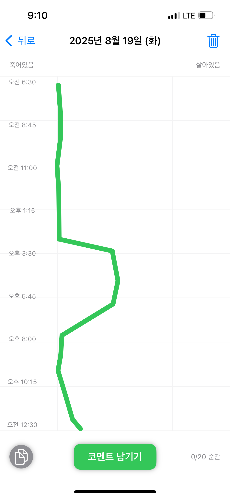

만족스러운 하동 생활과 나의 성질을 변화시키는 시간들이 흐르고나니 현실로 돌아온 듯 하다. 이력서를 수정하고, 새로운 채용 공고를 찾아다니다보니, 새로운 포지션에 지원하는 나의 경쟁력이 뚜렷이 보인다. 대화를 나눠본 적이 없기 때문에, 이력서에 나를 조금은 부풀려 적어야 매력적으로 보일텐데, 그걸 하는게 너무 어렵다. 없는 이야기를 지어냈다가 증명하지 못하는건 스스로 부끄럽기 때문이다.

장기적으로 저널치료 공부를 하고 싶다고 마음 먹은 후, 회사를 고를 때의 기준은 명확했다. 배울점이 있는 좋은 사람들과 함께할 수 있는가. 어떤 전문성을 훈련할 수 있는가. 잘 할 수 있는 일인가. 그래서 도메인은 조금 다양하게 지원했는데, 서류는 가볍게 합격할 것 같다는 내 오만은 틀렸다. 지원을 시작하고 9일이 지난 지금 지원한 8곳 중 1곳만이 서류 통과라는 결과를 내어주었으니. 핏이 잘 맞다고 생각해 면접을 기대하고 준비한 회사에는 특히 실망이 컸다. 어떤 부분이 부족한지 피드백이라도 있으면, 개선하고 나아질 수 있을텐데 아쉬운 마음이 한 편이 자리한다. 또다른 한 편에서는 많은 이력서를 검토할 인사 담당자에게 공감하기도 하지만. 이렇게까지 과거에 대해 자신없던 적이 없었던 것 같다.

이 과정에서 크게 배운 점이 있다. 회사에 소속되어 돈을 벌려면, 채용 시장에서 매력적인 사람이 되어야 한다는 것이다. ‘그냥 있어도 누군가 뽑아가겠지’라는 나이브한 상상은 더 이상 통하지 않는다. 물론 머리로는 알고 있었지만, 이번 기회에 냉정하고 현실적으로 깨닫고 있다. 회사를 비전 실현 파트너의 관점으로 보던 예전과 달리, 스스로의 경쟁력도 생각하는 현실감각이 생겼다. 당분간 나는 회사에 소속되어 돈을 벌 것이다. 그렇다면 단순히 시도하고 완료하는 수준을 넘어, 수치로 증명할 수 있는 성과를 내는 경험이 중요하다.

*바닥을 쳤던 어제의 생명선*
