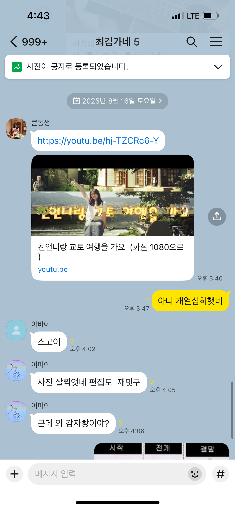

많은 사람들은 가족과 함께 하는 시간을 좋아하는 듯 하다. 세로토닌이 나오고 안전감이 느겨지기 때문일까?

작년까지 나는 가족을 ‘의무를 다해야 하는 존재’로 정의했다. 그리고 실제로 문제가 생기면 함께 해결하고, 생일이나 명절에 모여 밥 먹는 정도의 유대를 나누는 사이였던 것 같다. 연락을 자주 하는 것도 어색하고, 구성원 중 누군가와 단둘이 시간을 보내는 것도 어색하게 느껴졌다. 사실 함께한 시간을 떠올려보면 어색한게 당연하다. 서로를 즐겁게 한 시간보다 힘들게 한 시간이 더 많다고 느꼈기 때문이다.

재작년에는 막내를 내가 원하는대로 바꾸려고 노력했다. 바람직하지 않은 생활패턴 때문에 발생하는 갈등이 내게 불편했기 때문이다. 불순한 의도를 가지고 코칭을 하려고 했는데, 영기님이 다른 제안을 주셨다. 뭔가를 바꾸려고 하지말고 그냥 즐거운 시간을 더 많이 보내는게 좋을 수 있다고 하셨다. 처음엔 이해되지 않았다. 코칭 대화를 하면 변화가 생기지 않을까? 단순히 즐거운 시간을 보내는 게 변화를 만든다는 건 상상이 안 됐다. 하지만 더 현명한 조언이라 믿고, 일단 시도해봤다. 일부러 보고 싶다고 했던 영화를 보러 가고, 먹고 싶다고 했던 음식을 사주고, 공통 관심사에 대해 이야기 나눴다. 함께 즐거운 시간을 보내다보니, 동생의 마음이 열리기 시작했다. 나를 믿고 내면의 이야기를 먼저 꺼내기 시작했다. 사춘기 남학생에게 쉽지 않을텐데 먼저 도움을 요청하기도 했다.

그리고 깨달았다. 그냥 시간을 보내다보면 변화의 씨앗이 생길 수도 있구나. 이 단계 없이 변화하는건 정말 어렵구나. 애초에 내 마음대로 가족 구성원을 변화시키려는건 오만이구나. 스스로 그다운 모습으로 나아갈 수 있도록 돕는 것이 내가 할 일이겠다.

‘그냥 즐거운 시간 보내기’는 재작년부터 약 2년에 걸쳐 막내, 엄마, 아빠, 둘째 순서대로 해봤다. 시간을 보내면서 서로에 대한 지식이 쌓이니, 말과 행동의 배경이 이해되기 시작했다. 그리고 가족과 보내는 시간에 대한 인식이 ‘의무’에서 ‘즐거움’으로 바뀌었다. 엄마가 가족이 제 1가치라고 했던 말이 이해되고, 나의 가치 우선순위에서도 높아졌다. 가족의 정의는 이제 ‘평생을 함께 할 재밌는 사람’이 되었다.

가족에 대한 정의가 바뀌니, 함께 보내는 시간에 대한 태도도 바뀌었다. 먼저 질문을 하고, 장난치고, 반응하고, 노는 시간이 아깝지 않다. 한명 한명 알수록 입체적이고, 가끔 미성숙한 모습이 튀어나와 서로를 힘들게 하지만 귀여운 구석이 많다. 이 사람들이 내 가족이라 좋다. 내가 이런 생각을 할 수 있다니! 4개월 전 목표했던 ‘자연스러운 나’에 조금이나마 가까워진 것 같아 기분이 째진다.

*웃긴 인간들,, 가족톡방의 발화량이 작년보다 눈에 띄게 늘었다*
