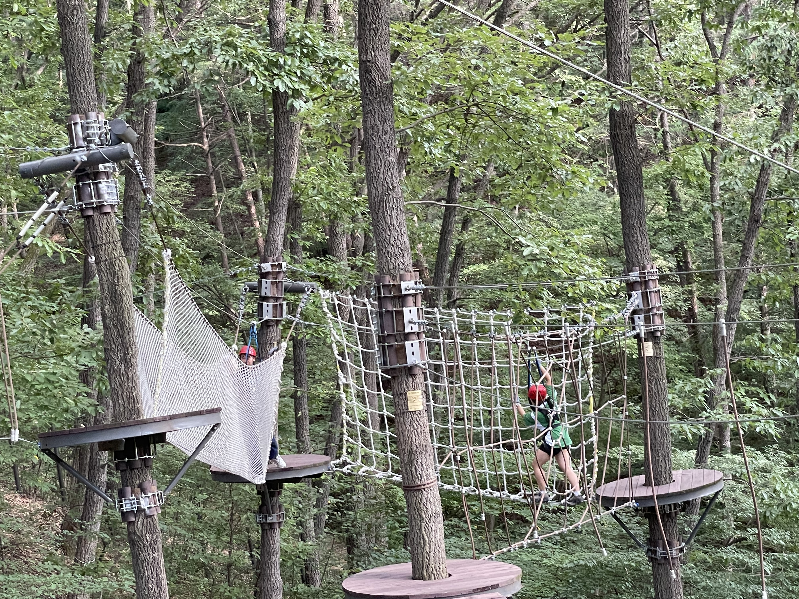
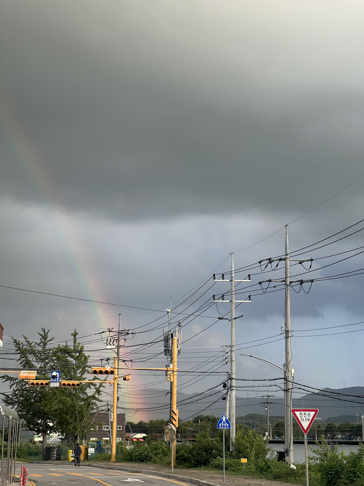
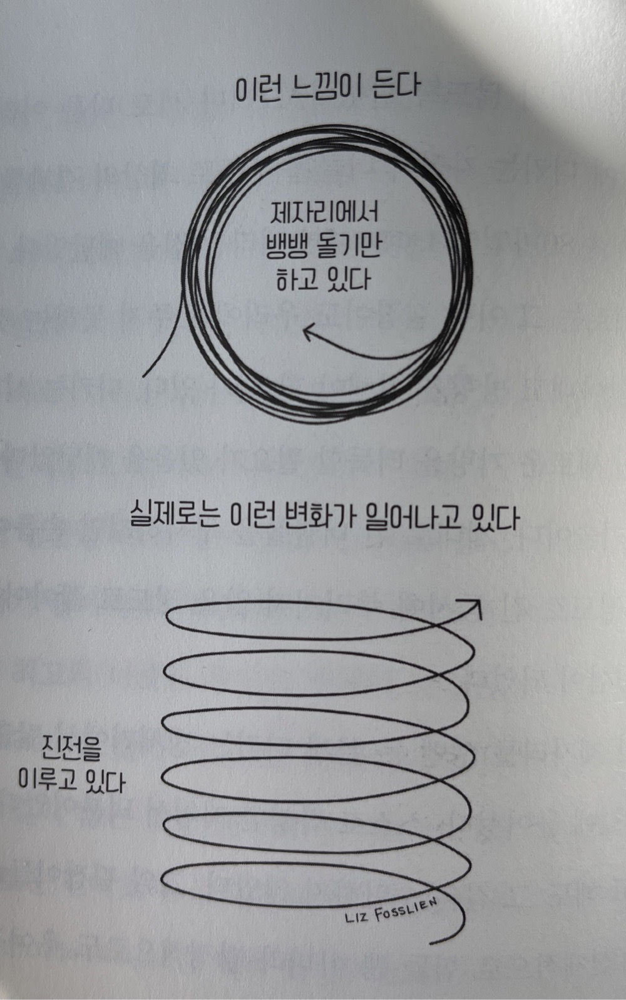

모든 사람들의 인생그래프를 그려보면, 누군가는 목표를 향해 달려가고 있을 것이고, 누군가는 목표를 찾아 방랑하고 있을 것이다. 목표라는 것은 항상 달성하고나면 완결되는 개념이므로, 두 상태를 전환하며 살아가는것이 인생인 듯 하다.

나는 개발자와 스크럼마스터로 일하다가 방랑하고, 작년에 사람들이 자기답게 살아가는 것을 돕겠다는 목표를 찾았다. 이 목표를 달성하기 위해 나아가다보니 새로운 정보가 생기고 상황이 바뀌어, 다시 방랑하는 시즌이 돌아왔다. 아마 이 패턴을 인식하지 못했더라면 더 혼란스러웠을 듯 한데, 아주 다행히도 작년과 올해 배운 지식 덕분에 이전의 방랑보다 덜 혼란스럽다.

이번 방랑 시즌의 목표는 ‘과도한 책임감으로 인한 경직을 완화하여 조금 더 자연스럽고 여유로운 사람이 되는 것’이었다. 목표를 달성했는지 묻는다면, 달성했다고 말할 수 있겠다. 목표를 달성했는지 확인하기 위한 지표로 1) 타인에게 자연스럽거나 여유로워 보인다는 피드백을 받았는가 2) 도움 요청하는 것이 조금 더 쉽게 느껴지는가 두 개를 정했다. 그리고 약 4개월간 3명에게 자연스럽거나 여유로워 보인다는 피드백을 받아 1번을 달성했다. 예전에는 도움을 요청하지 않았을만한 상황에서 약 10회 이상 의도적으로 도움을 요청하면서 예전보다 쉽게 느껴고 있어 2번을 달성했다.

이번 변화는 마치 AC2 44기를 수료했을 때의 느낌이다. 로봇이었던 내가 점점 살아있는 생명체가 되어가는 느낌이라고나 할까? 아직 나의 어휘력으로는 적확하게 표현하기 어렵지만, 굉장히 살아있는 느낌이다. 방랑하는 시즌에도 어떤 시도를 다르게 해보는지에 따라 배움과 변화가 생긴다는걸 다시금 깨달았다. 이 깨달음을 바탕으로 앞으로는 다시 찾아올 방랑 시즌을 (조금 과장해서 말하자면) 아주 자연스럽게 여기고 즐길 수 있을 것 같다.

여담으로, 이번 방랑은 꽤 즐거웠다. 당분간은 ‘저널치료 전문가 되기’라는 목표를 향해 달려갈 예정이다. 인생의 리듬을 알았으니 이제 리듬타면서 살 수 있을 것 같다.

Previous image
Next image
