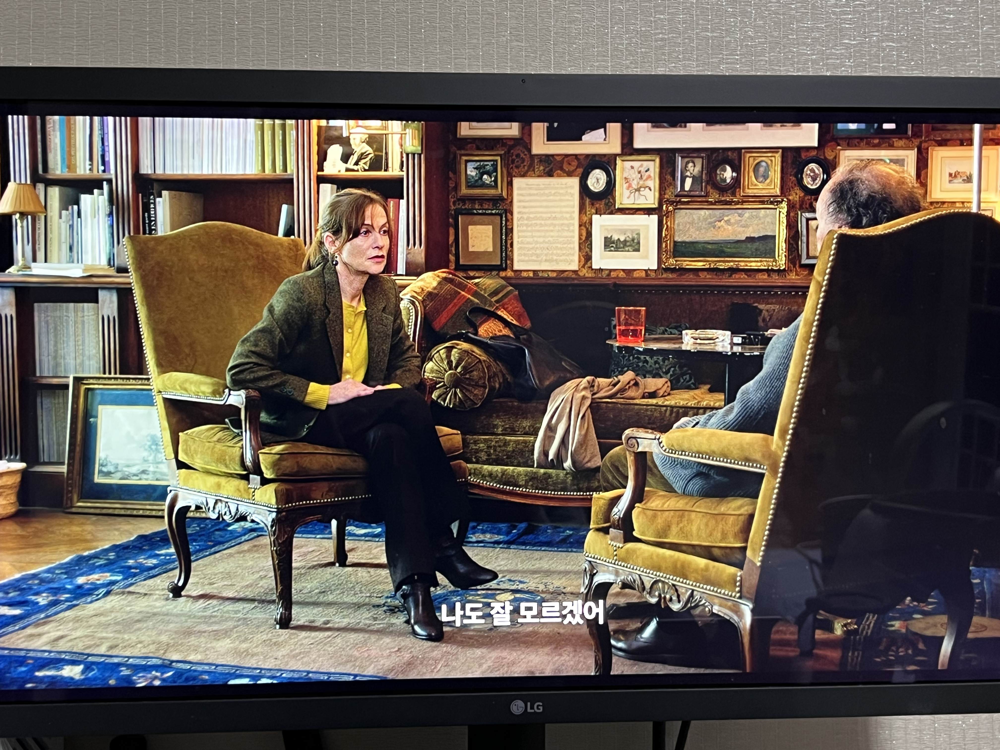

병들어 돌봄을 필요로 하는 사람을 사랑한다면, 처음엔 힘들지 않다고 느끼나보다. 영화의 초반, 괴로워하는 안느에게 조르주는 분명히 힘들지 않다고, 괜찮다고 했다. 그러나 후반, 한 장면에서 조르주는 온종일 누워 문장을 구사하기도 어려워하는 안느에게 힘들다고 했다. 내가 사랑하던 사람이 죽어가는 모습을 보기만 하는 것이 힘들지 않을 수 있을까. 조르주의 변화가 가장 크게 느껴진 두 장면이었다.

영화가 전개되는 동안, 나는 조르주의 시간을 함께할 수 있었다. 특히 딸 에바가 집에 찾아와 거실에서 근황과 안느의 수술에 대해 이야기하는 장면에서 긴 시간동안 에바의 앞모습과 조르주의 뒷모습만 비췄는데, 아마 그때부터 조르주에게 몰입을 시작할 수 있었던 것 같다. 마치 내가 조르주가 되어 에바와 이야기를 하는 듯한 착각을 주는 구도였다.

안느가 수술을 마치고 돌아오고나서부터는 조르주가 안나를 돌보는 과정을 길게 볼 수 있었다. 휠체어에서 의자로 옮기는 장면, 변기에서 일어나 휠체어로 옮기는 장면, 걷는 연습을 하는 장면, 스트레칭하는 장면 등 컷편집 할 수 있는 장면이 처음부터 끝까지 들어가있었다. 불쾌할 정도로 사실적이고, 답답할 정도로 느린 돌봄의 시간을 기다릴수록, 조르주가 될 수 밖에 없었다.

조르주의 마지막 선택은 충동적인 듯 하다. 어쩌면 선택이라고 할 수 없을 정도로 갑작스러웠다. 그러나 곱씹을수록 이해가 된다. 그게 선택이든 아니든 돌봄의 시간을 기다리는 동안 조르주가 된 나는 이해할 수 있었다. 아마 돌봄의 시간을 기다리지 않고 딴 짓을 한 관객이라면, 조르주의 마지막 선택을 이해할 수 없을 것 같다.

