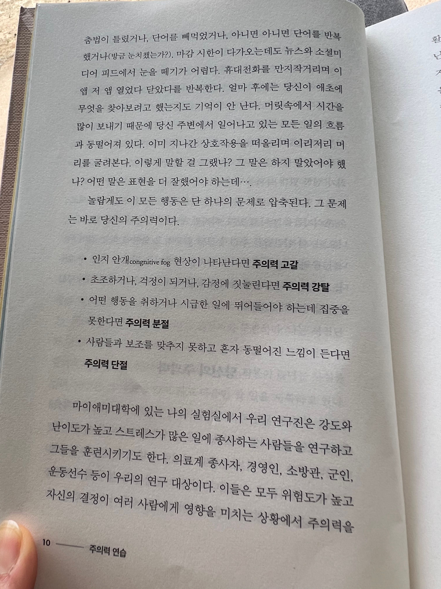

거의 두세달 전까지 친구와 함께 매일 아침 상호코칭을 했는데, 그 과정을 회고해보니 현재에 더 오래 머무르는 능력이 높은 에너지를 유지하기 위한 핵심 요소라는 것을 발견했다. 자기 전에 과거의 일을 생각하거나, 미래의 일을 걱정하면 수면의 질이 낮아지고 아침에 일어날 때 개운하지 않으며 인지적 에너지가 낮아지는 패턴을 관찰한 결과였다.

그 즈음 나는 아미시 자의 <주의력 연습>을 읽었고, 4주간의 마음챙김 훈련을 마쳤다. 그리고 호흡명상은 스트레스 상황에서 현재로 돌아와 감각을 회복하는 기술이 되었다. 이 기술은 내재화 시작한지 3개월 언저리라서 미숙하지만, 틈틈이 활용하며 효과를 보고 있다.

마음챙김 훈련 전까지 나는 현재와 멀어짐을 알아차리는 기술을 여러개(스트레칭, 스타일링, 상호코칭, 데일리 에너지 측정, 일기) 가지고 있었지만, 현재로 돌아오는 기술은 개인기에 의존하고 있었다. 그래서 상황의 심각성에 따라, 에너지 수준에 따라, 돌아오는 시간이 들쭉날쭉 했다. 하지만 마음챙김이 진정 나의 기술이 되면, 현재로 돌아오는 시간이 점차 줄어들 것이다. 중요한 일에 더 많은 주의력을 사용할 앞으로의 시간이 기대된다.

