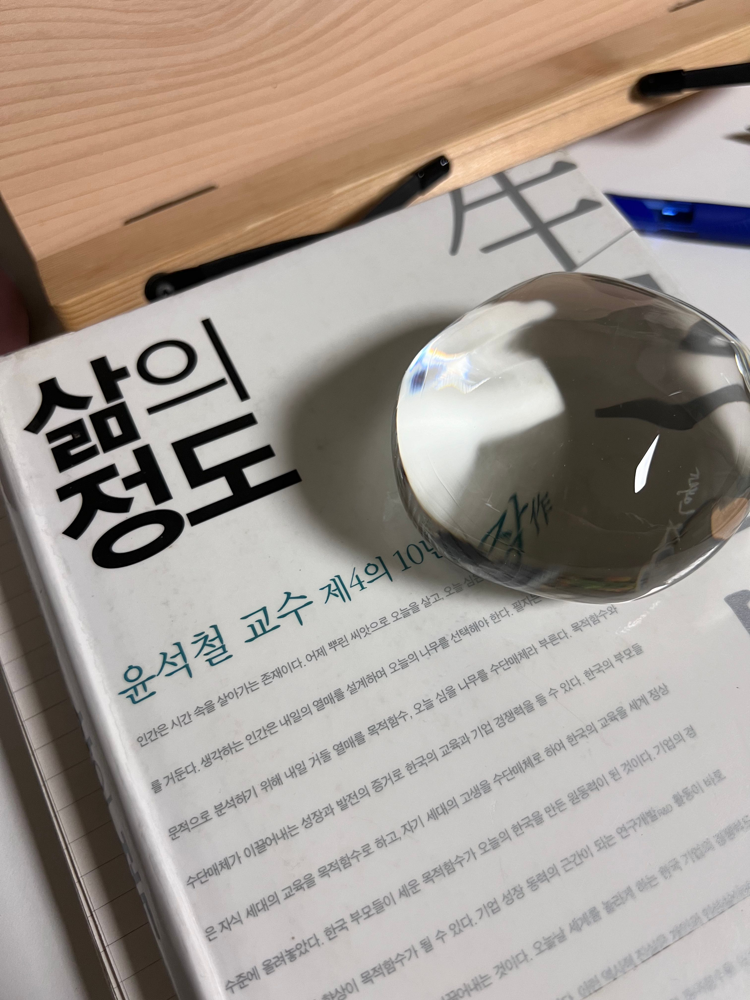

2025년 4월 21일의 글

지난주는 폭풍같았다. 조직 개편 이후 상황이 변동됨에 따라 인수인계 문서를 작성하는 시간이 늘어나고 있었다. 하지만 고객을 이해하고 공감하며 설득하는 시간이 늘어날 것이라는 믿음이 있었기에, 불만 대신 기대가 컸다.

당장 2주 전에는 높은 점수로 수습 기간을 끝내고, 팀원들의 축하 인사를 받았다. 업무가 바쁜 상황이었기에 축하를 즐기고 주변에 알릴 새도 없이 일주일 내내 10시간 이상을 일했다. 권고사직이라는 키워드를 머릿속에 떠올릴 여유는 전혀 없었다.

하지만 open system에서는 여유와 상관없이 누군가의 의사결정이 나에게 영향을 미칠 수 있다. 시간을 아무리 되짚어본다한들 이유를 명확히 알 수 없는 결정이 있다. 복잡계를 조금이나마 이해해서인지 큰 그림을 그려볼 수 있었다. 나의 잘못이 있는지, 회사의 잘못이 있는지, 회사와 나라는 사람의 미스매치인지 짧은 시간 동안 멘탈 시뮬레이션을 했다. 결과는 미스매치에 가까웠고 나는 떳떳한 상황이었기에 회사의 의사결정은 억울하고 슬프기보다는 아쉬웠다.

회사라는 시스템에서 신뢰했던 핵심가치와 사람들은 더이상 중요하지 않았다. 더 중요한 것은 방향이 바뀌고 있고 그 방향에 조금이라도 불필요하다고 판단되는 사람을 신속하게 제거하는 속도였다. 통보를 받는 입장에서 그 결단은 매우 견고해보였고, 나는 명백한 제거 대상이었다. 그렇게 지난주, 나는 회사에서 제거됐다. 더 완곡한 말도 있었겠지만, 그 순간 내가 느낀 건 정확히 ‘제거’였다.

이제 내가 할 수 있는 것, 해야 하는 것은 손실을 줄이면서 다음 스텝으로 나아가는 것이었다. 사직서를 작성하고, 서명 후 느끼는 인간적인 허무함은 하루로 충분했다. 밀도있는 3개월을 보냈지만, 절대적인 시간은 길지 않았기에 깊은 유대가 있었던 사람도 함께 일한 매니저뿐이었다. 매니저님께 회사의 결정을 공유하는 자리에서, 그는 정규직 전환 선물이었던 퇴사 선물을 건넸다. 앞으로 더 많은 것들을 함께 해보자는 메시지가 담긴 포스트잇을 제거한 후, 이런 상황에서 선물을 건넬 줄은 꿈에도 몰랐다고 했다. 유일하게 눈물이 난 순간이었다. 고마움과 아쉬움, 깊은 유대 관계 상실로 인한 눈물이었다.

인수인계 문서를 깔끔하게 작성한 후, 정시에 퇴근했다. 집에 가기 전에, 생각을 정리할 때마다 가는 동네 LP바에 들렀다. 노트에 생각을 적으면서 다음 스텝을 결정할 때 어떤 것이 중요한지, 지금 내가 가진 것에서 어떤 선택을 하는게 유리할지 고민했다. 방향은 명확하기 때문에, 구체적인 고민에 집중할 수 있었다. 이 회사에서 일한 경험과 배움 덕분에 3개월 전보다 커리어의 해상도가 높아졌음을 느꼈다.

다음 스텝에 대한 생각을 정리한 후에는 이 과정에서 더 많은 것을 배우기 위해 피드백을 구하기로 했다. 조직 개편을 주도하는 임시 부사장님께 티타임을 요청했다. 내가 제거 대상이 된 이유, 객관적인 회사의 상황, 지금까지 관찰한 나라는 사람에 대한 피드백을 비롯하여 현실적인 조언을 많이 얻을 수 있었다. 짧은 시간이었지만 나를 좋게 봐주셨는지 책 추천과 함께 퇴사 후 식사 약속을 했다. 권고사직으로 인한 퇴사가 만연하던 상황이라, 다양한 사람들과 대화를 나눌 수 있었다. 이 과정에서 새로운 정보도 얻고, 내가 놓친 것도 알아차렸다.

다음 스텝을 준비하면서도, 맡은 일은 잘 마무리하고 싶었다. 책임감도 컸지만, 하던 사업이 성공적인 결과를 거두었으면 하는 바람도 컸다. 함께 협력하던 사람들과 인사를 나누고, 진행하던 업무를 빠짐없이 인계했다. 마지막까지 교육 운영 세팅 작업을 완료한 지금은, 고요하고 평온하지만 어딘가 희망차다.
