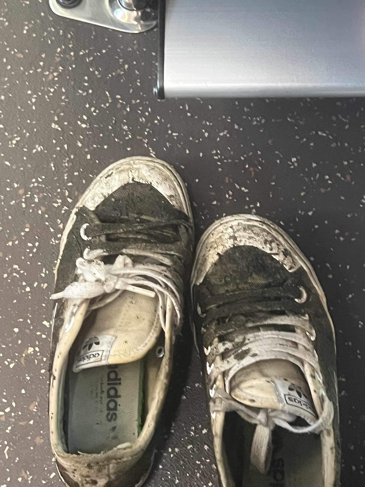

일반적으로 타인을 돕는 행위는 그저 보기 좋은, 그러니까 실질적인 이익은 없는 행위라는 믿음이 있는 듯 하다.

과연 그럴까? 최근 알게 된 Helper’s High(이하 ‘헬퍼스하이‘)라는 개념은 누군가를 도울 때 엔돌핀이 분비되어 신체적 통증을 완화하고 스트레스 호르몬 수치를 낮추며, 면역체계가 강화되는 실질적인 이익이 있다고 한다.

영성, 과학, 의학을 통합하는 내과의사이자 작가 Larry Dossey가 2018년 <Explore>에 기고한 글에 따르면, 헬퍼스하이는 타인에 대한 이타적인 봉사 후에 오는 기쁨, 활기, 에너지 증가의 감정이며, 이후 평온함과 평정으로 이어진다. 이는 격렬한 신체운동 뒤에 오는 느낌과 유사하다. (Larry Dossey는 믿음을 통한 치유와 과학적 근거가 없는 다른 대체의학 접근법을 옹호하는 사람이다. Explore의 2024년 영향력 지수는 1.761으로 매우 낮은 편이므로, 참고만 하는게 좋겠다.)

이 개념을 처음 정의한 Allen Luks는 자원봉사자 3000명 이상을 연구하여 이 행복감이 몇주동안 지속될 수 있으며, 단순히 선함을 기억하는 것만으로도 유포리아적 감각이 되돌아 올 수 있음을 발견했다.

헬퍼스하이는 단순한 감정이 아니라, 생물학적 메커니즘을 가진 현상이다. 국립보건원(National Institutes of Health, NIH)의 신경과학자 호르헤 몰(Jorge Moll)은 개인이 돈을 기부할 때 뇌의 중변연계(mesolimbic system)가 활성화된다는 것을 발견했다. 이 중변연계는 일반적으로 성관계, 음식, 약물, 돈과 같은 자극을 보상하고 강화하는 시스템이다. 중변연계 시스템이 활성화될 때 옥시토신과 바소프레신과 같은 기분 좋은 신경 전달 물질이 방출되는데, 이는 베푸는 행동이 반복될 가능성을 높인다. 이러한 발견은 타인을 돕는 행동이 단순히 사회적 기대 때문이 아니라, 본질적으로 뇌가 보상하는 생물학적 행위임을 시사한다.

이를 이용하여 사회심리학적 관점에서 헬퍼스하이는 개인의 행복을 증진시키는 전략이 될 수 있다. 그리고 행복을 극대화하기 위해서는 타인을 돕는 행동을 할 때의 구체성이 중요하다. 2014년 사회심리학자 Melanie Rudd(휴스턴 대학교)와 Jennifer Aaker(스탠퍼드 대학교)는 약 500명의 사람들을 대상으로 한 6가지 연구에서, 타인을 돕는 행동을 할 때 구체적인 목표를 가지는 것이 도움을 주는 사람에게 가장 효과적이라는 패턴을 발견했다. 예를 들면 누군가를 미소 짓게 만들고 싶어하는 사람들은 누군가를 단순히 ‘행복하게‘ 만들고 싶어하는 사람보다 더 큰 행복을 경험했다.

다만, 일부 회의론자들의 주장처럼 도움을 주는 사람들이 단지 스스로 기분 좋게 느끼고자 하는 이기적인 욕망 때문에 행동하는 경우도 가능해보인다. 특히 개인의 행복 증진 전략으로 활용하는 경우, 이기적인 동기의 최종 결과를 핵심 보상으로 여길 수 있다. 그러나 이러한 경우 헬퍼스하이를 통해 얻을 수 있는 보상의 극히 일부만 얻게 된다. 내어주는 행위 자체에서 오는 근원적인 충만함은 이기적인 보상과 완전히 다른 것이기 때문이다.

그러므로, 진심으로 타인을 돕는 행위를 하는 것이 현명한 선택이겠다. 진심으로 타인을 돕다보면, 사려깊게 행동할 수 밖에 없을 것이고, 결과적으로 그 과정에서 해를 끼치는 일이 자연스럽게 줄어들 것이다.

*7월 수해복구 봉사활동의 흔적*
