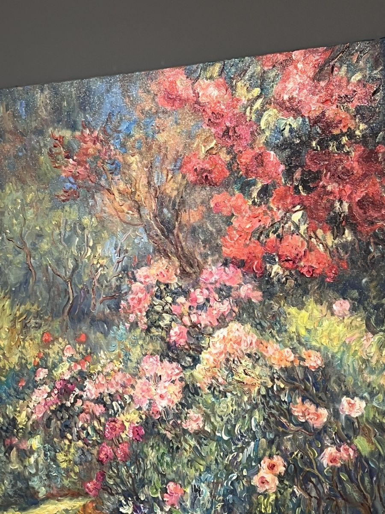
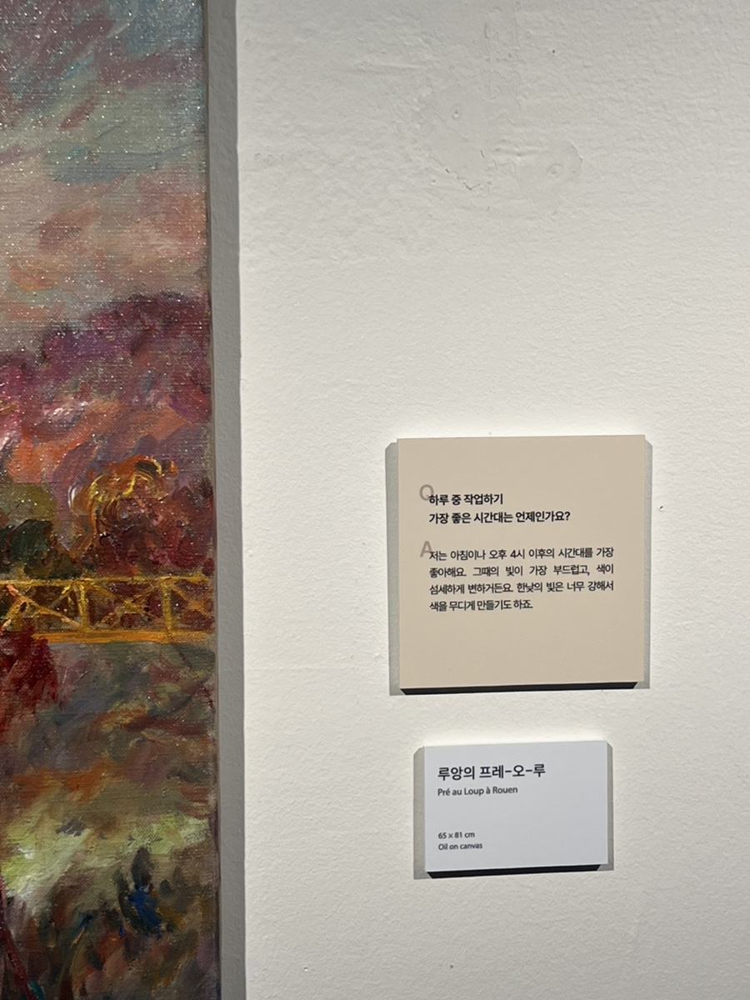
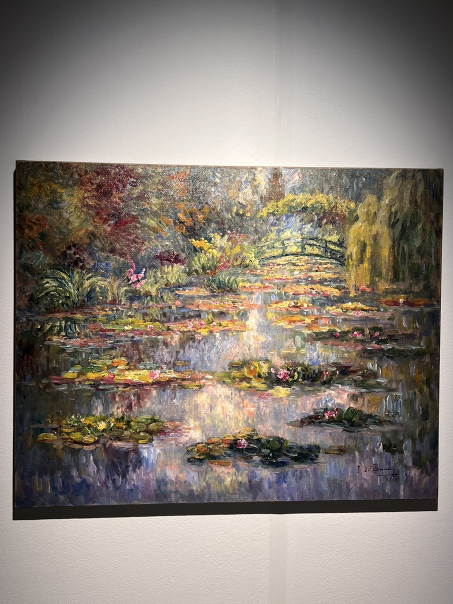
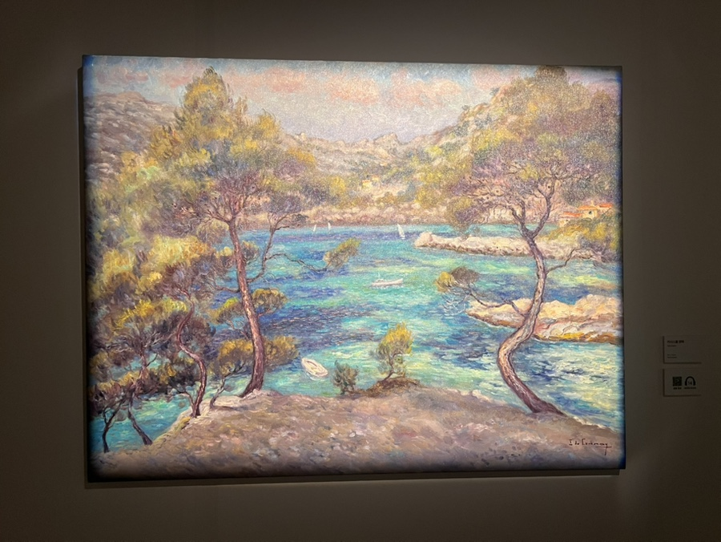

교토에서 봤던 모네의 전시 이후로 인상주의 작품 전시가 나를 스칠 때마다 관심을 가지게 된다. 이번엔 루앙 학파의 4대 학회장 이자벨 드 가네의 전시를 관람했다. 지역 청년 센터에서 청년 예술가에게 강의를 듣고, 전시를 본 후, 대화를 나누는 프로그램 덕분에 무료로 관람할 수 있었다.

신기하게도 인상주의 작품은 감상에 가까운 인지적, 영적 경험을 하게 된다. 미술에 조예가 없는 내가 감상할 수 있는 작품이 있다는 것이 감사하다.

이자벨의 작품은 색이 참 다채로워서 맘에 들었다. 모네의 색은 오묘하면서도 비현실적인 색채로 느껴졌는데, 이자벨의 색은 함께 조합 가능할 것이라고 생각해본 적 없는 색이 조화를 이루며 현실적인 색채로 느껴졌다. 색채에 감탄하다가 위 작품에 멈춰섰는데, 이 작품의 색은 하나하나 면밀히 살피는 재미가 있었다. 우리네 삶도 한 결의 색으로 설명할 수 없지 않은가. 이자벨의 다채로운 색채가 내게 좀 더 와닿았다.

그리고 모네의 작품은 어둡고 채도가 낮은 색이 많았던 것 같은데, 이자벨 작품은 어둡더라도 채도가 높은 색이 많았다. 이렇게 내가 (유일하게) 아는 작가와 스타일을 비교하는 것도 재밌다.

전시장 곳곳에는 Q&A가 적혀있는데, 그 중 마음에 들었던 답변이 위 사진에 있다. 하루 중 작업하기 가장 좋은 시간이 아침이나 오후 4시 이후인데, 이유는 그때의 빛은 부드럽고 색 또한 섬세하게 변하는데 한낮의 빛은 너무 강해서 색을 무디게 만들기도 하기 때문이라고 한다. 강한 것이 아니라 부드럽고 섬세한 것에 초점을 맞추는 방식이 나의 추구미에 들어맞았다.

위 작품은 모네를 좋아하는 한국 사람들을 위해 특별히 그린 작품이라고 한다. 일본식 다리부터 모네가 떠오를 수밖에 없었지만, 분명히 느낌이 다르다. 이자벨의 붓이 더 굵게 느껴지는데, 실제로 굵을 수도 있겠지만 아마 좀 더 대비가 있는 색을 함께 배치하기 때문에 더 굵게 느껴지는 것 같다. 볼드함을 좋아하는 나에게 이자벨은 매력적일 수밖에 없다.

이 작품이 재밌는건 수직 방향으로 칠한 부분과 수평으로 칠한 부분의 방향감 덕분에 진짜 연못에 수련이 반사되는 느낌이 든다는 것이다. 모네의 작품에서도 종종 이렇게 표현된 작품을 볼 수 있었는데, 방향이라는 요소 하나만 바꾸어도 이렇게 다양하게 표현할 수 있다는게 재밌다.

마지막으로 가장 기억에 남는 작품은 현장감이 생생한 작품이었다. 양쪽에 위치한 소나무가 저기 좀 보라고 유도한 시선의 끝에는 깊이의 다름이 느껴지는 바다가 있고, 바위산 앞에는 두 채의 집이 있다. 시선이 아주 자연스럽게 이어지면서 과거의 경험을 부르는 작품이었다. 다른 작품들 중에서 과거 경험이 자연스레 연상되는 작품은 없었다. 단지 언젠가 본 적이 있는 것 같은 느낌적 느낌이었다. 그러나 이 작품은 보는 순간 여기가 울릉도인 줄 알았다. 우리나라에서 가장 좋아하는 풍경이 떠오르면서, 이자벨 특유의 현장감이 무슨 말인지 이해했다. 모노레일을 타고 올라가 보았던 바위, 소나무, 공기의 흐름, 대화를 생생하게 불러온 작품이었다.

이자벨의 작업 방식도 기억에 남는다. 금속 튜브 형태의 물감이 발명되면서 야외에서 그림을 그리는 앙플레네 기법이 발전했는데, 이는 빛의 변화, 공기의 흐름, 순간의 분위기를 포착하여 그리는 인상주의의 발전으로 이어졌다고 한다. 이자벨도 주로 실외에서 앙플레네 기법으로 그리는데, 그리기 전에 2~3일 동안 장소에서 머물면서 빛과 공기를 느낀다고 한다. 그리고 타이밍이 오면 빠른 붓터치로 단숨에 그림을 그린다. 수정은 없다. 같은 장소와 시간이더라도 순간의 빛과 공기는 다르기 때문이다. 이자벨은 이러한 작업 방식이 동양의 서예와 닮아있다고 말한다. 마음 속에서 충분히 그린 뒤, 기회가 오면 멈추지 않고 단숨에 그려내는 것. 바로 ‘일필휘지‘의 정신과 닮아있다는거다.

이번 전시의 주제는 ”이 순간의 빛은 다신 돌아오지 않는다“라고 한다. 나는 작품을 감상하는 내내 이자벨의 순간 속에 잠깐이라도 들어가 빛을 느낄 수 있었고, 그림의 힘을 체감했다. 다시 돌아오지 않을 순간의 빛을 붙잡는 붓을 손에 쥔 이자벨이 참 부럽다. 지금의 나는 붓 대신 펜과 키보드를 쥐고 순간을 붙잡고자 노력하고 있는데, 언젠간 붓을 쥐고 순간의 빛까지 붙잡고 싶다.
