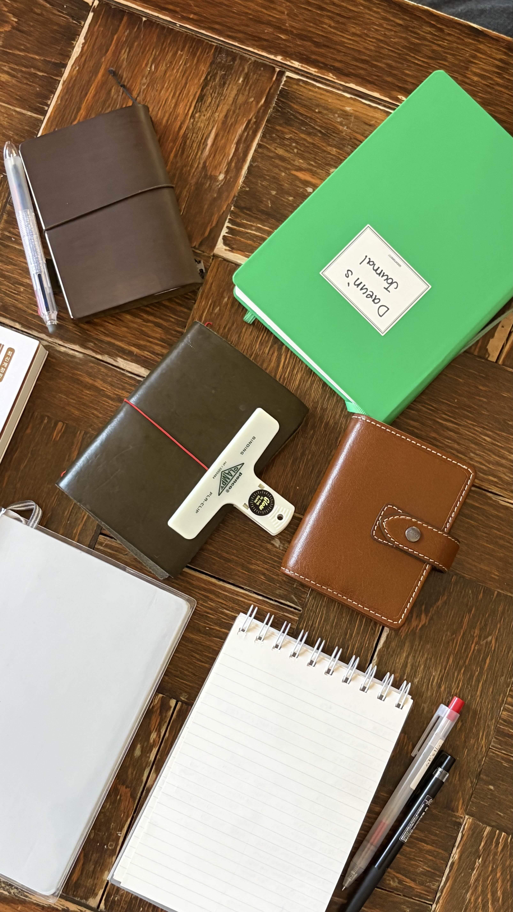

작년에 중용을 실천하는 것을 중요히 여기다보니 예전에는 보지 않았던 나의 약점을 더 많이 들여다보게 되었다. 그리고 최근에 내게 가장 장애물이 되는 약점을 알게 되었는데, 바로 구체화 였다. 구체화를 항상 못하느냐? 그것은 아니다. 내가 경험을 많이 해보았거나, 성장하고 싶은 분야에서는 구체화를 충분히 할 수 있다. 하지만 대부분의 분야에서는 추상화를 먼저 하고, 구체적인 내용을 생각하지 못한다.

이번에 신년 계획을 세울 때에도 그랬다. 올해 내게 중요한 것은 4가지 카테고리로 정리할 수 있겠다고 생각했다. 영어, AI 활용 역량, 논리적 글쓰기 역량, 재무 관리였다. 심지어 나름의 근거를 마련하고 결정한 것이었다. 그런데 친구들과 이야기 나누다보니 연결고리가 희미한 지점들이 드러나기 시작했다. 내가 원하는 모습의 전문가가 되기 위해서 영어가 왜 필요한지 AI 활용 역량이 왜 필요한지 논리적 글쓰기 역량이 무엇인지 재무 관리를 잘한다는 것을 어떻게 측정할 수 있을지를 설명할 수 없었다.

그래서 내가 논리적이지 않다는 믿음이 구체적인 사고를 못한다는 믿음으로 바뀌었다. 본질이 가장 중요하고 디테일은 부차적이라는 가치관을 가진 덕에 본질을 더 빠르게 파악할 수 있는 강점을 가지게 되었으나, 동시에 현실에 적용하기 어려운 일반론적인 이야기만 하게 되는 약점을 가지게 되었다는 것을 알게 되었다.

다행인 것은 이제 현실 세계는 지엽적인 것들의 총합이라는 것을 알고 있고, 미래를 생각하면 지금 구체적인 사고를 내 도구 상자에 넣는 것이 얼마나 가치로운 일인지 이해하고 있다. 특히 지금처럼 추상적인 정보가 넘쳐나는 세상에서, 구체적으로 행동하면서 얻는 배움은 진짜 내것이 되고 언제든지 활용할 수 있는 자본이 된다.

그러니 올해는 본질을 보면서도 구체적인 사고를 할 수 있는 사람이 되고 싶다.

